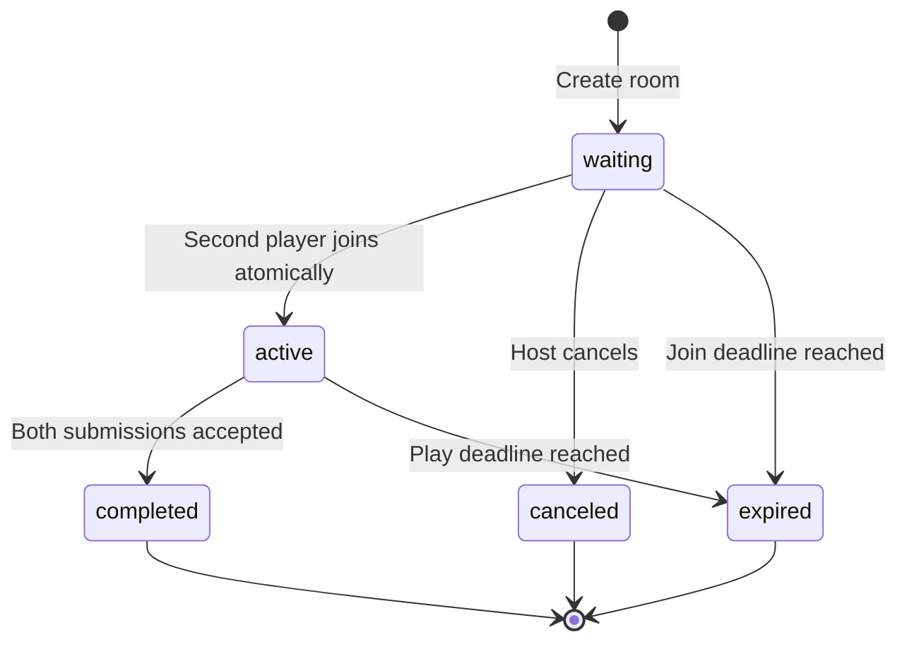
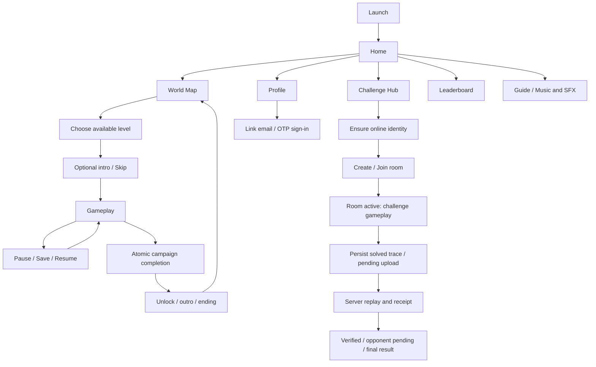
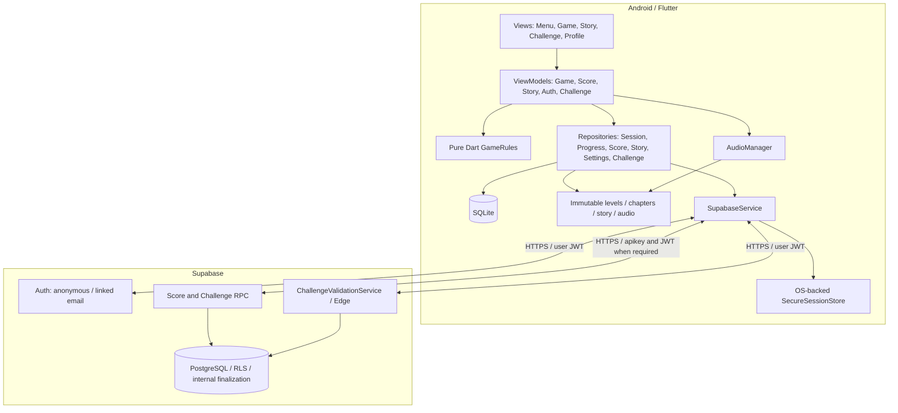
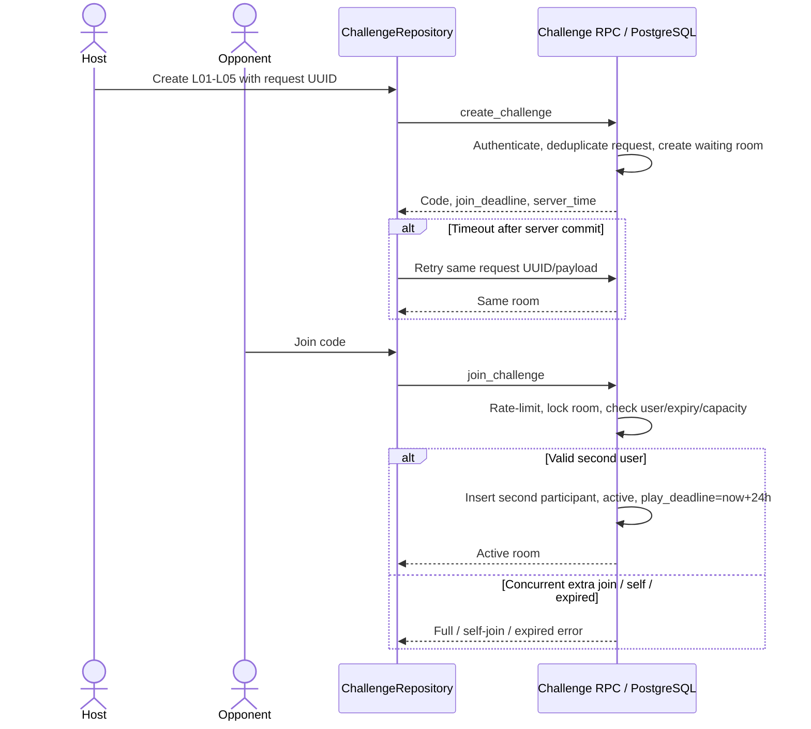
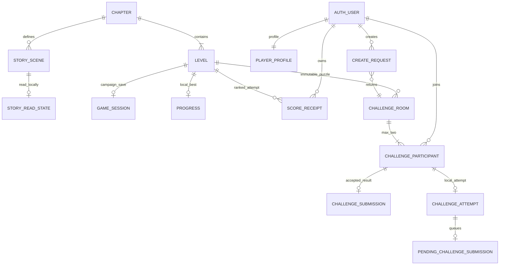

# FOREST SOKOBAN: THE LOST SEEDS

## Comprehensive Specification and Design — Assignment 01

| Thuộc tính | Giá trị |
|---|---|
| Phiên bản | **v1.1-r1 — revised consolidated specification draft** |
| Ngày biên soạn | 01/11/2026 — Asia/Ho_Chi_Minh |
| Ngôn ngữ | Tiếng Việt; giữ ID và thuật ngữ kỹ thuật tiếng Anh để truy vết |
| Baseline | [Forest-Sokoban-A01.pdf](Forest-Sokoban-A01.pdf), v1.0-draft, 60 trang, 21/10/2026 |
| Đầu vào thay đổi | [Forest_Sokoban_v1.1_A01_Change_Plan.md](Forest_Sokoban_v1.1_A01_Change_Plan.md) |
| Review đã xử lý | [Forest_Sokoban_v1.1_Spec_Review.md](Forest_Sokoban_v1.1_Spec_Review.md); disposition trong §11.6 |
| Thành viên | Member A / Member B — chưa cung cấp tên và xác nhận đóng góp |
| Phê duyệt baseline | Chờ hai thành viên review |
| Sản phẩm tài liệu hiện tại | Một bản Markdown hợp nhất cho v1.1; có thể dùng làm nguồn biên tập và xuất PDF |

Tài liệu này mô tả **hành vi sản phẩm sau thay đổi**, thay thế các quy định bị ảnh hưởng trong v1.0. Luật Sokoban, năm bản đồ đầu, cách tính Steps/Time, kiến trúc MVVM, SQLite và contract leaderboard được giữ. Campaign mở rộng thành 12 level/3 chapter, có story, Music/SFX riêng, email-linked identity và asynchronous 1v1.

**Tình trạng minh chứng:** đã đọc PDF và Change Plan; đã tái dựng/kiểm tra năm bản đồ gốc, thiết kế bảy bản đồ mới và chạy kiểm tra lời giải bằng script trên các layout trong tài liệu. Chưa có app Flutter, Supabase deployment, file audio, hi-fi v1.1, Figma URL, phỏng vấn hay usability sessions. Use-case UML, overall và in-app MVVM có source PlantUML và hình SVG đã render; các sequence và sơ đồ còn lại cũng có bản render trong source package. Screen inventory vẫn là đặc tả, chưa phải hi-fi đã triển khai. Không xem bản Markdown này là một bộ nộp A01 đã hoàn tất.

**Quy ước:** Must = bắt buộc; Should = mục tiêu tinh chỉnh có thể hoãn với lý do/review ghi nhận; Could = tùy chọn, không cản hoàn thành phạm vi Must; Won't = ngoài v1.1. AC là điều kiện chấp nhận, VF là phương pháp kiểm chứng NFR. “Đã kiểm tra tĩnh” chỉ áp dụng cho đầu vào và kiểm tra cụ thể ghi trong Phụ lục C. Các source thực đã tạo được liệt kê và liên kết ở §11.3; những path đích còn lại không hàm ý đã có implementation.

## Mục lục

1. [Sản phẩm, phạm vi và luật cố định](#sec-1)
2. [Phân tích vấn đề và elicitation](#sec-2)
3. [Functional requirements và acceptance criteria](#sec-3)
4. [Use cases và user flows](#sec-4)
5. [NFR và ràng buộc mobile](#sec-5)
6. [Kiến trúc và sequence diagrams](#sec-6)
7. [Dữ liệu, persistence và migration](#sec-7)
8. [API và bảo mật](#sec-8)
9. [UI/UX và prototype](#sec-9)
10. [Traceability và verification](#sec-10)
11. [Delivery, change control và A02 handoff](#sec-11)
12. [Evidence, attribution và nguồn](#sec-12)
13. [Phụ lục A — nội dung campaign và screen-state manifest](#appendix-a)
14. [Phụ lục B — OpenAPI JSON](#appendix-b)
15. [Phụ lục C — báo cáo kiểm tra tài liệu](#appendix-c)

<a id="sec-1"></a>

# 1. Sản phẩm, phạm vi và luật cố định

## 1.1. Product goal

*Forest Sokoban: The Lost Seeds* là game giải đố Sokoban góc nhìn từ trên xuống, ưu tiên offline, dành cho những phiên chơi ngắn có thể bị gián đoạn. Người chơi đóng vai Forest Guardian, đẩy các thùng Hạt Giống Ánh Sáng vào bệ phục hồi để chữa lành rừng Evergreen. Story tạo ngữ cảnh cho puzzle; toàn bộ campaign chơi được ngay lần khởi chạy đầu không có internet.

Leaderboard cho phép so personal best theo từng level/version. Challenge 1v1 cho phép hai người nhận cùng puzzle, chơi vào thời điểm riêng và gửi lời giải cho server xác minh. Campaign không cần đăng nhập. Online write cần anonymous hoặc linked identity; liên kết email là lựa chọn của người chơi và là chức năng Must mà sản phẩm phải hỗ trợ.

| Hạng mục | Baseline v1.1 | Priority |
|---|---|---|
| Platform | Android 10+, landscape; Flutter/Dart | Must |
| Puzzle | Move, push một crate, Undo, Restart, Pause, Save/Resume, Steps/Time | Must |
| Campaign | 12 level cố định, 3 chapter; không tải nội dung bắt buộc từ mạng | Must |
| Narrative | Intro/outro chapter, archive, ending, Next/Skip/Replay | Must |
| Audio | Contextual BGM; SFX walk/push/blocked/completion/UI; Music và SFX độc lập | Must |
| Online ranking | Top 20, best-per-user, theo level/version | Must |
| Identity | Anonymous on demand, Guest → email link, OTP sign-in khôi phục online identity | Must |
| Competitive mode | 1v1 bất đồng bộ, invite code, server replay, kết quả/expiry | Must |
| Haptic | Một pulse khi valid push, nếu triển khai | Could — FR-17 |
| Cloud campaign sync | Đồng bộ completed/best trên nhiều thiết bị, opt-in | Could — FR-29 |
| Ngoài phạm vi | Real-time co-op, chat, combat, daily challenge, procedural maps, editor, solver hints, ads/IAP, video replay, unfinished-session cloud sync | Won't |

## 1.2. Luật board và attempt

1. Board chữ nhật, tối đa **10 cột × 8 hàng**. Tọa độ `[x,y]` bắt đầu từ góc trên trái; `x` tăng sang phải, `y` tăng xuống dưới.
2. Mỗi level có một player, **1–4 crate**, số goal bằng số crate, floor và wall. Trang trí ngoài board không tham gia collision.
3. Một tap hướng yêu cầu một bước trực giao U/D/L/R. Không có diagonal, pull, multi-crate push, swipe hay hold-to-repeat bắt buộc.
4. Player đi vào floor hoặc goal trống. Crate chỉ đẩy được khi ô ngay sau nó đi được và không có crate.
5. **Blocked input** giữ nguyên player/crates/history/Steps; hiện feedback. Không tạo một action trong challenge trace.
6. **Valid move/push**: lưu snapshot board trước đó, cập nhật board, cộng **1 Steps**.
7. **Valid Undo**: pop một snapshot, khôi phục player/crates, cộng **1 Steps**; không giảm elapsed time, không hoàn lại tổng action, không tạo redo. Undo bị disable khi history rỗng hoặc attempt đã complete.
8. Thắng ngay khi mọi crate nằm trên goal. Input và active timer đóng băng; một attempt chỉ tạo một completion. Replay tạo attempt mới.
9. **Restart** phải xác nhận; Confirm tạo `attempt_id` mới, initial board, Steps=0, elapsed=0, history rỗng. Cancel giữ attempt. Challenge Restart chỉ bỏ trace của attempt hiện tại, không sửa campaign hay accepted server result.
10. Không có lives, campaign time limit hay automatic deadlock detector. Guide giải thích crate trong góc không có goal và cách Undo/Restart.
11. Không xử lý hai intent move/undo đồng thời. Chỉ xác nhận một action đã lưu sau khi transaction thành công. Lỗi lưu dừng input và cho Retry.

**Active-play time:** đo bằng monotonic clock, lưu milliseconds, hiển thị `mm:ss`. Bắt đầu khi board sẵn sàng và Gameplay active, kể cả trước bước đầu tiên. Không chạy trong dialogue, pause, confirmation, background hay completion. Checkpoint mỗi giây khi active và flush khi pause/background. OS kill đột ngột có thể mất tối đa một giây timer chưa checkpoint; board/Steps đã ACK phải phục hồi nguyên vẹn. Thời gian active không quyết định challenge thắng/thua.

## 1.3. Progression và story canon

Cơn bão ma thuật làm thất lạc Hạt Giống Ánh Sáng của Cây Cổ Thụ. Forest Guardian đưa seed crates về restoration altars, phục hồi từng khu vực. Sự thật ở Forgotten Ruins: cơn bão đã làm đứt liên kết giữa các bệ; hành trình phục hồi kết nối các hạt giống, không thêm cơ chế chiến đấu hay tile đặc biệt.

| Chapter | Level | Điều kiện mở | Nội dung |
|---|---|---|---|
| CH-01 — The Awakening | L01–L05 | Luôn mở | Thức tỉnh, học điều khiển, hồi sinh khoảng rừng đầu |
| CH-02 — Forgotten Ruins | L06–L09 | Completed đủ L01–L05 | Khám phá phế tích và nguyên nhân rừng mất sức sống |
| CH-03 — Heart of the Forest | L10–L12 | Completed đủ L01–L09 | Phục hồi các bệ cuối, đánh thức Cây Cổ Thụ |

Trong chapter đã mở, chọn level theo thứ tự bất kỳ. Unlock được **tính từ tập completed**, không dựa vào flag tự do hay trạng thái đã đọc story. Challenge không mở chapter và không sửa campaign progress.

Intro hiện lần đầu vào chapter, outro sau khi hoàn thành đủ level của chapter. Next tiến thoại, Skip đánh dấu cảnh đã xử lý và trở về context; Replay từ Archive xem lại cảnh đã mở offline. Không thao tác thoại nào thay đổi score/completion/unlock. Completion transaction phải commit trước khi mở story.

**Ending:** mở khi completed đủ **12 level**, tự động đề nghị hiển thị một lần rồi cho replay qua Archive. Vì có thể chơi L10–L12 theo thứ tự bất kỳ, trigger là **level cuối còn thiếu của campaign**, có thể là L10/L11/L12. Đây là cách cụ thể hóa điều kiện “L12 và các level yêu cầu” trong Change Plan để không mất ending khi L12 được hoàn thành trước. Nếu app bị kill trước khi hiển thị, ending vẫn ở trạng thái cần xem; không viết `seen` trước khi người chơi Next đến hết hoặc Skip.

## 1.4. Catalogue và versioning

Layout và lời giải đầy đủ nằm ở Phụ lục A. L01–L05 được tái dựng từ hình trang 4 PDF và kiểm tra lại với lời giải gốc; giữ `level_version=1`. L06–L12 là **nội dung thiết kế mới**, không có trong PDF. Sau review, cả bảy layout được thiết kế lại và tăng thành **level_version=2**; bản draft cũ version 1 không được tái sử dụng với layout mới. L01–L05/version 1 giữ nguyên. Chapter prerequisites và progress dùng version trong catalogue hiện hành: L01–L05/1, L06–L12/2; completion của layout/version cũ không tự cấp completion cho version mới.

| Level/version | Tên | Chapter | Board | Crate | Shortest valid moves | Mục tiêu thiết kế |
|---|---|---|---|---|---|---|
| L01/1 | First Steps | 1 | 7×5 | 1 | 2 | Đẩy thẳng |
| L02/1 | Around the Bend | 1 | 7×6 | 1 | 6 | Đi vòng về phía đẩy |
| L03/1 | Two Deliveries | 1 | 8×7 | 2 | 10 | Di chuyển giữa hai crate |
| L04/1 | Forest Divider | 1 | 9×7 | 2 | 12 | Đi vòng vách ngăn |
| L05/1 | Three Clearings | 1 | 10×8 | 3 | 25 | Phối hợp ba lượt giao |
| L06/2 | Moss Gate | 2 | 9×7 | 2 | 21 | Đích bên phải; đẩy ngang và đi vòng vật cản |
| L07/2 | Broken Courtyard | 2 | 8×8 | 2 | 24 | Đích sát vách trái; tiếp cận từ phải và tránh góc chết |
| L08/2 | Roots of Memory | 2 | 10×8 | 2 | 31 | Chuyển hai crate qua cửa nối hai buồng |
| L09/2 | Echoing Altars | 2 | 9×8 | 3 | 35 | Phân phối ba crate tới đích trên và dưới |
| L10/2 | Heartwood Passage | 3 | 8×8 | 4 | 34 | Bốn crate, bốn đích; điều phối đường tiếp cận hai phía |
| L11/2 | Last Light | 3 | 10×8 | 3 | 23 | Hai bệ trong hốc và một bệ phía trên phải |
| L12/2 | The Ancient Tree | 3 | 9×8 | 3 | 41 | Dời crate đang ở goal để mở cửa nối hai buồng, rồi hoàn trả |

Shortest counts đã được tính bằng BFS trên layout trong tài liệu; không phải số bước người dùng cần đạt. Độ khó cảm nhận và tính đa dạng của bảy map mới **chưa có đánh giá người chơi**. Bảy map sau review có các tập crate/goal khác nhau, 2–4 crates, đích ngang/dọc, cửa giữa hai buồng và crate-on-goal cần dời. Không ép shortest counts tăng đơn điệu: số bước ít hơn không chứng minh map dễ hơn. Cần ít nhất ba người playtest trước freeze; hiện chưa có kết quả playtest.

Đổi layout hoặc luật làm thay đổi lời giải phải tạo version mới. Khóa online là `(level_id, level_version)`; không xếp chung hai phiên bản. Catalogue server immutable phải khớp layout app. Challenge pool v1.1 chỉ gồm **L01–L05/version 1**, độc lập với catalogue campaign 12 level.

## 1.5. Hai cơ chế so điểm

| Thuộc tính | Campaign / personal leaderboard | Challenge 1v1 |
|---|---|---|
| Nguồn điểm | Client gửi Steps và elapsed_ms | Server replay rồi tính verified_steps |
| So điểm | Steps tăng dần, sau đó elapsed_ms tăng dần | Chỉ verified_steps tăng dần |
| Bằng nhau | Server received_at rồi submission UUID để sắp thứ tự xác định | **Draw**, không so thời gian |
| Best | Một best pair/user/level-version; pair lấy từ cùng một attempt | Một accepted solved submission/người/phòng |
| Xác minh lời giải | Không có replay trong contract leaderboard gốc | Bắt buộc replay canonical map |
| Offline | Complete và lưu local không hạn thời gian chơi | Chỉ chơi offline sau khi room active đã được tải; phải submit kịp deadline server |

Kết quả kém hơn hoặc bằng best pair không thay best. Không lấy Steps từ attempt A ghép time của attempt B. Linked account giữ cùng identity nên dùng cùng best-per-user logic. Liên kết email **không đồng nghĩa** campaign đã được cloud sync. UI đặt nhãn **“Casual leaderboard — điểm tự khai, chưa xác minh lời giải”**; challenge dùng **“Verified challenge — server đã kiểm tra lời giải”**. Guide và Completion giữ cùng thông điệp, không gọi cả hai modes là verified/fair-play ranking.

## 1.6. Challenge state machine

Host tạo room cho L01–L05; room có hai slot, host chiếm slot đầu. Invite code 8 ký tự uppercase chữ/số được sinh CSPRNG, kiểm tra collision, còn hiệu lực **24 giờ**. Host chỉ bắt đầu attempt có tính điểm khi người thứ hai join và room active.




`play_deadline = server_time_at_second_join + 24h`. Thời điểm hết hạn là biên loại trừ: acceptance mới yêu cầu `server_now < play_deadline` tại transaction ghi receipt. Client countdown chỉ để hiển thị; pause/background không gia hạn. Không có host cancel khi room active.

Khi cả hai accepted: ít Steps hơn thắng, bằng Steps hòa. Khi hết hạn: một người accepted thắng do đối thủ timeout; không ai accepted → `no_winner`. Room đã hết hạn vẫn đọc được; không phụ thuộc cleanup job để hiển thị expiry đúng. Final outcome không bị local clock thay đổi.

Một submission đã accepted được truy xuất lại qua idempotent retry kể cả sau deadline. Receipt lookup cho cùng user/UUID/payload phải diễn ra trước khi từ chối một submission mới vì expiry; cùng UUID khác payload luôn conflict. Replay đang chạy nhưng chưa commit trước deadline không được tự coi là accepted.

<a id="sec-2"></a>

# 2. Phân tích vấn đề và requirements elicitation

## 2.1. Problem statement và stakeholders

Giả thuyết sản phẩm: sinh viên chơi puzzle giữa các hoạt động cần thao tác rõ, có thể sửa sai, tiếp tục sau gián đoạn và không lệ thuộc mạng. Story ngắn có thể tạo lý do hoàn thành campaign; thử thách không đồng bộ có thể phù hợp hai người không rảnh cùng lúc. Đây là giả thuyết cần kiểm chứng, không phải kết luận khảo sát hoặc tuyên bố lợi ích sức khỏe.

| Stakeholder | Nhu cầu / trách nhiệm | Cách thu thập hoặc kiểm tra |
|---|---|---|
| Student player | Vào chơi nhanh, resume, controls dễ hiểu | Phỏng vấn và prototype tasks |
| Competitive friend | Mã mời, biết hạn nộp và kết quả hợp lệ | Phỏng vấn, create/join walkthrough |
| Hai thành viên | Scope thiết kế/triển khai vừa sức, review chéo | Change log và review thực tế |
| Assessor | Yêu cầu đo được, thiết kế nhất quán, evidence thật | A01 document/prototype; A02 build/demo |
| Backend project owner | Auth, access control, secrets, reset sau chấm | Configuration và integration review A02 |

A01 cần thiết kế có trace và prototype/evidence thật. A02 cần mọi Must AC đạt, build lặp lại được, backend thật và đo NFR. Không lấy số lượng FR thay cho chất lượng thiết kế.

## 2.2. Elicitation protocol

Phỏng vấn **3–5 sinh viên**, 10–15 phút/người; xin consent cho ghi chú ẩn danh. Hỏi trải nghiệm thực trước khi giới thiệu concept. Không thu thập email/tên thật nếu không cần cho nghiên cứu. Dành ID P01–P05, finding F-xxx; chưa gán câu trả lời hoặc ngày khảo sát khi chưa thực hiện.

1. Kể lần gần nhất bạn chơi mobile puzzle; vì sao tiếp tục hoặc dừng?
2. Phiên chơi thường kết thúc do chủ động hay bị gián đoạn? Bạn mong Continue phục hồi gì?
3. Gần đây bạn gặp mạng kém khi chơi chưa, app đã phản hồi thế nào?
4. Bạn hiểu biểu tượng crate/altar và Undo như thế nào sau khi xem concept?
5. Story ảnh hưởng việc tiếp tục chơi ra sao? Đoạn thoại dài đến đâu bắt đầu gây khó chịu?
6. Bạn từng so lời giải với bạn bè chưa? Có cần hai người chơi cùng thời điểm?
7. Khi game đề nghị email, bạn muốn biết điều gì trước khi đồng ý?
8. Sau khi gửi điểm thất bại, bạn cần thông tin nào để tin kết quả vẫn còn?
9. Chữ, nút, màu hoặc âm thanh nào khó sử dụng?

Record gồm participant ID, ngày thật, consent, context, observation, anonymized note, interpretation tách riêng, requirement links, decision và status. Câu hỏi về story/online không được dẫn dắt thành “bạn có thích tính năng này không”.

## 2.3. Proto-personas

| ID | Giả thuyết context | Nhu cầu phải kiểm chứng | Requirement candidates |
|---|---|---|---|
| PP-01 — Interrupted Player | Sinh viên chơi giữa các tiết, mạng không ổn định | First-launch offline, save nhanh, resume đúng attempt | FR-01/06/08/09/11 |
| PP-02 — Improving Puzzler | Chơi lại để giảm sai sót và hoàn thành hành trình | Undo rõ chi phí, best score, story không cản replay | FR-04/07/10/13/19 |
| PP-03 — Competitive Friend | Muốn gửi một puzzle cho bạn chơi khi rảnh | Join dễ, deadline rõ, không tin điểm tự khai | FR-24…28 |

Cả ba là **proto-persona**, PP-03 là giả thuyết mới. Không thêm tuổi, quote, tỷ lệ đồng ý hay mức độ phổ biến khi chưa có evidence. Sau khảo sát mới sửa thành persona có dẫn Pxx/F-xxx.

## 2.4. Competitor desk analysis

Hai quan sát đầu được kế thừa từ desk research ngày 21/10/2026 trong PDF, chưa kiểm tra lại hands-on. Hai mục sau đọc trang chính thức ngày 01/11/2026; không có thử nghiệm bản game, phiên bản binary hoặc đo mobile accessibility.

| Sản phẩm / nguồn | Quan sát có nguồn | Suy luận thiết kế cho Forest Sokoban |
|---|---|---|
| Sokoban Online — [How to Play](https://www.sokobanonline.com/help/how-to-play), [Getting Started](https://www.sokobanonline.com/help/getting-started) | Theo baseline PDF: classic push/no pull, controls undo/reset/pause; guest scores không được tính trong hệ thống của họ | Dùng luật quen thuộc và controls touch rõ; Forest dùng anonymous identity để publish mà không ép email |
| Skladnik — [KDE Handbook](https://docs.kde.org/trunk_kf6/en/skladnik/skladnik/skladnik.pdf) | Theo baseline PDF: hướng dẫn dùng Undo khi crate arrangement không thể giải | Dạy deadlock và làm Undo dễ thấy |
| Patrick's Parabox — [trang nhà phát triển](https://www.patricksparabox.com/) | Trang chính thức mô tả box pushing đệ quy, các puzzle được thiết kế thủ công và có music/sound design | Suy luận: dùng level có mục đích học và audio phù hợp; v1.1 giữ Sokoban thường, không thêm recursion |
| A Monster's Expedition — [trang chính thức](https://www.monsterexpedition.com/) | Được giới thiệu là một open-world puzzle adventure | Suy luận: puzzle có thể nằm trong hành trình khám phá; Forest chọn ba chapter cố định cho scope hai người |

Các nguồn trên không chứng minh người chơi mục tiêu cần story/email/1v1. Không sao chép layout, âm nhạc hoặc artwork của đối thủ.

<a id="sec-3"></a>

# 3. Functional requirements và acceptance criteria

Mỗi FR có một AC cùng số, dùng làm acceptance test ID. “Given / When / Then” là điều kiện thiết kế, **chưa phải kết quả PASS**. Có **29 FR: 27 Must và 2 Could (FR-17, FR-29)**; FR-16 được nâng từ Should thành Must.

| ID | Priority | Yêu cầu v1.1 | Acceptance criterion |
|---|---|---|---|
| FR-01 | Must | Chọn level trong chapter đã mở | **AC-01:** Given fresh install offline, When Campaign → World Map, Then L01–L05 khả dụng, các chapter sau khóa đúng prerequisites; chọn bất kỳ level khả dụng tải initial board không auth. |
| FR-02 | Must | Move và blocked input | **AC-02:** Given active board, When tap một hướng, Then player đi một ô nếu hợp lệ; wall/out-of-board giữ board/history/Steps và hiện blocked feedback. |
| FR-03 | Must | Chỉ đẩy một crate hợp lệ | **AC-03:** Given crate sát player, When đẩy về phía ô đi được, trống, Then player/crate dịch một ô; two-crate/wall-backed push không đổi state. |
| FR-04 | Must | Undo có chi phí action | **AC-04:** Given history có entry, When Undo, Then restore snapshot, pop một entry, Steps +1, elapsed không giảm; empty-history/completed disable Undo. |
| FR-05 | Must | Restart có xác nhận | **AC-05:** Given unfinished attempt, When Restart, Then pause để hỏi; Cancel giữ state, Confirm tạo attempt mới Steps/time=0 và history rỗng; challenge chỉ reset namespace của mình. |
| FR-06 | Must | Pause/background/resume an toàn | **AC-06:** Given active campaign/challenge, When pause/background, Then input/timer dừng, audio theo lifecycle, state được flush; Resume giữ board/counters, không tính khoảng pause và không đổi deadline challenge. |
| FR-07 | Must | Hiển thị Steps/active time | **AC-07:** Given Steps=0 và history ban đầu rỗng, When valid move → blocked → valid Undo, Then Steps lần lượt 1 → 1 → 2; elapsed chỉ tăng khi active. |
| FR-08 | Must | Save campaign và challenge riêng | **AC-08:** Given campaign có save và room có challenge attempt, When app reopen, Then Continue campaign phục hồi level/version/board/history/steps/time ở paused state; resume challenge qua room không ghi đè campaign; không save thì Continue disable. |
| FR-09 | Must | Toàn bộ campaign offline | **AC-09:** Given first launch airplane mode, When chơi, pause, restart, complete và reopen các chapter qua tiến trình hợp lệ, Then 12 level, story, progress và audio bundle hoạt động local; create/join online hiện offline/retry. |
| FR-10 | Must | Completion và personal best atomic | **AC-10:** Given crate cuối đến goal, When complete campaign, Then freeze input/time; commit một completion, best pair nếu tốt hơn, score outbox và clear campaign save trong một transaction; unlock/story đọc trạng thái đã commit. |
| FR-11 | Must | Identity online theo nhu cầu | **AC-11:** Given không có session, When pending score được gửi hoặc create/join room online, Then tạo anonymous identity và secure session; auth failure giữ local data, campaign vẫn chơi được. |
| FR-12 | Must | Score retry không trùng | **AC-12:** Given pending score có UUID/binding cố định, When timeout rồi retry, Then giữ UUID và payload; server trả accepted/duplicate một receipt, local synced chỉ sau ACK; UUID khác payload bị conflict. |
| FR-13 | Must | Leaderboard L01–L12/version-aware | **AC-13:** Given selected level/version có dữ liệu, When load rankings, Then tối đa 20 best-per-user theo Steps/time/server timestamp/UUID; đổi level không nhận response cũ thành dữ liệu hiện tại. |
| FR-14 | Must | Online score states rõ ràng | **AC-14:** Given loading/empty/error/offline, When mở leaderboard/completion, Then hiện state, navigation/retry tương ứng; cache có level/version, last-updated và nhãn casual/unverified; pending không ghi synced. |
| FR-15 | Must | Guide về luật và modes | **AC-15:** Given người mới, When mở Guide, Then thấy bốn hướng, push/no pull, goals, win, Undo cost, Restart/deadlock; có giải thích ngắn story/unlock/challenge deadline và casual unverified leaderboard so với verified challenge; Close về Home. |
| FR-16 | Must | SFX riêng, persisted | **AC-16:** Given SFX enabled, When walk/push/blocked/complete/UI event, Then phát đúng SFX theo event map; tắt SFX giữ qua restart, không tắt Music; pause/background dừng SFX. |
| FR-17 | Could | Optional push haptic | **AC-17:** Given haptic được triển khai và enabled, When valid push, Then đúng một pulse; blocked/background không tạo pulse. Bỏ feature không làm thiếu Must. |
| FR-18 | Must | Chapter unlock dựa trên completed | **AC-18:** Given fresh local progress, When đủ L01–L05 completed, Then CH-02 mở; đủ L01–L09 mở CH-03; thứ tự trong chapter tùy ý; sửa read-state không thay unlock. |
| FR-19 | Must | Story Next/Skip/Replay offline | **AC-19:** Given scene đã mở, When Next/Skip/Replay, Then tiến/thoát/xem lại đúng context; không đổi best, Steps hoặc completed; replay được không mạng. |
| FR-20 | Must | Ending và story completion | **AC-20:** Given còn một level bất kỳ chưa completed, When hoàn thành level đó và đủ 12 level, Then ending mở và được tự đề nghị một lần; ghi read-state sau xem/Skip, replay giữ best. |
| FR-21 | Must | Contextual BGM | **AC-21:** Given Music enabled, When Home/story/gameplay đổi context, Then theme phù hợp và tối đa một BGM; Music mute persisted độc lập SFX, pause/background dừng. |
| FR-22 | Must | Guest → linked email cùng identity | **AC-22:** Given guest A đang active, When email verification hợp lệ hoàn tất, Then user ID vẫn là A, scores/challenges giữ owner; email đã tồn tại/conflict không auto-merge. |
| FR-23 | Must | Email OTP sign-in/restore | **AC-23:** Given email đã linked, When OTP sign-in thành công, Then trở lại cùng online identity; sai/hết hạn/offline có lỗi rõ; account khác không nhận pending data của guest cũ. |
| FR-24 | Must | Create asynchronous challenge | **AC-24:** Given authenticated user online, When tạo L01–L05/1 với request UUID, Then room creation commit dùng server time, `join_deadline=created_at+24h`; retry cùng key/payload kể cả sau expiry trả cùng creation receipt rồi get current status; offline không tạo phòng giả. |
| FR-25 | Must | Join bằng code atomic | **AC-25:** Given waiting room, When second user join transaction khóa room, Then chỉ join mới nếu `server_now < join_deadline`; đúng hai participants, fixed map/version, `play_deadline=server_now_at_join+24h`; concurrent join/cancel không tạo state trộn; host tự join bị từ chối. |
| FR-26 | Must | Challenge attempt offline-capable | **AC-26:** Given room A active đã tải, When offline/background/kill hoặc switch sang user B, Then attempt/outbox vẫn bound A và tách campaign; B không thấy cache A và không gửi queue A; local solved chỉ được upload mới nếu commit trước play_deadline, không gia hạn vì offline. |
| FR-27 | Must | Verified challenge và kết quả | **AC-27:** Given solved trace bound user/room, When server replay và atomic finalize, Then verified_steps được tính lại; new receipt chỉ commit nếu `server_now < play_deadline`; same accepted UUID/digest lookup trước expiry trả duplicate sau hạn; different digest conflict; cùng bước → draw. |
| FR-28 | Must | Status, expiry và recovery | **AC-28:** Given requesting participant, When đọc room, Then server-derived status và viewer-relative outcome tách riêng; draw/no_winner/canceled có winner=null; nonmember/B không xem room/cache A; local solved nhưng late chưa accepted → rejected; expired một accepted thắng, không accepted → no_winner; waiting canceled retry vẫn đọc được. |
| FR-29 | Could | Cloud campaign sync opt-in | **AC-29:** Given linked user và feature được triển khai, When opt-in rồi login máy khác, Then union completed và chọn lexicographic best pair theo level/version; không sync unfinished attempt. Nếu bỏ feature, UI không hứa cloud progress. |

**AC bổ sung bắt buộc trong test suite:** storage failure không báo saved; timeout sau server commit dùng lại UUID; guest session thay đổi giữa lúc verify email không đổi owner; local solved nhưng gửi trễ bị reject; receipt đã accepted vẫn retry được sau expiry; một accepted result không được thay bằng attempt tốt hơn; ending không phụ thuộc thứ tự L10–L12.

## 3.1. Must core và Should refinements

Giữ **29 FR chính = 27 Must + 2 Could** để không tự bỏ feature decisions của Change Plan. Review không phải bằng chứng nhóm đã đủ năng lực hoàn thành cả scope trong một lịch trình A02 cụ thể. Bốn refinement dưới đây được tách thành **Should subrequirements**, có AC/trace riêng; không tạo thêm FR để tính trùng cùng feature và không làm suy yếu core save/auth/replay/accessibility.

| ID | Priority | Phạm vi và điều kiện chấp nhận | Trace |
|---|---|---|---|
| SH-01 | Should | **AS-01:** Khi có volume sliders Music/SFX, chỉnh riêng [0,1], persisted qua restart; nếu hoãn sliders thì hai toggles độc lập và fixed defaults vẫn Must. | FR-16/21; UC-09; SCR-08; SettingsRepository/AudioManager; UT-05 |
| SH-02 | Should | **AS-02:** Từ Hub có thể duyệt nhiều trang **lịch sử terminal rooms** bằng Load more/filter; nếu hoãn, Must vẫn discover mọi waiting/active room và đọc terminal room đang biết ID qua get-status. | FR-28; UC-14; SCR-11/14; ChallengeRepository; UX-03 |
| SH-03 | Should | **AS-03:** Archive có thumbnails, chapter filtering và chuyển cảnh; nếu hoãn, danh sách text với Next/Skip/Replay cho mọi scene available vẫn Must. | FR-19/20; UC-08; SCR-10/17; StoryViewModel; UX-02 |
| SH-04 | Should | **AS-04:** Có animation push/chapter reveal ngắn, được giảm hoặc bỏ khi reduced-motion; nếu hoãn, board/status phản hồi tức thì bằng text/icon, không thay time/rules. | FR-02/03/18; UC-02/08; SCR-04/09; Views; VF-02/09 |

Should chỉ được hoãn bằng change-log entry có lý do, reviewer và UI fallback đã nêu. Must release gate vẫn bao gồm campaign 12 map, story cơ bản, Music/SFX toggles, leaderboard, email link/re-login và verified 1v1; Could FR-17/29 có thể bỏ. Không dùng “0 Should” ở bảng FR chính để suy ra mọi visual polish đều bắt buộc.

<a id="sec-4"></a>

# 4. Use cases và user flows

## 4.1. Actors và UML use-case diagram

Player là actor chung. Online Player chuyên biệt Player; Anonymous Guest và Email-linked Player chuyên biệt Online Player. UC-10 áp dụng Guest; UC-15 chỉ linked user và Could. Supabase Auth, Score Service và Challenge Service là supporting actors. SQLite/GameRules là component nội bộ, không vẽ thành actor.


Source chỉnh sửa được: [use-cases.puml](docs/architecture/use-cases.puml). Hình dùng actor stick figures, use-case ovals, system boundary, associations và generalization UML; thay flowchart mô phỏng cũ. Không thêm `include`/`extend` cho các thao tác chỉ là lựa chọn khác nhau hoặc kế tiếp theo thời gian: UC-03 không phải lúc nào cũng được chạy trong UC-02, và UC-05 diễn ra sau local completion qua outbox, nên association cùng precondition/trigger ở bảng UC thể hiện đúng hơn một include bắt buộc.

## 4.2. Use-case specifications

| UC | Actor, precondition, trigger | Main flow và postcondition | Alternatives / failures |
|---|---|---|---|
| **UC-01 Choose/start** | Player; app/content initialized; chọn Campaign | Home → World Map → chapter mở → level → validate layout → persist initial campaign attempt → Gameplay active | Chapter khóa giải thích prerequisites; thay campaign save hỏi Confirm/Cancel; content invalid về selection; storage lỗi không giả vờ start đã lưu |
| **UC-02 Play/finish** | Player; active attempt; direction tap | VM serialize intent → GameRules → commit state/counters → render; solved campaign commit result/progress/outbox/clear save rồi Completion | Blocked không mutate; deadlock dùng UC-03; save lỗi giữ last committed board và pause Retry; challenge completion chuyển UC-13 |
| **UC-03 Undo/restart** | Player; unfinished active/paused attempt | Undo pop board snapshot, +1 Steps, giữ time, save; Restart confirm tạo attempt mới trong cùng mode/room | Empty/completed disable Undo; Cancel giữ state; không sửa accepted result hoặc campaign từ challenge |
| **UC-04 Pause/continue** | Player/OS; unfinished attempt; Pause/Home/background/reopen | Freeze timer/audio/input → flush state → Pause/Home; Continue load/validate đúng namespace → paused → Resume | Không save thì disable; corrupt/version mismatch hỏi Discard/Select, giữ progress/outbox; challenge deadline vẫn trôi |
| **UC-05 Publish score** | Pending campaign score; foreground startup, leaderboard hoặc Retry | Bind owner trước first send → obtain/refresh session → submit UUID/payload → accepted/duplicate → local synced | Offline giữ pending; refresh một lần; 5xx/timeout giữ queue; 4xx không recover được → rejected; account mismatch không rebind |
| **UC-06 Rankings** | Player; chọn level/version | Matching cache có age label → request → top 20 hoặc empty → replace cache | Public read không cần user session; offline/no cache có offline empty; lỗi có Retry; cancel/discard response context cũ |
| **UC-07 Guide/settings** | Player; từ Home | Đọc rules/story/challenge; đổi settings local → về Home | Không cần mạng; settings write lỗi báo rõ; haptic chỉ xuất hiện nếu FR-17 triển khai |
| **UC-08 Story campaign** | Player; chapter đã mở | Intro → level tùy chọn → local completion → derive unlock → outro/ending → Archive | Skip/Replay không sửa gameplay; offline đầy đủ; kill sau completion trước dialogue vẫn còn story pending; unlock không lệ thuộc read-state |
| **UC-09 Audio** | Player/OS; Settings hoặc context/lifecycle event | Persist Music/SFX độc lập → AudioManager chọn đúng theme/event → stop khi pause/background | Thiếu audio là content defect cần sửa trước release; fallback không cản puzzle, không dùng audio làm tín hiệu duy nhất |
| **UC-10 Link email** | Anonymous user A, online; Profile → Link | Recheck active session A → request link email → verify → refresh/read session → assert ID=A và linked → show status | Invalid/existing email, timeout, OTP expired, session changed: giữ owner và data; không đổi sang sign-in/merge âm thầm |
| **UC-11 Sign in** | Email đã linked; Profile → Sign in | Show account switch consequences → request OTP không tạo account mới → verify → secure session đúng online user → tải dữ liệu online được phép | Wrong/expired OTP, offline, old pending owner khác: giữ queue old-owner; campaign local vẫn còn; email login không hứa cloud campaign |
| **UC-12 Create/join** | Online authenticated host/opponent | Create L01–L05 bằng request UUID → waiting code → second user join transaction → active với common level/version/deadline | Offline, rate limit, invalid/full/self/expired; concurrent joins lock room; host cancel khi waiting; retry join cùng participant idempotent |
| **UC-13 Challenge play/submit** | Participant; active room snapshot/canonical map đã tải | Persist room/user attempt → play local → solved trace/outbox transaction → online submit → server replay/atomic receipt → show verified/opponent pending | Offline queue; illegal/unsolved/version mismatch reject; late submit reject; retry same UUID; one accepted/participant; không ghi campaign progress |
| **UC-14 Room/result** | Authenticated participant; mở Hub/Room/Results | Discover own rooms → get current server state → waiting/active/final; render relative winner/draw/no_winner, self/opponent status | Cached offline marked stale; 403 không hiển thị room; timeout retry; expiry lazy-computed; không background polling |
| **UC-15 Cloud sync — Could** | Linked user, feature enabled, opt-in | Upload completed/best → merge union completed, pairwise best → restore device | Offline giữ local; account-switch scope tách; incompatible versions không merge; excluded khỏi Must gate |

## 4.3. Main user flow




<a id="sec-5"></a>

# 5. Non-functional requirements và ràng buộc mobile

Baseline đo A02: thiết bị Android vật lý, Android 10+, RAM ít nhất 4 GB, release build; ghi model/OS/build, cấu hình mạng và mọi mẫu đo. Layout kiểm tra **640×360 dp và 800×450 dp**, safe insets, text scale 1.3×. Đây là targets, chưa có số đo thiết bị.

| ID | Yêu cầu đo được | Verification |
|---|---|---|
| NFR-01 | Cold launch → Home dùng được ≤3 s ở ≥95% của 20 lần, có assets v1.1 | VF-01: timed launches, giữ cả cold/slow/failure samples |
| NFR-02 | Input → visible move ≤100 ms ở ≥95% của 100 valid inputs | VF-02: input/frame timestamps, gồm transaction path |
| NFR-03 | Leaderboard request → rendered ≤3 s ở ≥95% của 20 Wi-Fi trials; timeout 10 s | VF-03: request/render logs, không loại cold starts |
| NFR-04 | First launch airplane mode chơi được 12 boards, story/audio, save/complete/reopen theo unlock | VF-04: fresh-install offline walkthrough và restart |
| NFR-05 | Sau lifecycle pause: không tiến active timer/animation; audio stop theo NFR-14; không polling/sync nền | VF-05: 60 s background observation và network capture |
| NFR-06 | HTTPS only; tokens trong OS-backed secure store; zero privileged secrets trong app/repo | VF-06: config/source/build/secure-adapter inspection |
| NFR-07 | Online write bound JWT user; public ranking và participant responses không lộ email/raw owner IDs; expired session không write | VF-07: cross-user/RLS/gateway tests |
| NFR-08 | Không dangerous runtime permissions; chỉ quyền mạng cần thiết | VF-08: manifest/fresh install; OTP entry không đòi đọc SMS/contacts; deep-link config nếu dùng phải review |
| NFR-09 | Touch ≥48×48 dp; body contrast ≥4.5:1; goal/crate-on-goal khác shape/icon | VF-09: contrast/layout audit và TalkBack trên build |
| NFR-10 | Android 10+ landscape; không cắt board/đè controls ở hai viewports, insets và 1.3× text | VF-10: screenshots, interaction walkthrough các màn mới |
| NFR-11 | Không request lặp lúc idle; leaderboard 20 rows ≤50 KB serialized; challenge trace request ≤256 KiB UTF-8 và ≤5000 actions | VF-11: capture/serialization và boundary tests; không áp budget 50 KB leaderboard cho trace |
| NFR-12 | 100% acknowledged local actions restore nhất quán; completion atomic; retry tạo một receipt | VF-12: SQLite fault injection, crash và duplicate-send tests riêng score/challenge |
| NFR-13 | SFX valid push bắt đầu ≤150 ms ở ≥95% của 100 pushes | VF-13: input/audio-start instrumentation trên baseline release |
| NFR-14 | Pause/background dừng mọi Music/SFX ≤250 ms ở ≥95% của 40 transitions; ≤1 BGM stream/context | VF-14: lifecycle/audio instrumentation; policy là **stop**, Resume khởi động lại theme đúng context |
| NFR-15 | 100% auth test cases: không token trong SQLite/log, HTTPS, successful link giữ ID; conflict không đổi ownership | VF-15: inspection + link/re-login integration |
| NFR-16 | Create/join/get room → rendered ≤3 s ở ≥95% của 20 Wi-Fi trials; timeout 10 s | VF-16: full request/render timing, cold path, failures |
| NFR-17 | 100% accepted challenge submissions replay solved/legal/version-correct; 100% tampered fixtures và UUID/payload mismatch bị reject | VF-17: golden cross-language fixtures và server integration |
| NFR-18 | Nonmember không đọc room; join attempts tối đa 10/user/phút server enforce; invite CSPRNG | VF-18: auth/RLS/rate/concurrency tests và code-generation audit |
| NFR-19 | 100% offline/kill/clock-skew tests giữ campaign và challenge tách; deadline server quyết định, late submit bị reject | VF-19: skew ±10 phút, fault injection, retry sau deadline |
| NFR-20 | Mọi dialogue có text, Next/Skip/labels; controls ≥48 dp, contrast ≥4.5:1; không thông tin bắt buộc chỉ bằng audio | VF-20: story/accessibility audit; production TalkBack ở A02 |
| NFR-21 | 12 level/3 chapter đọc offline lần đầu; Android release artifact mục tiêu ≤120 MB | VF-21: packaged content audit, airplane-mode run, artifact-size log sau có assets thật |

Percentile được đánh giá bằng số mẫu đạt ngưỡng: 19/20, 95/100, 38/40 tương ứng. Timeout/mẫu lỗi tính là không đạt; ghi raw samples. NFR-11 trace budget là quyết định bổ sung v1.1 để chặn request quá lớn; local gameplay không có giới hạn 5000 Steps, nhưng online challenge submission vượt policy phải báo không đủ điều kiện gửi.

Lỗi mạng phải trả điều khiển về UI sau timeout, giữ pending. Lỗi lưu local phải hiển thị; không tiếp tục báo “đã lưu” khi transaction thất bại. Chữ lớn được scroll ở nội dung giải thích; board và touch targets không bị che.

<a id="sec-6"></a>

# 6. Kiến trúc và sequence diagrams

## 6.1. Technology choices và trade-offs

Giữ Flutter/Dart, ChangeNotifier ViewModels, pure Dart GameRules, SQLite và Supabase Auth/PostgreSQL/RPC. Đây là lựa chọn thiết kế kế thừa baseline; phiên bản toolchain/packages phải pin sau build thử ở A02. Game theo lượt nhỏ không cần physics engine. MVVM tách render/intent khỏi rules và storage; SQLite cho phép completion/outbox transaction offline.

Story và audio dùng packaged assets, không cần content server. Supabase cung cấp online identity và database; bổ sung Edge Function để replay challenge trên server. Async 1v1 giảm nhu cầu đồng bộ hai client theo thời gian thực, nhưng vẫn cần server-authoritative membership, deadlines và receipts. Leaderboard giữ chính sách client-claimed score của PDF; không mô tả là chống gian lận toàn diện.

| Quyết định | Lợi ích | Chi phí / giới hạn |
|---|---|---|
| Packaged immutable content | First-launch offline, deterministic replay | Thêm content cần app release; asset size phải đo |
| Một campaign save, challenge namespace riêng | Continue dễ hiểu, không mất campaign khi online | Phải migrate và test nhiều namespace |
| Server replay qua Edge | Không tin claimed solved/steps ở challenge | Dart/TypeScript phải cùng semantics, golden fixtures bắt buộc |
| Anonymous rồi link email | Không ép đăng ký; có đường khôi phục online identity | Guest mất session mà chưa link có thể không phục hồi |
| Refresh theo thao tác foreground | Ít request, không background polling | Trạng thái opponent có thể chưa mới cho đến refresh |
| Story bằng tranh tĩnh/thoại ngắn | Phù hợp hai người, offline và dễ Skip | Chưa có art/audio final, cần attribution |

## 6.2. Overall architecture


Source: [overall.puml](docs/architecture/overall.puml). Sơ đồ Mermaid tương ứng giữ bên dưới để đối chiếu boundary.



Views không truy cập SQL, token hay API trực tiếp. GameRules không biết Flutter, network, SQLite hoặc audio. VM chỉ phát domain event sau action commit; AudioManager phản ứng event. Story không tự cấp completion; ChapterCatalogService đọc progress đã commit.

## 6.2.1. In-app MVVM component diagram


Source: [in-app-mvvm.puml](docs/architecture/in-app-mvvm.puml). Arrows biểu diễn dependency/calls, không trao quyền truy cập DB cho View. GameViewModel serialize intent và chỉ ACK sau repository transaction; remote repositories giữ owner-bound outboxes, còn token đi qua SecureSessionStore. Đây là sơ đồ riêng với overall app/backend, không thay thế bằng bảng interface.

## 6.3. Responsibilities và logical interfaces

| Component | Trách nhiệm | Interface thiết kế |
|---|---|---|
| GameViewModel | Serialize input, mode/context, timer, commit, pause/completed | `start(context)`, `move(dir)`, `undo()`, `restart()`, `pause()`, `resume()` |
| GameRules | Board transition, collision, solved state | `tryMove(board,dir)`, `isSolved(board)`; blocked giữ nguyên |
| LevelService | Parse/validate immutable level/version | `readCatalogue()`, `load(id,version)` |
| ChapterCatalogService | Mapping chapter-level và derive unlock | `unlockedChapters(completedSet)` |
| SessionRepository | Một campaign save, validate restore | `loadCampaign()`, `saveCampaign()`, `completeCampaign()` |
| ProgressRepository | Completed và lexicographic best pair | `bestFor(levelVersion)`, `recordResult()` |
| StoryRepository / StoryViewModel | Bundle, availability/read-state, Next/Skip/Replay/ending | `scene(id)`, `availableScenes(progress)`, `markSeen(id)` |
| AudioManager | Theme/context, event SFX, independent volumes, lifecycle | `setContext()`, `onGameEvent()`, `applySettings()`, `suspend()` |
| SettingsRepository | Persist music/sfx; optional haptic | `loadSettings()`, `updateAudio()` |
| ScoreRepository / ScoreViewModel | Score outbox, public cache, selected-level request guard | `retryPending()`, `leaderboard(levelVersion)` |
| AuthViewModel | Identity state, link/sign-in, conflict/switch warnings | `ensureIdentity()`, `beginLink()`, `verify()`, `signInLinked()` |
| SupabaseService / SecureSessionStore | HTTPS, refresh, secure token adapter | `rpc()`, `invokeFunction()`, `loadSecureSession()` |
| ChallengeRepository | Room discovery/cache, saves/trace/outbox và owner binding | `create()`, `join()`, `listMine()`, `getStatus()`, `cancel()`, `submit()` |
| ChallengeViewModel | Hub/lobby/result states; countdown chỉ hiển thị | `refreshRoom()`, `resumeAttempt()`, `retrySubmission()` |
| ChallengeValidationService | Verify JWT, canonical replay, limits, payload digest | `validateTrace(levelVersion,actions)` |
| RoomResultService | Atomic membership/deadline/receipt/final outcome | Internal transaction functions; không client-callable tùy ý |
| LocalStore | SQLite migrations/transactions/fault boundaries | `transaction()`, `migrate()` |

## 6.4. Sequences S-01…S-07

### S-01 — Move, save, Undo và completion


```mermaid
sequenceDiagram
    actor P as Player
    participant VM as GameViewModel
    participant R as GameRules
    participant L as LocalStore
    P->>VM: Direction / Undo
    VM->>R: Validate transition
    alt Blocked or empty Undo
      R-->>VM: Unchanged
      VM-->>P: Feedback, no board/Steps mutation
    else Valid
      R-->>VM: Candidate board and history
      VM->>L: Transaction state + counters + time
      alt Solved campaign
        Note over VM,L: Same transaction: progress + result/outbox + clear save
      else Solved challenge
        Note over VM,L: Same transaction: solved trace + pending submission
      end
      alt Commit success
        L-->>VM: ACK
        VM-->>P: Render board or Completion; emit audio event
      else Commit failure
        L-->>VM: Rollback
        VM-->>P: Last committed board, pause and Retry
      end
    end
```

### S-02 — Pause, lifecycle và restore


```mermaid
sequenceDiagram
    actor P as Player / OS
    participant VM as GameViewModel
    participant A as AudioManager
    participant L as LocalStore
    P->>VM: Pause / background
    VM->>VM: Freeze active timer and input
    VM->>A: Stop BGM/SFX
    VM->>L: Flush state in current namespace
    alt Storage error
      L-->>VM: Save failed
      VM-->>P: Show unsaved error and Retry
    else Persisted
      L-->>VM: ACK
      VM-->>P: Paused / Home
    end
    P->>VM: Reopen / Continue room or campaign
    VM->>L: Load and validate schema, map, owner, history
    alt Valid save
      VM-->>P: Paused board ready to Resume
    else Missing or corrupt
      VM-->>P: Disable Continue or explicit Discard; retain progress/outbox
    end
```

### S-03 — Campaign score sync và public leaderboard


```mermaid
sequenceDiagram
    participant C as ScoreRepository
    participant L as SQLite Outbox
    participant A as Auth / SecureSessionStore
    participant S as Score RPC
    C->>L: Read pending score
    alt Offline
      C->>L: Keep pending
    else Online
      C->>A: Ensure or refresh identity
      alt Auth ready and owner matches
        C->>L: Persist owner before first send
        C->>S: submit_score(same UUID, same payload)
        alt Accepted or duplicate
          S-->>C: Receipt
          C->>L: Mark synced
        else Timeout or transient failure
          C->>L: Keep pending and error
        else Permanent validation error
          C->>L: Mark rejected, keep diagnostics
        end
      else Auth failed or different owner
        C->>L: Preserve binding; no send as another user
      end
    end
    C->>S: get_leaderboard(selected level/version)
    S-->>C: Top 20 or empty/error
    Note over C,L: Cache only in matching context; ignore stale responses
```

### S-04 — Campaign completion → unlock → story


```mermaid
sequenceDiagram
    participant G as GameViewModel
    participant L as LocalStore
    participant C as ChapterCatalogService
    participant S as StoryViewModel
    G->>L: Atomic completion / best pair / score outbox / clear save
    alt Commit failed
      L-->>G: Rollback
      G->>G: Pause and Retry, no story/unlock claim
    else Commit succeeded
      L-->>G: Completed set
      G->>C: Derive chapter availability
      C-->>G: Unlocked chapters and eligible scenes
      G->>S: Offer outro / ending after Completion
      alt Next to end or Skip
        S->>L: Mark scene seen
      else App killed before scene handled
        Note over L,S: Completion remains; scene is still eligible on reopen
      end
    end
```

### S-05 — Guest → linked email


```mermaid
sequenceDiagram
    actor P as Player
    participant VM as AuthViewModel
    participant A as Supabase Auth SDK
    participant SEC as SecureSessionStore
    P->>VM: Link email on guest A
    VM->>A: getUser confirms A; updateUser(UserAttributes(email))
    alt Invalid / existing email / network failure
      A-->>VM: Auth-specific error
      VM-->>P: Explain and Retry, keep A
    else Verification initiated
      A-->>P: Email OTP sent
      P->>VM: Return manually to app and enter email OTP
      VM->>A: verifyOTP(type emailChange); refreshSession and getUser
      alt Linked and ID remains A
        A-->>VM: Verified linked identity A
        VM->>SEC: Secure session persistence
        VM-->>P: Email linked, online ownership retained
      else Expired OTP / session changed / identity mismatch
        VM-->>P: Error; no owner rebinding or silent merge
      end
    end
```

### S-06 — Create/join và room race




### S-07 — Offline solved → verified submission → outcome


```mermaid
sequenceDiagram
    actor P as Player
    participant C as ChallengeRepository
    participant L as SQLite Outbox
    participant E as Validation Edge Function
    participant D as PostgreSQL
    P->>C: Solve active challenge
    C->>L: Atomic solved trace + stable UUID + owner
    alt Offline
      C-->>P: Saved locally, Pending verification / upload
    else Online
      C->>E: JWT + room_id + submission_id + actions
      E->>D: Verify identity, membership; find existing receipt
      alt Same accepted UUID and digest
        D-->>E: Original receipt, even after deadline
        E-->>C: Duplicate receipt and current room outcome
      else Same UUID, changed payload
        E-->>C: 409 IDEMPOTENCY_CONFLICT
      else New submission
        E->>E: Load canonical level, replay legal actions, solved check
        alt Invalid trace / unsolved / payload too large
          E-->>C: Reject with stable error code
        else Valid solved trace
          E->>D: Internal atomic finalize; recheck owner/active/deadline/unique result
          alt Deadline reached or already submitted
            D-->>E: Reject late or conflicting second result
            E-->>C: Stable rejection
          else Accepted
            D->>D: Insert receipt; compute completed outcome if both verified
            D-->>E: Receipt and room snapshot
            E-->>C: Verified result
          end
        end
      end
      alt Response accepted or duplicate
        C->>L: Mark synced; retain immutable receipt metadata
      else Network timeout or 5xx
        C->>L: Keep pending UUID/payload
      else Permanent rejection
        C->>L: Mark rejected; retain explanation
      end
      C-->>P: Verified / opponent pending / final / rejected
    end
```

<a id="sec-7"></a>

# 7. Dữ liệu, persistence và migration

## 7.1. Entity catalogue

| Entity | Key / fields chủ yếu | Location và constraints |
|---|---|---|
| Level | `(id,version)`, name, chapter_id, map[], width, height | Packaged JSON; immutable mirror trên server; composite FK ở mọi reference |
| Chapter | chapter_id, order, title, level_ids[], prerequisite_level_ids[], intro/outro IDs | Bundle; ba chapter; không lưu unlock flag làm nguồn chân lý |
| StoryScene | scene_id, chapter_id, ordered_lines, speaker, background_asset, audio_theme_id | Versioned bundle; script trong Phụ lục A |
| StoryReadState | scene_id, seen_at | SQLite; read-history không điều khiển unlock |
| GameSession (campaign) | slot=1, schema_version, attempt_id UUID, level/version, player, crates, history, total_actions, elapsed_ms, saved_at | SQLite; tối đa một unfinished campaign attempt |
| Progress | `(level_id,level_version)`, completed, best_steps, best_elapsed_ms | SQLite; hai best fields luôn cùng một attempt; giữ tên bảng gốc để migrate |
| ScoreSubmission | submission_id, attempt_id, level/version, steps, elapsed_ms, owner_user_id nullable trước binding, status, last_error | SQLite; pending/synced/rejected; unique attempt_id; owner cố định sau first-send binding |
| LeaderboardCache | `(level_id,level_version)`, fetched_at, rows_json | SQLite; stale label; không token/email |
| AuthOperation | operation_id, mode link/sign_in, source_user_id nullable, started_at | SQLite metadata phục hồi UI; không lưu email/OTP/token; sau kill yêu cầu nhập lại email và recheck source user |
| Settings | singleton, music_enabled, music_volume, sfx_enabled, sfx_volume; optional haptic | SQLite; defaults Music=true/0.7, SFX=true/1.0; volume trong [0,1] |
| ChallengeAttempt | `(room_id,user_id)`, attempt_id, level/version, board, history, actions, steps, elapsed_ms, state | SQLite; một active attempt/room/user; namespace tách campaign |
| PendingChallengeSubmission | `(owner_user_id,submission_id)`, room_id, attempt_id, actions, payload_digest, state, last_error, created_at | SQLite; UUID/payload immutable sau enqueue; không token; pending/synced/rejected |
| ChallengeRoomCache | `(room_id,user_id)`, server snapshot, fetched_at | SQLite; không dùng cache để quyết định server acceptance/final outcome mới |
| PlayerProfile | auth_user_id PK/FK, display_name, created_at | PostgreSQL; tiến hóa từ GuestProfile, user ID không đổi khi link |
| ScoreReceipt | `(user_id,submission_id)` unique, level/version, steps, elapsed_ms, received_at | PostgreSQL; giữ score API `p_steps`/`p_elapsed_ms`; **claimed** score, không đặt tên verified |
| CreateChallengeRequest | `(user_id,request_id)` unique, payload_digest, room_id, created_at | PostgreSQL; create retry trả cùng room; khác payload conflict |
| ChallengeRoom | room_id PK, invite_code unique, host_user_id, level/version, status, join_deadline, play_deadline nullable, final_outcome, winner_user_id nullable | PostgreSQL; host là participant; play_deadline có khi active; tất cả timestamp UTC server |
| ChallengeParticipant | `(room_id,user_id)` PK, slot 1/2, joined_at | PostgreSQL; unique(room,slot); room transaction bảo đảm ≤2 |
| ChallengeSubmission | `(user_id,submission_id)` unique, `(room_id,user_id)` unique, trace_digest, verified_steps, verified_at, full_trace nullable theo retention | PostgreSQL; chỉ internal finalizer được ghi sau validation |

Email và verification status do Supabase Auth quản lý, không sao chép email vào public PlayerProfile. SecureSessionStore tách SQLite. Public responses chỉ chứa display name/server-generated `Guest-XXXXXXXXXX`, self/opponent slot và điểm; không raw auth IDs, email hoặc trace đối thủ.

## 7.2. Logical ERD




ERD biểu diễn quan hệ logic; SQL phải dùng composite FK cho Level và Participant, không chỉ một cột level_id. Local stores thuộc một installation, còn online rows thuộc Auth identity. Max-two là transaction constraint bổ sung, không suy ra chỉ từ ký hiệu cardinality.

## 7.3. Session và trace format

Campaign session kế thừa payload gốc, schema_version nâng thành 2 sau migration:

```json
{
  "schema_version": 2,
  "slot": 1,
  "attempt_id": "10000000-0000-4000-8000-000000000001",
  "level_id": "L01",
  "level_version": 1,
  "player": [3, 2],
  "crates": [[4, 2]],
  "history": [{"player": [2, 2], "crates": [[3, 2]]}],
  "total_actions": 1,
  "elapsed_ms": 1200,
  "saved_at": "2026-11-01T08:00:00Z"
}
```

History chỉ lưu player/crates, không chép total_actions/elapsed. Restore kiểm tra schema, level/version, cells, goal layer, số crates, history và counters. Challenge restore còn kiểm tra bound user/room, replay local trace để đối chiếu board/Steps. Save không tương thích cho lựa chọn Discard/Restart rõ ràng; không xóa progress/outbox.

Challenge trace gồm valid `move` và valid `undo`; direction chỉ U/D/L/R. Không ghi blocked tap vào accepted trace; `restart` không là token trong final trace. Restart tạo attempt mới và reset trace trước khi solved. Nếu trace đã solved ở action trước action cuối, mọi action tiếp theo bị reject theo completion freeze. Không có `steps`, `solved`, `user_id`, `elapsed_ms` trong submit-challenge request để client tự quyết điểm hoặc owner.

## 7.4. Transactions và save policy

| Transaction | Ghi cùng nhau | Không được xảy ra |
|---|---|---|
| Valid campaign move/Undo | Player/crates/history/Steps/time | ACK board mới khi state chưa commit |
| Campaign completion | Final result, Progress best comparison, score outbox UUID, clear slot | Unlock/scene nhưng mất completion sau crash |
| Valid challenge action | Board/history/trace/Steps/time đúng room/user | Board và trace lệch nhau |
| Challenge solved | Frozen attempt + immutable outbox UUID/actions/owner | UI “đã xác minh” trước ACK server |
| Settings update | Music/SFX preferences | UI persisted khi write fail |
| Server join | Room lock, participant insert, status/deadline | Ba participant hoặc hai play_deadline |
| Server submit | Recheck membership/deadline/uniqueness, insert receipt, recompute result | Ghi verified_steps trực tiếp từ client hoặc double accepted |

Timer checkpoint local mỗi giây khi active; không tự tạo network requests. Retry xử lý hữu hạn queue, từng request một. Trigger: app foreground startup, mở screen online liên quan hoặc người chơi Retry/Refresh; không retry loop và không cần background worker.

## 7.5. Migration V1 → V2

1. Chạy trong SQLite migration transaction; lỗi thì rollback và giữ database cũ có thể phục hồi.
2. Giữ campaign `GameSession(slot=1)`, attempt UUID, board/history/time; giữ Progress, score outbox, cache và owner binding cũ.
3. Nâng schema và thêm ChallengeAttempt/outbox/cache, StoryReadState; không nhân bản Progress thành một bảng cùng chức năng.
4. `sound_enabled → sfx_enabled`; giữ giá trị cũ. Thêm Music=true/volume=0.7, SFX volume=1.0. Không bật lại SFX người chơi đã tắt.
5. Không derive completed từ story-read-state. User đã completed L01–L05 trong V1 được mở CH-02; không đánh dấu đã xem story mới thay họ.
6. Profile remote đổi cách gọi GuestProfile → PlayerProfile nhưng giữ auth_user_id và score ownership, không tái tạo user.
7. Secure tokens không chuyển vào SQLite. Sau account switch, queue old-owner không gửi với new-owner JWT.
8. App kill giữa migration/action/complete được kiểm tra ở A02; bản tài liệu chưa có migration implementation.

## 7.6. Identity recovery và retention

Link email nâng anonymous A thành linked A; cùng owner, không merge. Sign in email B là account switch. Cảnh báo khi guest A còn pending/challenge và chưa linked; giữ các local rows bound A, không chuyển sang B. Nếu A không thể phục hồi, vẫn giữ trạng thái và giải thích dữ liệu không gửi được; không tự đổi owner. Campaign local không bị xóa khi sign-out/sign-in và không được quảng bá là dữ liệu cloud của B.

| Dữ liệu | Retention thiết kế |
|---|---|
| Local progress, story read-state, settings | Đến khi app data bị xóa; corrupt read-state không khóa tiến trình |
| Campaign save | Đến complete hoặc explicit replace/discard |
| Pending outboxes | Không xóa vì offline/app kill/account switch; late challenge chuyển rejected với lý do |
| Synced/rejected challenge payload local | Giữ receipt/error metadata; có thể xóa full trace sau 30 ngày kể từ final/rejected, không xóa pending |
| Leaderboard/room caches | Đến khi thay thế; luôn có timestamp và stale label |
| Server receipts, rooms, profiles | Giữ đến project owner reset sau assessment; không gọi uninstall là cloud deletion |
| Full accepted challenge trace server | Tối thiểu 30 ngày sau room terminal để debug; sau đó có thể chỉ giữ digest/receipt/result; ownership và idempotency keys tồn tại cùng receipt |
| Create request → room mapping | Giữ cùng room lifetime để retry không sinh phòng khác |

Đây là policy thiết kế, chưa có cleanup job. Status/expiry không cần chờ job; sensitive Auth data tuân theo cấu hình provider và policy dự án phải công bố khi deploy.

<a id="sec-8"></a>

# 8. API contract và security

## 8.1. Contract boundary

Full proposed OpenAPI JSON nằm trong Phụ lục B. `https://PROJECT_REF.supabase.co` là URL ví dụ, chưa deploy. HTTPS + project publishable `apikey`; key công khai này không thay authorization. Online write và room read cần user JWT; public leaderboard chỉ cần project key. Anonymous Auth user có identity riêng, không đồng nhất với unauthenticated public client.

Giữ hai Score RPC và baseline anonymous Auth operation. **Chọn email OTP nhập thủ công trong app cho cả link và sign-in; không dùng magic link/deep-link callback trong v1.1.** Không tự tạo REST Auth endpoints ngoài SDK/provider. Thiết kế SDK được pin tại §8.1.1; smoke tests trên project thật vẫn là gate chưa chạy, không đồng nghĩa SDK đã build thành công.

Thêm `cancel_challenge` và `list_my_challenges` để cụ thể hóa trạng thái canceled và khả năng khôi phục room trong Hub sau re-login của FR-28. Đây là hai bổ sung thiết kế của bản hợp nhất, không được gán là API có sẵn trong PDF/Change Plan.

### 8.1.1. Auth integration decision — OTP-only mobile

**Design dependency pin:** `supabase_flutter: 2.18.3` (exact, không `^`), phụ thuộc `supabase 2.16.5` và `gotrue 2.27.3`. Metadata của package yêu cầu Dart ≥3.9, Flutter ≥3.35; đây là minima của dependency, không phải một Flutter build đã xác minh. Đã đối chiếu metadata/source công khai cho các method/enum dưới đây. A02 phải tạo `pubspec.lock`, pin Flutter toolchain build được, dùng secure LocalStorage adapter và chạy auth smoke test trước freeze. Nguồn: [supabase_flutter 2.18.3](https://pub.dev/packages/supabase_flutter/versions/2.18.3), [supabase 2.16.5](https://pub.dev/packages/supabase/versions/2.16.5), [gotrue 2.27.3](https://pub.dev/packages/gotrue/versions/2.27.3).

| Setting / decision | Giá trị thiết kế và điều kiện kiểm tra |
|---|---|
| Providers | Anonymous sign-in bật; Email bật; manual identity linking bật theo [Anonymous Sign-Ins guide](https://supabase.com/docs/guides/auth/auth-anonymous) |
| Verification | Confirm email bật; **Secure email change giữ bật**. V1.1 chỉ hỗ trợ Guest chưa có verified email → link email đầu tiên; không có UI đổi email của linked user. Smoke test phải chứng minh anonymous upgrade hoàn tất bằng code gửi đến email mới; không tự tắt verification nếu cấu hình không đạt |
| Templates | Change Email Address và Magic Link/sign-in email được cấu hình để hiển thị OTP qua `{{ .Token }}`, không có nút đăng nhập bằng URL. Dùng code sáu chữ số; expiry mục tiêu 600 s và resend cooldown 60 s do project cấu hình/kiểm tra thật; server rate limit là nguồn quyết định |
| Mobile callback | Người chơi mở email rồi **tự quay lại app**, nhập code trong SCR-16. Không có auth redirect URI/Android intent filter cho v1.1 OTP flow; đặt `FlutterAuthClientOptions(detectSessionInUri: false, localStorage: secureAdapter)`; không auto-consume session từ URI. Resume chỉ refresh/getUser và khôi phục đúng màn đang nhập OTP |
| Secure persistence | Session/tokens qua OS-backed adapter; OTP không lưu/log. AuthOperation chỉ lưu mode/source user/operation ID/time; email ở UI memory, sau process kill hỏi nhập lại email |
| Recovery | Linked email OTP khôi phục **online identity** và room/score ownership; không tự cloud-sync campaign. Anonymous chưa link mà mất session không có cam kết khôi phục |

SDK contract cho từng bước; đây là mã minh họa integration chưa compile trong app:

```dart
// Anonymous identity on demand; campaign never calls this just to start a level.
await supabase.auth.signInAnonymously();

// LINK mode: capture/verify current anonymous user A before initiating.
await supabase.auth.updateUser(UserAttributes(email: email));
await supabase.auth.verifyOTP(
  email: email,
  token: code,
  type: OtpType.emailChange,
);
// Refresh and getUser; assert id == captured A and linked email confirmed.

// SIGN-IN mode: a separate screen/context, after account-switch warning.
await supabase.auth.signInWithOtp(email: email, shouldCreateUser: false);
await supabase.auth.verifyOTP(
  email: email,
  token: code,
  type: OtpType.email,
);

// Resend LINK code; SIGN-IN resend calls signInWithOtp again with false.
await supabase.auth.resend(email: email, type: OtpType.emailChange);
```

`signInWithOtp` có lựa chọn không tạo user mới; verify type phải khớp flow `email_change` hoặc `email`. Resend email-change khác resend passwordless sign-in. Nguồn: [Dart signInWithOtp](https://supabase.com/docs/reference/dart/auth-signinwithotp), [verifyOtp](https://supabase.com/docs/reference/dart/auth-verifyotp), [resend](https://supabase.com/docs/reference/dart/auth-resend), [updateUser](https://supabase.com/docs/reference/dart/auth-updateuser). Không coi `updateUser` success, auth event hoặc email “đã gửi” là đủ bằng chứng link đã verified; phải re-fetch user và assert cùng ID, email đã confirmed, không anonymous.

### 8.1.2. Auth lifecycle và same-ID test matrix

| Scenario | Required behavior / expected assertion | Test trace |
|---|---|---|
| Guest A link thành công | Trước/sau verify+refresh/getUser: cùng A; scores/challenges/outboxes giữ owner, không copy rows sang ID mới | AC-22, IT-05, VF-15 |
| Email thuộc user B | Link hiện conflict; không gọi sign-in/merge ngầm. Chỉ chuyển sang Sign-in khi người chơi chọn rõ và chấp nhận switch warning | AC-22/23, IT-05 |
| Background để đọc email rồi foreground | Giữ mode/source ID và code UI nếu process còn; pause audio/timer, refresh/recheck identity; không auto-verify, không resume puzzle phía sau OTP | AC-06/22, IT-05 |
| Process kill trong lúc chờ | Restore mode/operation metadata, hỏi nhập lại email; re-fetch session. Nếu A mất session, không verify dưới guest mới rồi tuyên bố giữ A | AC-08/22, IT-05 |
| Code sai/hết hạn, resend | Báo lỗi tương ứng, giữ A/queue; UI cooldown không thay enforcement server; resend giữ đúng mode và không log token | AC-22/23, IT-05 |
| Session hết hạn giữa request | Refresh tối đa một lần; recheck source user sau await. Nếu mất hoặc đổi user, SESSION_CHANGED và chặn completion link | AC-22, VF-15 |
| Cancel trước verify | Đóng AuthOperation UI, giữ session/owner/queue; không đánh dấu linked. Provider request có thể còn chờ, không giả vờ đã rollback bên server | AC-22, IT-05 |
| A pending, Sign-in B | Cảnh báo trước verify; tạm dừng queue send; thành công B thì hide/invalidate cache A, list rooms của B, queue A vẫn bound A và blocked; campaign local không xóa | AC-23/26/28, IT-05/09 |
| Cancel Sign-in trước verify | Giữ session A nếu còn hợp lệ; không tự sign-out A khi vừa gửi OTP cho B. Sau verify B thành công, account switch đã xảy ra và UI phải ghi rõ B | AC-23, IT-05 |
| Anonymous upgrade provider trả state trung gian | Không có verified user/session đáp ứng invariant thì giữ “Chờ xác minh”; không coi response thiếu session là link complete; kiểm tra cấu hình và code mới đúng flow | AC-22, IT-05 |

**Gate trạng thái thật:** SDK/source đã đối chiếu, project config/template/SMTP/OTP expiry và các hàng integration ở trên **chưa chạy**. Nếu smoke test không đạt, dừng freeze phần Auth để sửa config/design có change log; không tuyên bố đã hoạt động và không thay Link thành một login mới khác owner.

## 8.2. Operations

| API | Operation | Auth | Kết quả / policy |
|---|---|---|---|
| `POST /auth/v1/signup` | `createAnonymousGuest` | Project key, SDK-managed | Operation kế thừa PDF; session secure storage; provider contract/config phải xác minh A02 |
| `POST /rest/v1/rpc/submit_score` | `submitScore` | Project key + JWT | Owner từ JWT; UUID idempotency; claimed score; một JSON object |
| `POST /rest/v1/rpc/get_leaderboard` | `getLeaderboard` | Project key | Public top 20 best-per-user L01–L12/version |
| `POST /rest/v1/rpc/create_challenge` | `createChallenge` | Project key + JWT | L01–L05/1; request UUID dedup; code 8 ký tự; 24h join |
| `POST /rest/v1/rpc/join_challenge` | `joinChallenge` | Project key + JWT | Atomic second participant; common play deadline +24h |
| `POST /rest/v1/rpc/get_challenge_status` | `getChallengeStatus` | Participant JWT | Current server state/time; expired room vẫn trả 200 snapshot |
| `POST /rest/v1/rpc/list_my_challenges` | `listMyChallenges` | Project key + JWT | Chỉ room của user; tối đa 20/page, opaque cursor; newest first theo created_at/room_id |
| `POST /rest/v1/rpc/cancel_challenge` | `cancelChallenge` | Host JWT | Chỉ waiting; canceled retry idempotent; active/final không cancel |
| `POST /functions/v1/submit-challenge` | `submitChallenge` | Project key + JWT | Replay, compute steps, internal atomic finalize; một accepted/player/room |

Client Must đọc các trang cần thiết để tìm mọi waiting/active room của chính user; pagination của transport vẫn là core recovery, còn UI duyệt lịch sử terminal nhiều trang là SH-02. Account switch phải hủy/ignore response của user trước, invalidate visible cache và không gửi outbox khác owner. List chỉ trả tóm tắt room, không invite code; host đọc invite code trong authorized waiting-room snapshot. Participant đã join có thể get lại status; nonmember không dùng room_id để đọc metadata. Invite code là capability chỉ cho thao tác join, không thay JWT membership ở mọi endpoint khác.

## 8.3. Personal score — giữ contract gốc

Request:

```json
{
  "p_submission_id": "20000000-0000-4000-8000-000000000001",
  "p_level_id": "L01",
  "p_level_version": 1,
  "p_steps": 2,
  "p_elapsed_ms": 3200
}
```

Response 200:

```json
{
  "submission_id": "20000000-0000-4000-8000-000000000001",
  "status": "accepted",
  "is_personal_best": true,
  "received_at": "2026-11-01T08:00:04Z"
}
```

Giới hạn: integer Steps **1…100000**, elapsed_ms **0…86400000**; là online eligibility, không giới hạn local play. Known level/version bắt buộc; unknown → 404 `LEVEL_NOT_FOUND`. Same user/UUID/payload trả `duplicate`, giữ received_at. `is_personal_best` là trạng thái receipt tại thời điểm response, có thể thay đổi sau receipt khác. Same key khác payload → 409.

Server không replay lời giải leaderboard. Không dùng `verified_steps` cho ScoreReceipt và không gọi leaderboard là verified ranking. Một linked user vẫn chỉ có một best entry cho mỗi level/version.

Leaderboard request: `{"p_level_id":"L01","p_level_version":1}`. Response:

```json
{
  "level_id": "L01",
  "level_version": 1,
  "generated_at": "2026-11-01T08:00:05Z",
  "entries": [
    {"rank": 1, "display_name": "Guest-7F2A90C1D4", "steps": 2, "elapsed_ms": 3200}
  ]
}
```

Known level không có receipts trả entries=[]; unknown version không đổi sang latest âm thầm. Thứ tự `(steps,elapsed_ms,received_at,submission_id)` tăng dần, lấy một best/user trước top 20. Display-name collision không có ý nghĩa identity.

## 8.4. Challenge request/response examples

Create request:

```json
{
  "p_request_id": "11111111-1111-4111-8111-111111111111",
  "p_level_id": "L03",
  "p_level_version": 1
}
```

Create response 200:

```json
{
  "room_id": "22222222-2222-4222-8222-222222222222",
  "invite_code": "F8K2Q7RM",
  "status": "waiting",
  "level_id": "L03",
  "level_version": 1,
  "server_time": "2026-11-01T14:00:00Z",
  "join_deadline": "2026-11-02T14:00:00Z"
}
```

Create retry sau room chuyển active/expired vẫn trả cùng immutable creation receipt, không tạo code mới; gọi get status để biết state hiện tại. Join request `{"p_invite_code":"F8K2Q7RM"}`; server row-lock room trước check/insert. Cùng opponent join lại room đã tham gia trả snapshot hiện tại; host tự join → 409 `SELF_JOIN`.

Get status request `{"p_room_id":"22222222-2222-4222-8222-222222222222"}`. Snapshot active mẫu:

```json
{
  "room_id": "22222222-2222-4222-8222-222222222222",
  "status": "active",
  "level_id": "L03",
  "level_version": 1,
  "server_time": "2026-11-02T15:00:00Z",
  "join_deadline": "2026-11-02T14:00:00Z",
  "play_deadline": "2026-11-03T13:30:00Z",
  "participants": [
    {"role": "self", "display_name": "Guest-7F2A90C1D4", "state": "verified", "verified_steps": 10},
    {"role": "opponent", "display_name": "Guest-A123456789", "state": "pending", "verified_steps": null}
  ],
  "outcome": "pending",
  "winner": null
}
```

`outcome` ∈ pending/win/loss/draw/no_winner/canceled, theo **requesting participant**; `winner` ∈ self/opponent/null. Status có thể expired và outcome win/loss/no_winner. Khi waiting chỉ có self host; play_deadline=null. Chỉ host đang waiting được nhận optional invite_code. Cached snapshot offline phải đánh dấu stale.

Submit request **có thể replay thật trên L01**:

```json
{
  "room_id": "44444444-4444-4444-8444-444444444444",
  "submission_id": "33333333-3333-4333-8333-333333333333",
  "actions": [
    {"type": "move", "direction": "R"},
    {"type": "move", "direction": "R"}
  ]
}
```

Response 200 nếu room đó dùng L01/1 và còn hạn:

```json
{
  "submission_id": "33333333-3333-4333-8333-333333333333",
  "status": "accepted",
  "verification": "solved",
  "verified_steps": 2,
  "verified_at": "2026-11-02T15:00:00Z",
  "room_status": "active",
  "outcome": "pending",
  "winner": null
}
```

L01 là context của ví dụ submit; không dùng hai move R làm lời giải L03 của ví dụ create. Verified receipt metadata cố định; room_status/outcome/winner có thể mới hơn khi retry. UI pending không dùng `You win`; chỉ accepted receipt xác nhận kết quả cá nhân và server final outcome xác nhận thắng/thua.

## 8.5. Replay và idempotency algorithm

1. Enforce body ≤256 KiB và actions 1…5000; validate JSON allowlist, move U/D/L/R hoặc undo không thêm field.
2. Verify JWT và derive user; xác minh room membership. Không nhận owner/level layout từ client.
3. Canonical digest gồm room_id và action array với schema cố định; dùng SHA-256 trên canonical JSON (object keys sorted, không whitespace, direction/type chuẩn). UUID scope `(user_id,submission_id)`. Include room_id để same key khác room conflict.
4. Lookup accepted receipt: same digest trả duplicate kể cả terminal/expired; khác digest conflict. Nếu participant đã có receipt bằng UUID khác → `ALREADY_SUBMITTED`.
5. New attempt: kiểm tra active/deadline theo server, lấy room level/version immutable, replay initial board.
6. Move hợp lệ cộng 1, lưu history; blocked/unknown/empty-history undo reject. Undo restore board, cộng 1, không rewind score. Không accept action sau solved; final state phải solved.
7. Internal finalizer khóa room và recheck membership/deadline/one accepted constraint. Edge pass verified_steps nội bộ; client không có quyền gọi finalizer với claimed steps.
8. Insert receipt và update room atomically. Khi đủ hai accepted, compare steps và final result; khi hết hạn compute timeout result. Same user concurrent submit khác UUID chỉ một result được ghi.
9. Timeout không phải rejection receipt; client giữ UUID/actions. Validation rejection không tiêu thụ accepted slot; người chơi có thể tạo attempt mới trước deadline nếu room vẫn active. Accepted result thì không replay để thay score.

Giới hạn này xác minh lời giải hợp lệ, không ngăn bot/solver hoặc chứng minh người chơi tự giải. Bài toán anti-bot toàn diện ngoài scope.

## 8.6. Error contract và UI behavior

RPC dùng PostgREST-style envelope; Edge được thiết kế trả cùng application error fields cho lỗi do app kiểm soát. Gateway/Auth provider có thể khác envelope, adapter phải normalize bằng status và documented fields, không match substring prose.

```json
{
  "code": "PT409",
  "message": "IDEMPOTENCY_CONFLICT",
  "details": "The same submission ID was used with different data.",
  "hint": null
}
```

| HTTP | Stable app codes | UI / retry policy |
|---|---|---|
| 400 | INVALID_ARGUMENT | Explain validation; không retry loop |
| 401 | AUTH_REQUIRED | Refresh một lần; failure giữ owner/data, mở account recovery |
| 403 | FORBIDDEN, NOT_ROOM_MEMBER | Không expose room; giữ local record, không retry dưới user khác |
| 404 | LEVEL_NOT_FOUND, ROOM_NOT_FOUND, INVALID_INVITE_CODE | Sai level/version hoặc mã không hợp lệ; không lộ metadata room |
| 409 | IDEMPOTENCY_CONFLICT, ROOM_FULL, SELF_JOIN, ALREADY_SUBMITTED, ROOM_NOT_WAITING | Conflict rõ; không tự đổi UUID/payload để lách accepted policy |
| 410 | ROOM_EXPIRED, SUBMISSION_TOO_LATE | Read-only room, pending chưa accepted → rejected, giữ kết quả local |
| 413 | PAYLOAD_TOO_LARGE | Explain budget; không âm thầm cắt trace |
| 422 | INVALID_TRACE, UNSOLVED_LEVEL, UNKNOWN_LEVEL_VERSION | Reject verified submit; không công bố thắng |
| 429 | RATE_LIMITED | Honor Retry-After nếu có, giữ state, retry sau |
| 500/503 hoặc timeout/offline | SERVER_ERROR / NETWORK_UNAVAILABLE | Pending, Retry cùng UUID; không giả ACK |
| Auth-specific | EMAIL_ALREADY_LINKED, OTP_INVALID, OTP_EXPIRED, SESSION_CHANGED | Account error state; không auto merge hoặc rebind |

RPC thiết kế PT400/PT403/PT404/PT409/PT410/PT422 cho custom status; gateway có mã khác. Mapping trên phải được kiểm tra với provider thật ở A02, không khẳng định mọi lỗi Auth dùng SQLSTATE.

## 8.7. Authorization và threat controls

| Threat | Control thiết kế | Test |
|---|---|---|
| Score spoofing challenge | Canonical server replay, không nhận claimed steps/solved | IT-07, UT-06 |
| Direct-table writes | RLS + revoke table mutation/default PUBLIC execute; narrow RPC grants | IT-03, VF-07 |
| Arbitrary room read / insecure IDs | JWT membership ở get/list/submit; list chỉ own rooms | IT-03, VF-18 |
| Invite brute force | CSPRNG code 8 ký tự, unique collision handling, ≤10 join attempts/user/minute; bổ sung IP/provider limits khi deploy | VF-18 |
| Join/submit races | Row locks, unique(room,slot), unique(room,user), transaction | IT-06/07/10 |
| Clock tamper / late queue | Server deadlines, finalizer recheck, duplicate receipt lookup trước expiry gate | IT-08/09 |
| Retry duplication | Owner-scoped UUID + payload digest + atomic receipt | IT-02/07 |
| Token leakage | HTTPS, secure session store; không SQLite/log; secret chỉ server environment | VF-06/15 |
| Account takeover/rebinding | Provider verification, same-ID assertion khi link; no silent merge | IT-05 |
| Trace exhaustion | 256 KiB, 5000 actions, time/resource bounds và rate limits ở deployment | VF-11/17 |

Client-facing SECURITY DEFINER RPC nếu dùng phải có empty search_path, schema-qualified objects và auth.uid() check; internal server-only finalizer dùng verified actor theo §8.7.1 và không cấp EXECUTE cho client roles. Edge server credentials nếu cần chỉ có trong server secrets. Không nhúng service-role key vào Flutter, doc examples hoặc source. Public leaderboard chỉ trả allowlisted fields; email chỉ hiện trong Profile của chính user qua Auth.

### 8.7.1. Edge authentication và finalizer trust boundary

`submit-challenge` là **user-JWT-only**: `Authorization: Bearer <user session JWT>` và publishable key trong `apikey`. Dùng handler auth mode `user` (hoặc explicit verified-JWT equivalent trong server SDK đã pin); không chấp nhận request chỉ có project key, admin secret hoặc client-supplied user ID. `verify_jwt=true` là lớp platform bổ sung, **không thay kiểm tra user claims và membership trong handler**. Hai lớp và header roles được đối chiếu tại [Securing Edge Functions](https://supabase.com/docs/guides/functions/auth), [Authorization headers](https://supabase.com/docs/guides/functions/auth-headers).

Caller-scoped client dùng verified JWT cho reads/RLS. Nếu finalizer cần admin connection thì `auth.uid()` trên **admin connection không được coi là ID người chơi**. Handler lấy verified `sub`, truyền actor ID nội bộ cùng room/submission/digest/computed steps cho một function chỉ server role được execute; finalizer tự lookup participant, khóa room, recheck deadline/unique receipt và ghi owner bằng verified actor đó. Body client không có cách override actor ID hoặc verified_steps; không export finalizer thành một RPC client-callable.

Test IT-03/VF-07/VF-18 phải có: missing JWT; publishable key giả làm bearer; secret-only call; valid JWT nonmember; body có owner/claimed steps; room của A với JWT B; client gọi trực tiếp finalizer; và actor bị đổi trong khoảng chờ auth refresh/replay. Tất cả phải không tạo hoặc đọc được receipt/room không thuộc caller. Đây là thiết kế authorization, chưa có deployed-policy PASS.

### 8.7.2. Boundary fixtures cho AC-24…28

| Fixture | Expected result | Acceptance trace |
|---|---|---|
| Create retry cùng key/payload sau 24h | Trả cùng creation receipt; get-status có thể expired, không phòng mới | AC-24, IT-02/08 |
| Second join tại `join_deadline - 1 ms` / đúng deadline | Trước hạn có thể active nếu lock/commit check còn hợp lệ; đúng hạn reject ROOM_EXPIRED | AC-25, IT-06/08 |
| Valid replay hoàn tất nhưng finalizer chạm `play_deadline` | Reject SUBMISSION_TOO_LATE; thời điểm client solve/replay start không gia hạn | AC-26/27, IT-08/09 |
| Accepted trước hạn, ACK mất, retry sau hạn | Membership và same owner/UUID/digest → duplicate receipt trước expiry gate, không biến accepted thành rejected | AC-27, IT-02/08 |
| Same UUID khác actions hoặc room | IDEMPOTENCY_CONFLICT, kể cả sau expiry; không overwrite | AC-27, IT-07 |
| Hai verified_steps bằng nhau, client elapsed khác nhau | completed/draw và winner=null cho cả hai | AC-27/28, IT-10 |
| Room expired, một accepted / không accepted | win/loss theo viewer và winner self/opponent; hoặc no_winner và winner=null | AC-28, IT-10 |
| A có local solved, switch B trong lúc submit/refresh | Queue A không gửi dưới B, response A không hiện trong B, B không list/get room A | AC-26/28, IT-05/09 |

<a id="sec-9"></a>

# 9. UI/UX và clickable prototype

## 9.1. Visual system

Giữ forest style của PDF: Ink `#173B32`, Forest `#164A3A`, Paper `#FFF8E7`, Meadow `#B4CC75`, Gold `#F4C766`, Muted Ink `#486156`, Alert `#8A3028`. Motif chương: sáng ấm, phế tích rêu, cây phát sáng. Không dùng Gold làm body text trên Paper nếu chưa đạt contrast.

Canvas thiết kế **1280×720 px tại 2×** cho viewport baseline 640×360 dp; touch control tối thiểu 96×96 design px. Inter Regular/Bold theo baseline, body 28 px ở 2×, heading 40–62 px; kiểm tra font thực khi làm Figma. Không coi bản Markdown là hi-fi layout.

Gameplay giữ D-pad bên trái, board giữa, action rail bên phải. Board scale đồng nhất, không tap cell để di chuyển. Header hiển thị chapter/level, Campaign hoặc Challenge, Steps, Time; challenge có deadline/status không che board. Dialogue trước/sau gameplay, không che puzzle đang active. Goal có ring/diamond; crate-on-goal có check; player silhouette riêng. Text và icon bổ sung cho audio/màu.

## 9.2. Screen inventory

| ID | Screen / layout chính | States và navigation bắt buộc |
|---|---|---|
| SCR-01 | Home: The Lost Seeds, Campaign, Continue, Challenge, Leaderboard, Profile, Guide, Settings | New install; campaign Continue available/disabled; không tự resume challenge bằng nút campaign Continue |
| SCR-02 | Level Selection trong chapter | L01–L12 theo chapter context; enabled/completed/best; locked reason; replace-save Confirm/Cancel |
| SCR-03 | How to Play | U/D/L/R, seed crate/altar, no pull, Undo cost, deadlock/Restart; mục story/challenge ngắn; Back |
| SCR-04 | Gameplay | Initial, valid walk/push, blocked, Undo, resumed; Campaign/Challenge badge; local-save error; challenge trace và deadline label |
| SCR-05 | Pause / Confirm / Recovery | Resume/Home, Restart Confirm/Cancel, replace campaign save, corrupt save Discard/Back; audio dừng |
| SCR-06 | Completion | Campaign saved/personal best/score pending/synced/rejected; Challenge local complete/pending upload/pending verification/verified; hướng tới Room Results |
| SCR-07 | Casual leaderboard | L01–L12/current version picker, unverified label, loading/populated/empty/error/offline cache/no cache; updated_at; Refresh/Retry |
| SCR-08 | Settings | Must: Music/SFX toggles độc lập, persisted/error; Should SH-01: volume sliders; optional haptic chỉ nếu FR-17 triển khai |
| SCR-09 | World / Chapter Map | Ba chapter locked/unlocked/completed; preview, level counts, prerequisites text; offline-ready |
| SCR-10 | Story Dialogue / Archive | Introduction, Next, Skip, chapter outro, Replay available/locked, readable speaker/text; Back về context |
| SCR-11 | Challenge Hub | Create/Join, own rooms list, no rooms, auth loading, offline cache/error, room recovery sau login |
| SCR-12 | Create / Lobby | Choose L01–L05, submitting, code/copy, waiting, active, canceled, expired, refresh; Cancel chỉ host/waiting; warning offline không gia hạn upload deadline |
| SCR-13 | Join by Code | Input 8 ký tự, validating, active success, invalid/full/expired/self-join/rate-limit/network error |
| SCR-14 | Challenge Results | Self verified/opponent pending, won/lost/draw, one timeout, no winner, rejected/expired; Refresh/Hub |
| SCR-15 | Profile / Account | Anonymous/no session/linked, Link/Sign-in, account switch warning và old-owner queue blocked; offline/lost session; online identity recovery không cloud-sync campaign |
| SCR-16 | Email Verification / Sign-in | Email entry, OTP sent/input, verified/wrong/expired/conflict/resend/offline/canceled; Link=emailChange, Sign in=email; bàn phím OTP không che Verify/Back ở landscape |
| SCR-17 | Ending / Archive Entry | Locked nếu chưa đủ 12; unlocked, Next/Skip, Replay, Back World Map; không mất personal best |

**Inventory là 17 screen groups**, không phải 17 frames. Chưa có exported v1.1 frame files; không tái sử dụng số “38 frames/166 hotspots PASS” từ PDF làm số liệu mới. Phụ lục A có state manifest để dựng Figma.

## 9.3. UI status language

| Trạng thái | Thông báo mẫu | Hành động |
|---|---|---|
| Local complete offline | “Đã lưu trên thiết bị. Chờ kết nối để xác minh; cần gửi trước hạn.” | Retry / về Room |
| In-flight validation | “Đang xác minh lời giải…” | Chờ có timeout hữu hạn; navigation giữ outbox |
| Verified, opponent pending | “Lời giải đã xác minh: 27 bước. Đang chờ đối thủ.” | Refresh / Hub |
| Deadline qua, chưa accepted | “Kết quả local còn trên thiết bị. Đã quá hạn gửi.” | Xem room / Hub |
| Stale room cache | “Thông tin từ lần cập nhật …; cần mạng để biết trạng thái mới.” | Refresh |
| Campaign save failure | “Không thể lưu tiến trình. Thao tác chưa được xác nhận.” | Retry / Back an toàn |
| Guest profile | “Chơi offline không cần tài khoản. Liên kết email để khôi phục tài khoản online.” | Link email |
| Linked profile, FR-29 absent | “Tài khoản online có thể đăng nhập lại. Tiến trình campaign hiện lưu trên thiết bị này.” | Back / Sign in |

Countdown dùng server_time và khoảng thời gian monotonic kể từ snapshot; hiển thị stale khi offline. Không dùng đồng hồ client để tự quyết thắng, hoặc khẳng định vẫn còn hạn submit khi chưa liên hệ server.

## 9.4. Audio event map

| Context / event | Asset ID thiết kế | Behavior |
|---|---|---|
| Home, World Map, Profile, Hub | BGM_MENU | Loop nhẹ, cùng theme xuyên các menu, không restart vô ích |
| CH-01/02/03 gameplay | BGM_CH01 / BGM_CH02 / BGM_CH03 | Một theme theo chapter; challenge dùng theme của level |
| Story chapter | Theme của chapter | Chỉ khi scene active, puzzle timer pause |
| Ending | BGM_ENDING | Theme ending, có thể Skip; không phụ thuộc audio để hiểu kết thúc |
| Valid walk | SFX_WALK | Một effect sau commit |
| Valid push | SFX_PUSH | Một push effect, không chồng thêm walk effect cho cùng input |
| Blocked move | SFX_BLOCKED | Feedback ngắn khác push; không thêm action |
| Completion | SFX_COMPLETE | Một lần sau completion commit |
| UI activation | SFX_UI | Throttle để không chồng vô hạn; không phát sau pause/background |

Music/SFX toggles persisted độc lập (Must); volume sliders nếu triển khai theo SH-01 cũng persisted độc lập. Pause/background stop; Resume phát theme đúng context, không cộng active time cho lúc audio load. Audio files/license/loop points vẫn pending; các asset ID không phải đường dẫn tới file đã có.

## 9.5. Prototype và usability protocol

**Figma viewer URL: chưa có.** Bản gốc cũng chưa có live link. Cần dựng interactions thật, không chỉ import screenshots. Bốn journeys phải click được:

1. Fresh install → chapter locked/unlocked → story Next/Skip → level → completion → outro/ending → Archive Replay.
2. Settings → tắt Music giữ SFX → quay lại gameplay → reopen settings cho persisted state; volume sliders chỉ nếu SH-01 được chọn.
3. Hub → Create/code → Join qua second-player fixture → play → offline pending → verified/opponent pending/final; thêm nhánh **solved local nhưng upload hết hạn**.
4. Profile Guest → Link email OTP → background/return/code success/conflict/expired/Cancel → linked; Sign-in B với queue A → warning và A data không hiện/gửi trong B. Kiểm tra keyboard OTP ở hai landscape viewports.

Run **3 consented usability sessions** sau khi prototype có interactions: start/solve L01 và giải thích altar; hiểu khóa chapter; Skip/Replay; mute Music giữ SFX; create/join/read status; pending offline/deadline; link email và nhận biết verified. Ghi task success, assistance, duration, observation, severity, evidence ID và change-log action. Không gán prototype state mock là response backend thật.

Accessibility checks: labels cho mọi control; Next/Skip rõ, story text readable/scroll; không thông báo mỗi tick timer qua screen reader; status changes có semantics; test 1.3× text, 48 dp, contrast và safe areas. Figma review không chứng nhận TalkBack trên Android.

<a id="sec-10"></a>

# 10. Traceability và verification

## 10.1. Functional traceability matrix

Mỗi dòng có requirement → UC → SCR → component → acceptance test. Test ở bảng này đang ở trạng thái **Designed**, không phải Executed. FR-17/29 không thuộc Must gate.

| FR | UC | SCR | Component | Test |
|---|---|---|---|---|
| FR-01 | UC-01 | SCR-01/02/04/09 | LevelService, ChapterCatalogService, GameViewModel | AC-01 |
| FR-02 | UC-02 | SCR-04 | GameRules, GameViewModel | AC-02, UT-01 |
| FR-03 | UC-02 | SCR-04 | GameRules, GameViewModel | AC-03, UT-01 |
| FR-04 | UC-03 | SCR-04 | GameRules, SessionRepository, ChallengeRepository | AC-04, UT-02 |
| FR-05 | UC-03 | SCR-04/05 | GameViewModel, SessionRepository, ChallengeRepository | AC-05, UT-06 |
| FR-06 | UC-04 | SCR-04/05 | GameViewModel, AudioManager, SessionRepository | AC-06, VF-05/14 |
| FR-07 | UC-02 | SCR-04/06 | GameViewModel, GameRules | AC-07, UT-02 |
| FR-08 | UC-04 | SCR-01/04/05/12 | SessionRepository, ChallengeRepository, LocalStore | AC-08, IT-01/09 |
| FR-09 | UC-01/02/04/08 | SCR-01/02/04/06/09/10/17 | LevelService, LocalStore, StoryRepository, AudioManager | AC-09, VF-04/21 |
| FR-10 | UC-02/08 | SCR-02/06/09 | GameRules, ProgressRepository, SessionRepository | AC-10, UT-03, IT-01 |
| FR-11 | UC-05/12 | SCR-06/11/15 | AuthViewModel, SupabaseService, SecureSessionStore | AC-11, IT-03 |
| FR-12 | UC-05 | SCR-06 | ScoreRepository, SupabaseService | AC-12, IT-02 |
| FR-13 | UC-06 | SCR-07 | ScoreRepository, ScoreViewModel | AC-13, IT-04 |
| FR-14 | UC-05/06 | SCR-06/07 | ScoreViewModel, SupabaseService | AC-14, UX-01 |
| FR-15 | UC-07 | SCR-01/03 | MenuViews | AC-15, UX-01/02 |
| FR-16 | UC-07/09 | SCR-04/05/08 | AudioManager, SettingsRepository | AC-16, UT-05, VF-13/14 |
| FR-17 | UC-02 | SCR-04/08 | GameViewModel, SettingsRepository | AC-17 — Could |
| FR-18 | UC-08 | SCR-02/09 | ChapterCatalogService, ProgressRepository | AC-18, DV-05 |
| FR-19 | UC-08 | SCR-10 | StoryViewModel, StoryRepository | AC-19, UT-04, UX-02 |
| FR-20 | UC-08 | SCR-09/17 | StoryViewModel, ProgressRepository | AC-20, UT-04 |
| FR-21 | UC-09 | SCR-04/08/10/17 | AudioManager, SettingsRepository | AC-21, UT-05 |
| FR-22 | UC-10 | SCR-15/16 | AuthViewModel, Auth SDK, SecureSessionStore | AC-22, IT-05 |
| FR-23 | UC-11 | SCR-15/16 | AuthViewModel, Auth SDK, SecureSessionStore | AC-23, IT-05 |
| FR-24 | UC-12 | SCR-11/12 | ChallengeViewModel, ChallengeRepository, Room RPC | AC-24, IT-02/06 |
| FR-25 | UC-12 | SCR-12/13 | ChallengeViewModel, Room RPC, RoomResultService | AC-25, IT-06 |
| FR-26 | UC-13 | SCR-04/05/06/12 | GameViewModel, ChallengeRepository, LocalStore | AC-26, IT-09 |
| FR-27 | UC-13 | SCR-04/06/14 | GameRules, ChallengeValidationService, RoomResultService | AC-27, UT-06, IT-07/10 |
| FR-28 | UC-14 | SCR-11/12/14 | ChallengeViewModel, ChallengeRepository, RoomResultService | AC-28, IT-08/10, UX-03 |
| FR-29 | UC-15 | SCR-09/15 | CloudProgressRepository nếu triển khai | AC-29 — Could |

## 10.2. NFR traceability matrix

VF-xx thực thi đúng phương pháp/ngưỡng của NFR-xx trong §5. Các VF đều **Pending A02 execution**, ngoại trừ kiểm tra design có thể tách báo cáo riêng và không thay kết quả thiết bị.

| NFR | UC | SCR | Component / owner | Test |
|---|---|---|---|---|
| NFR-01 | UC-01 | SCR-01 | MenuViews, LevelService | VF-01 |
| NFR-02 | UC-02 | SCR-04 | GameViewModel, GameRules, LocalStore | VF-02 |
| NFR-03 | UC-06 | SCR-07 | ScoreRepository, SupabaseService | VF-03 |
| NFR-04 | UC-01/02/04/08 | SCR-02/04/09/10/17 | LevelService, StoryRepository, SessionRepository, AudioManager | VF-04 |
| NFR-05 | UC-04/09/14 | SCR-04/05/12 | GameViewModel, AudioManager, ChallengeRepository | VF-05 |
| NFR-06 | UC-05/10/11/12/13 | SCR-06/15/16 | SecureSessionStore, SupabaseService, Edge configuration | VF-06 |
| NFR-07 | UC-05/06/12/13/14 | SCR-06/07/12/14 | Auth/RLS/RPC/Edge | VF-07 |
| NFR-08 | UC-01/10/11 | SCR-01/16 | Android manifest / Auth integration | VF-08 |
| NFR-09 | UC-01/02/07/08/14 | SCR-01/03/04/08/09/10/14/15/16/17 | GameView, MenuViews, Story/UI components | VF-09 |
| NFR-10 | UC-01/02/08/12/14 | SCR-02/04/09/10/12/14/15/16/17 | Responsive Views | VF-10 |
| NFR-11 | UC-05/06/12/13/14 | SCR-06/07/11/12/14 | ScoreRepository, ChallengeRepository, validation request guard | VF-11 |
| NFR-12 | UC-02/04/05/13 | SCR-04/06/14 | LocalStore, Session/Score/ChallengeRepository | VF-12 |
| NFR-13 | UC-02/09 | SCR-04 | AudioManager | VF-13 |
| NFR-14 | UC-04/09 | SCR-04/05/08/10/17 | AudioManager, lifecycle adapter | VF-14 |
| NFR-15 | UC-10/11 | SCR-15/16 | AuthViewModel, SecureSessionStore | VF-15 |
| NFR-16 | UC-12/14 | SCR-11/12/13/14 | ChallengeRepository, RPC | VF-16 |
| NFR-17 | UC-13 | SCR-06/14 | GameRules, ChallengeValidationService, RoomResultService | VF-17 |
| NFR-18 | UC-12/14 | SCR-11/12/13/14 | Auth/RLS/RPC/rate limiter | VF-18 |
| NFR-19 | UC-04/13/14 | SCR-04/05/06/14 | ChallengeRepository, LocalStore, deadline finalizer | VF-19 |
| NFR-20 | UC-08 | SCR-09/10/17 | Story/UI, accessibility semantics | VF-20 |
| NFR-21 | UC-01/08/09 | SCR-09/10/17 | Packaged content, LevelService, build pipeline | VF-21 |

## 10.3. Test registry

| ID | Scenario / expected result | Phase và trạng thái thực tế |
|---|---|---|
| DV-01 | Replay lời giải L01–L05: không blocked, solved ở cuối, reference strings giữ nguyên | A01: script kiểm tra layout trong Markdown đã chạy; xem Appendix C |
| DV-02 | BFS shortest paths trên catalogue: hữu hạn, solved, các count đúng với bảng | A01: đã chạy trên 12 layout; không phải Dart implementation test |
| DV-03 | FR/AC/trace IDs, OpenAPI schema/examples; frame reachability/hotspots/targets khi có Figma | A01: document/API checks đã chạy; phần frame/hotspot **pending** |
| DV-04 | PDF page tree/xref/fonts/layout, diagrams/screens embedded | A01: **pending** bản PDF v1.1; không dùng PASS v1.0 |
| DV-05 | L06–L12 parse/replay/BFS; chapter-unlock prerequisites | A01: maps đã kiểm tra; unlock algorithm runtime **pending A02** |
| UT-01 | Floor/wall/crate/goal/double-crate/wall-backed; pure rules không mutate blocked state | A02: Designed, not run |
| UT-02 | Undo exact snapshot; Steps tăng, time không giảm; empty/complete disable | A02: Designed, not run |
| UT-03 | Best pair từ một attempt; completion tạo đúng một outbox và transaction | A02: Designed, not run |
| UT-04 | Story Skip/Replay/read-state không đổi unlock/score; ending khi last missing L10/L11/L12 | A02: Designed, not run |
| UT-05 | Music/SFX independent persisted, đúng context, stop lifecycle, tối đa một BGM | A02: Designed, not run |
| UT-06 | Dart và server fixtures đồng nhất move/blocked/undo/crate-goal/solved; restart reset trace | A02: Designed, not run; Python reference replay không thay cross-language tests |
| IT-01 | Crash quanh valid move và completion commit: restore exact ACK hoặc một atomic result | A02: Designed, not run |
| IT-02 | Timeout sau server commit; score/create/challenge retry giữ UUID và receipt/room | A02: Designed, not run |
| IT-03 | Auth/arguments/direct-table/cross-user/room access không đổi ownership | A02: Designed, not run |
| IT-04 | Đổi leaderboard level trong lúc response trước bị chậm; không relabel stale data | A02: Designed, not run |
| IT-05 | Link giữ user ID, duplicate email/wrong/expired OTP/session change; sign-in khác owner giữ queue | A02: Designed, not run |
| IT-06 | Hai join tranh slot cuối; ≤2 participants, deadline duy nhất; self-join và cancel/join race | A02: Designed, not run |
| IT-07 | Fake steps extra field, illegal/blocked/unsolved/post-solved trace, unknown version, UUID conflict; concurrent submissions | A02: Designed, not run |
| IT-08 | Deadline bằng server time, clock skew ±10 min, new submit đúng biên bị reject, accepted retry sau hạn vẫn duplicate | A02: Designed, not run |
| IT-09 | Offline outbox, app kill, no campaign overwrite, account mismatch, payload không đổi sau retry | A02: Designed, not run |
| IT-10 | Ít bước thắng, bằng bước draw; một accepted + timeout thắng; không accepted no_winner; final result immutable | A02: Designed, not run |
| MT-01 | Corrupt/version-mismatched saves: explicit discard, giữ progress/outbox | A02: Designed, not run |
| MT-02 | Hai viewports, safe insets, 1.3× text; toàn bộ 17 groups không che board/controls | A02: Designed, not run |
| UX-01 | Ba sessions: start, symbols, Undo/pause/restart, leaderboard, score retry, settings | A01 prototype: chưa thực hiện |
| UX-02 | Hiểu seed/altar, chapter lock, story Next/Skip/Replay và ending | A01 prototype: chưa thực hiện |
| UX-03 | Create/Join, pending/verified/expired, account link/error dễ hiểu | A01 prototype: chưa thực hiện |

Fixture tối thiểu cho Undo trên L01: `R, Undo, R, R` solved với **4 verified_steps**; `R,R` solved với 2; `Undo` ở initial state invalid; `R,R,L` invalid vì action sau completion. Hai người có 4 và 2 bước thì người 2 bước thắng; cùng 2 bước thì draw bất kể elapsed_ms.

### 10.3.1. Should refinement verification

AS-01…AS-04 là acceptance IDs của SH-01…SH-04 ở §3.1, không thay AC-01…29. Khi hoãn một Should, ghi `Deferred with review` và fallback Must thay vì PASS; khi triển khai thì execution record tham chiếu đúng AS và FR gốc. AS-01 kiểm tra UI controls/persistence, AS-02 lịch sử terminal rooms, AS-03 Archive presentation và AS-04 animations/reduced motion. Tất cả hiện ở trạng thái **Designed**, chưa có giao diện chạy.

Mỗi execution record cần test ID, date, build/device/network, preconditions, action, expected/actual, raw evidence path, status và reviewer. Với NFR phải có sample count và tỷ lệ đạt ngưỡng. Không điền số liệu phỏng vấn hoặc device benchmark bằng mock.

<a id="sec-11"></a>

# 11. Delivery, change control và A02 handoff

## 11.1. Change log v1.0 → v1.1

Đây là log của thay đổi **tài liệu thiết kế**, không phải lịch sử implementation. Author hiện là AI-assisted draft; reviewer/team approval pending.

| Change | Quyết định | Affected IDs / sections |
|---|---|---|
| CR-01 | 5 → 12 level, ba chapter, unlock từ completed | FR-01/09/10/18/20, UC-01/08, SCR-02/09/17, Appendix A |
| CR-02 | The Lost Seeds, intro/outro/ending, Next/Skip/Replay | FR-19/20, StoryRepository/ViewModel, UC-08, SCR-10/17 |
| CR-03 | Music/SFX độc lập, contextual themes, FR-16 thành Must | FR-06/16/21, NFR-05/13/14, UC-09, SCR-08 |
| CR-04 | Guest link email, OTP restore cùng online identity | FR-11/22/23, NFR-06/07/15, UC-10/11, SCR-15/16 |
| CR-05 | Async 1v1, two-slot room/deadlines/server replay | FR-24…28, NFR-16…19, UC-12…14, SCR-11…14, API/ERD |
| CR-06 | Campaign save tách room/user challenge attempts và outbox | FR-08/26, NFR-12/19, schema V2, IT-01/09 |
| CR-07 | Giữ leaderboard Steps/time claimed; challenge chỉ verified_steps | FR-12/13/27, §1.5, §8; không đổi baseline score caps |
| CR-08 | Cloud campaign sync Could, không thuộc completion gate | FR-29, UC-15; không hứa unfinished-session recovery |
| CR-09 | Ending trigger theo đủ 12, dù level cuối không phải L12 | AC-20, UC-08, UT-04; giải quyết free-order chapter |
| CR-10 | Thêm own-room listing và host waiting-room cancel RPC | FR-28, UC-12/14, SCR-11/12; cụ thể hóa canceled/recovery states |
| CR-11 | Trace budget 256 KiB/5000 actions; duplicate ACK trước expiry gate | NFR-11/17/19, §8.5, IT-07/08/09 |
| CR-12 | Bảy map mới có script replay/BFS thật trong tài liệu | Catalogue, DV-02/05; perceived difficulty còn pending |
| CR-13 | Review r1: thiết kế lại L06–L12, tăng level_version=2; giữ L01–L05/1; không ép shortest counts tăng | §1.4, Appendix A/C, data/levels.json; DV-01/02/05 |
| CR-14 | Thay flowchart use-case bằng UML; render overall, in-app MVVM và các diagram nguồn | §4.1, §6, docs/architecture; DV-03 |
| CR-15 | Chốt OTP-only mobile, exact Supabase design dependency pin và same-ID/lifecycle matrix; làm rõ user JWT vs admin finalizer | FR-22/23/26/28, §8.1/8.7, IT-03/05/08/09 |
| CR-16 | Tách bốn Should refinements khỏi Must core; thêm casual/unverified UI label; export source API/checker/maps | SH-01…04, §3.1/9/10/11.3, Appendix B/C |

Mọi thay đổi tiếp theo cần ngày, rationale, author/reviewer thật, affected FR/UC/SCR/API/test và quyết định chấp thuận. Không cắt một Must âm thầm để khớp thời gian. Không tạo commit/contribution history giả.

## 11.2. Kế hoạch nhóm hai người

Bảy ngày dưới đây là **ngày làm việc tương đối**, không phải deadline đã được giảng viên xác nhận.

| Phase | Member A — requirements/backend | Member B — game/story/UI | Gate |
|---|---|---|---|
| D1 | Review auth/room/replay decisions, change log | Review chapter/maps/story scope | Scope freeze, hai người hiểu cùng luật |
| D2 | 3–5 interviews và findings | Source-based competitor review, personas/journeys | Evidence thật tách assumptions |
| D3 | FR/AC/UC/NFR, errors | Story script, map/content review, audio event map | Tất cả Must testable và traceable |
| D4 | ERD, API/schema/security, sequence | Export level JSON, validate content; audio manifest | Contract/data model nhất quán |
| D5 | Error/offline/auth state review | Hi-fi 17 groups, Figma interactions | Bốn journeys click được |
| D6 | Static API/trace checks, issue log | Ba usability sessions và revisions | Evidence + report đúng trạng thái |
| D7 | Proofread, source/API completeness | Final assets/attribution/sharing | PDF consolidated, link viewer, two-member review |

Dependency: requirements/data model trước detailed UI; clickable prototype trước usability; validator trên artifacts hiện tại trước báo PASS. A01 không tự nhận deployment hoặc mobile benchmark khi chỉ có design.

**A02 staged acceptance, không cam kết triển khai trong bảy ngày A01:** M1 = campaign/rules/save/story/basic audio/12 map; M2 = real score API, guest/session và link/re-login smoke test; M3 = create/join/verified replay/offline outbox/expiry; M4 = security/device NFR/build reproducibility và demo. Mỗi stage có buildable increment và người review; release chỉ đạt khi mọi Must của cả M1–M4 pass. Should không được lấy thời gian của auth/data-integrity tests. Nếu capacity thật không đủ, hai thành viên phải lập scope change thay vì tuyên bố 27 Must đã khả thi chỉ từ một lịch thiết kế.

## 11.3. Source artifact handoff

Sau review r1, đã export các source thật dưới đây; chúng là **design artifacts**, không phải Flutter/backend implementation:

- [data/levels.json](data/levels.json): 12 canonical map/version/solution và design objectives, khớp Appendix A.
- [docs/api/openapi.json](docs/api/openapi.json): full contract, khớp JSON Appendix B.
- [tools/validate_forest_spec.py](tools/validate_forest_spec.py): replay/BFS, map diversity, source/trace/API checks; không nhúng lại hàng trăm dòng Python vào PDF.
- [tools/spec-check-requirements.txt](tools/spec-check-requirements.txt): dependency pins cho validator.
- [deliverables/validation-report.md](deliverables/validation-report.md): kết quả static/reference validation mới sau review.
- [docs/architecture/README.md](docs/architecture/README.md): nguồn PlantUML, SVG đã render, renderer version và hướng dẫn tái tạo; PNG previews để xem nhanh.

Các paths trong bảng tiếp theo vẫn là **đích cần bổ sung hoặc trạng thái source** như cột nội dung ghi, không hàm ý đã có app chạy.

| Artifact đích | Nội dung cần có |
|---|---|
| `data/levels.json` | **Đã export** chính xác 12 ASCII maps/version/solutions ở Appendix A; bảo toàn whitespace |
| `data/chapters.json` | Ba chapter, explicit prerequisite levels, intro/outro scene IDs |
| `data/story.json` | Script/version/speaker/background/theme references theo Appendix A |
| `assets/audio/` và manifest | BGM/SFX thật, license, volume/loop points; không dùng asset ID như file có sẵn |
| `docs/api/openapi.json` | **Đã export/validate**; thay URL ví dụ khi deploy, không phải live service |
| `docs/architecture/` | **Đã tạo** editable UML/overall/in-app/state/flow/ERD/S-01…07 sources và rendered diagrams; chưa PDF QA |
| `docs/security-threats.md` | Auth, room/replay/expiry/idempotency/threat controls |
| `docs/traceability.csv`, `docs/test-cases.csv` | FR/NFR mapping, AC/VF/test metadata và execution status thật |
| `docs/research/interviews.csv`, `findings.csv`, `usability.csv` | Evidence sau sessions thật; không tạo fake participants |
| `docs/change-log.csv` | CRs và reviewer/date thật |
| `prototype/figma/`, `prototype/links.json` | Editable hi-fi/reactions; viewer URL đã kiểm tra |
| `deliverables/validation-report.md` | **Đã regenerate** cho đúng artifacts r1; không có backend/Figma/device PASS |
| `Forest-Sokoban-A01-v1.1.pdf` | Xuất sau review/evidence/prototype; không phải đầu ra đã tạo ở đây |

## 11.4. Risks và scope controls

| Risk | Mức | Mitigation / giới hạn |
|---|---|---|
| Bảy level mới chưa kiểm chứng cảm nhận | Cao | Solver chứng minh solvable; playtest riêng để tránh lặp hoặc khó đột ngột |
| Auth link bị lẫn sign-in khác identity | Cao | Hai flow và UI mode riêng, same-ID assertion, no merge |
| Dart/server khác luật | Cao | Versioned canonical maps và golden fixtures, đặc biệt Undo +1 |
| Offline upload quá deadline | Cao | Hiển thị hạn/pending; server quyết định; không hứa “gửi sau lúc nào cũng được” |
| Race/security flaws | Cao | Locks, unique constraints, replay, membership tests, internal finalizer |
| Figma/evidence chưa có | Cao đối với A01 | Làm sớm, ghi đúng status, không che bằng mock results |
| Nhiều screen states với hai người | Trung bình–cao | Reusable components, bốn primary journeys; không thêm mechanics |
| Audio/art license thiếu | Trung bình | Asset register creator/source/license; chưa đưa asset chưa rõ quyền vào build |
| Cloud sync mở rộng scope | Cao | FR-29 Could, tắt CTA nếu chưa triển khai |
| PDF lỗi bảng/font/link | Trung bình | Render kiểm tra từng trang, link viewer không cần editor access |

Không bỏ Must khi thiếu thời gian nếu chưa có change control. Bỏ FR-17/29 và polish ngoài scope trước; story giữ tranh tĩnh/thoại ngắn thay video. Kích thước content cố định không đồng nghĩa thêm nhiều loại tile.

## 11.5. Submission gates và A02

| Rubric từ Change Plan | Điểm | Điều kiện còn phải chứng minh |
|---|---|---|
| Problem analysis / elicitation | 15 | Interviews thật, findings/personas có source IDs, competitor method rõ |
| Functional requirements | 20 | 27 Must AC, use cases và error flows thống nhất với UI |
| NFR / mobile constraints | 10 | 21 measurable targets/methods; không giả số đo |
| Architecture | 20 | Editable/rendered overall/MVVM/ERD/sequences, technology rationale |
| Data / API | 10 | Schema/constraints/persistence/migration, full validated OpenAPI và auth boundary |
| UI/UX | 15 | Hi-fi v1.1, four clickable journeys, Figma viewer URL, ba usability sessions |
| Traceability / document quality | 10 | ID consistency, sources/attribution, fresh validation report, readable consolidated PDF |

**A01 v1.1 hoàn tất** khi mọi Must có design/trace, prototype và genuine evidence được ghi đúng, API/appendices được kiểm tra, hai thành viên review/approve, PDF và viewer link đọc được. Hiện vẫn thiếu nghiên cứu/prototype/assets/review nên không đánh dấu hoàn tất bộ nộp.

A02 triển khai các boundary trên, migration/secure sessions/audio thật, Supabase/RLS/Edge thật, unit/widget/integration/device tests, exact build/setup commands và APK cài được. Fresh checkout phải tái tạo build theo README với config placeholders; không ghi khóa thật. Demo: offline campaign, Undo cost, Continue, chapter/story, Music/SFX, score retry, create/join, verified challenge, timeout/draw, email link/sign-in. Quy định điểm/phạt/build cap của môn học cần đối chiếu assignment brief thật khi nộp; hai PDF bài giảng không được dùng làm bằng chứng đã kiểm tra rubric ở đây.

## 11.6. Disposition của review độc lập

| Review issue | Xử lý trong r1 | Trạng thái còn lại |
|---|---|---|
| P1 — L06–L12 cùng crate/goal layout | Thiết kế lại cả bảy map, version 2, positions/routes/2–4 crates khác nhau; rerun replay/BFS và diversity checks | Static map checks có report Appendix C; cần ≥3 người playtest cảm nhận, chưa có evidence |
| P1/P2 — UML và MVVM diagram | UML actor/oval/boundary/generalization thật; overall và in-app riêng; source và render kèm tài liệu | Chưa QA bản PDF cuối |
| P1 — Auth logical/callback chưa chốt | OTP-only, không deep link; exact design SDK pin, config/template/lifecycle/Cancel/Resend/same-ID matrix; Edge trust boundary rõ | Project config và smoke/integration tests chưa chạy |
| P1 — Scope Must dày | Giữ core feature decisions; thêm SH-01…04 và Must fallbacks, staged acceptance M1–M4, change-control rule | Chưa có velocity/estimate A02 thật; không khẳng định scope đã hết rủi ro |
| P2 — Deadline/wrong-account/fair-play | AC-24…28 và boundary fixtures đã phản chiếu server time, duplicate trước expiry, owner-scoped caches; casual vs verified labels | Cần Figma fixtures và backend/device tests thật |
| P2 — Code dài / source paths | Export OpenAPI/checker/maps và diagram source; Appendix B giữ full contract, Python chuyển ra file; links actual-vs-target phân biệt rõ | Khi xuất PDF: diagram rộng ở landscape, code font/wrapping và page breaks phải QA; chưa tạo PDF |
| **P0 — Hi-fi/Figma clickable** | Giữ manifest; thêm case local-solved-late, wrong-account, OTP keyboard/lifecycle và audio journey rõ hơn | **Chưa có hi-fi/Figma viewer URL; chưa giải quyết bằng việc sửa văn bản** |
| **P0 — Interviews/usability evidence** | Giữ protocol, evidence IDs, task/finding→decision trace; yêu cầu playtest maps | **Chưa có sessions người thật; không tạo quote hoặc PASS giả** |

Phần kỹ thuật có thể sửa từ các tài liệu đầu vào đã được chỉnh. Các hàng pending cần artifact/evidence thật tiếp tục là điều kiện còn thiếu của A01; không đánh dấu closed chỉ vì đã có kế hoạch.

<a id="sec-12"></a>

# 12. Evidence, attribution và declarations

## 12.1. Evidence register

| ID | Evidence / artifact | Status tại 01/11/2026 |
|---|---|---|
| E-BASE | PDF gốc 60 trang | Đã đọc text; đối chiếu hình catalogue trang 4 và representative Gameplay/Completion trang 23 |
| E-CHANGE | Change Plan v1.1 | Đã đọc; tích hợp scope/IDs/rules và đánh dấu các design clarifications |
| E-MAPS | 12 maps/version, reference solutions, BFS/replay/diversity | L01–L05/1 giữ nguyên; L06–L12/2 thiết kế lại sau review; source export và Appendix C có kết quả thực chạy |
| E-API | Full proposed OpenAPI + examples | Static validation theo Appendix C; chưa deploy/integration |
| E-DESK | Baseline competitor documentation + hai trang chính thức bổ sung | Desk research; không hands-on game test |
| E-INTERVIEW | P01–P05 | Chưa thực hiện, không quotes/survey numbers |
| E-FINDING | F-xxx và evidence-backed personas | Pending interviews; PP-01…03 vẫn là hypotheses |
| E-UX | U01–U03 | Chưa thực hiện |
| E-FIGMA | Editable hi-fi, reactions, viewer URL | Chưa có v1.1 artifacts/link |
| E-ASSETS | Audio, story art, licenses | Script/event/asset IDs đã thiết kế; file media và license records pending |
| E-APP | Flutter/backend/device results | Chưa có implementation/deployment/benchmark |
| E-DIAGRAM | PlantUML/SVG/PNG architecture và sequence source | Đã render và kiểm tra source/XML/hình; không phải prototype hi-fi hoặc PDF QA |
| E-AUTH-DOC | Supabase docs/package metadata/source | Đã đối chiếu OTP methods, SDK pin và Edge user-JWT design; project thật chưa kiểm tra |
| E-TEAM | Names/contributions/approvals | Chưa cung cấp, không tự gán đóng góp |

## 12.2. Attribution boundary

PDF tự mô tả artwork/vector và năm map đầu là original code-generated design. Trong lần biên soạn này chỉ dùng PDF làm baseline, tái dựng các map gốc và thiết kế thêm bảy biến thể có walls/routes khác; không khẳng định quyền sở hữu độc quyền hoặc tính độc nhất toàn cầu của các puzzle ngắn. Bảy map mới và story lines là AI-assisted design cần team review.

Không sao chép hình/nhạc game khác. URL tham khảo cũ `https://www.gpsuu.com/game/33740.html` được ghi theo provenance trong PDF, chưa inspect trong công việc này và không dùng làm nguồn luật. Asset register tương lai phải có asset ID/path, creator, source URL, license, permitted use/modifications, attribution text và ngày kiểm tra. Không có audio files hoặc hi-fi mới được tạo kèm Markdown.

## 12.3. AI-use declaration

OpenAI coding assistant hỗ trợ đọc/đối chiếu baseline, Change Plan và review, hợp nhất đặc tả, viết story draft, thiết kế rồi sửa lại bảy map, chạy Python reference replay/BFS/diversity, tạo và render diagram source, export OpenAPI và validator, đối chiếu Supabase primary docs/source. AI không phỏng vấn người thật, không tạo participant quotes, không chạy Flutter, không deploy Supabase và không chứng nhận production accessibility/performance. Team cần review nội dung và chỉnh declaration theo chính sách môn học.

Source được export mới ở r1 được liệt kê tại §11.3. Các implementation/prototype/research files khác được nhắc trong PDF chưa được cung cấp; không đồng nhất chúng với artifacts thiết kế vừa tạo. Member A/B approval vẫn pending.

## 12.4. References

| Nguồn | Vai trò / tình trạng xác minh |
|---|---|
| [PDF baseline](Forest-Sokoban-A01.pdf) | Nội dung gốc, luật/map/score contract; số trang là số vật lý của PDF |
| [Change Plan](Forest_Sokoban_v1.1_A01_Change_Plan.md) | Scope v1.1 và các thay đổi bắt buộc |
| [Patrick's Parabox](https://www.patricksparabox.com/), [A Monster's Expedition](https://www.monsterexpedition.com/) | Đọc trang chính thức 01/11/2026 cho §2.4; không dùng để chứng nhận mobile behavior |
| [Flutter architecture](https://docs.flutter.dev/app-architecture/guide), [offline-first](https://docs.flutter.dev/app-architecture/design-patterns/offline-first), [supported platforms](https://docs.flutter.dev/reference/supported-platforms) | Technical references kế thừa PDF; cần đối chiếu phiên bản A02, không tuyên bố đã audit lại toolchain |
| [Supabase anonymous auth](https://supabase.com/docs/guides/auth/auth-anonymous), [RLS](https://supabase.com/docs/guides/database/postgres/row-level-security) | Anonymous/link và Dart methods đã đối chiếu cho pin §8.1.1; project config/OTP tests pending; RLS reference vẫn cần deployment review |
| [PostgREST errors](https://docs.postgrest.org/en/stable/references/errors.html) | Error mapping reference kế thừa; kiểm tra gateway/RPC thực tế A02 |
| [Figma reactions](https://developers.figma.com/docs/plugins/api/properties/nodes-reactions/), [Material accessibility](https://m3.material.io/foundations/accessible-design/overview) | Prototype/accessibility references kế thừa; không thay execution trên artifacts mới |

**Glossary:** A01 = specification/design assignment; A02 = implementation assignment; AC = acceptance criterion; VF = NFR verification; MVVM = View/ViewModel/model-data separation; RPC = remote procedure call; RLS = row-level security; outbox = persisted pending operations; idempotency = retry không tạo tác dụng trùng; proto-persona = giả thuyết chưa có nghiên cứu; dp = density-independent pixel.

<a id="appendix-a"></a>

# Phụ lục A — Campaign content và screen-state manifest

## A.1. Canonical map format

`#` = wall; space = floor; `.` = goal; `$` = seed crate; `@` = Forest Guardian; `*` = crate on goal; `+` = player on goal. Giữ nguyên spaces trong code blocks. Mọi board có biên wall kín, một player, 1–4 crate và số goal bằng crate. Map/version trong phần này là nội dung chuẩn của bản draft; export sang `data/levels.json` phải bảo toàn từng hàng.

Solutions dùng U/D/L/R và chỉ valid move; không có Undo trong shortest-path solutions. Shortest move path tìm bằng BFS state `(player, sorted crates)` trên goal/wall layer cố định; có pruning góc wall không phải goal. Đây là cách chứng minh số bước tối thiểu trên layout, không đánh giá mức thú vị hay độ khó cảm nhận.

### L01/v1 — First Steps

**Nguồn:** PDF gốc trang 4, giữ layout/version.  
**Chapter:** 1; **board:** 7×5; **crate:** 1.  
**Mục tiêu thiết kế:** Đẩy thẳng.

```text
#######
#     #
# @$ .#
#     #
#######
```

**Reference solution:** `RR`  
**Shortest valid moves:** 2.

### L02/v1 — Around the Bend

**Nguồn:** PDF gốc trang 4, giữ layout/version.  
**Chapter:** 1; **board:** 7×6; **crate:** 1.  
**Mục tiêu thiết kế:** Đi vòng về phía đẩy.

```text
#######
#   . #
#     #
#  $  #
# @   #
#######
```

**Reference solution:** `URDRUU`  
**Shortest valid moves:** 6.

### L03/v1 — Two Deliveries

**Nguồn:** PDF gốc trang 4, giữ layout/version.  
**Chapter:** 1; **board:** 8×7; **crate:** 2.  
**Mục tiêu thiết kế:** Di chuyển giữa hai crate.

```text
########
# .  . #
#      #
# $  $ #
#  @   #
#      #
########
```

**Reference solution:** `LUUDDRRRUU`  
**Shortest valid moves:** 10.

### L04/v1 — Forest Divider

**Nguồn:** PDF gốc trang 4, giữ layout/version.  
**Chapter:** 1; **board:** 9×7; **crate:** 2.  
**Mục tiêu thiết kế:** Đi vòng vách ngăn.

```text
#########
# .   . #
#   #   #
# $   $ #
#   @   #
#       #
#########
```

**Reference solution:** `LLUUDDRRRRUU`  
**Shortest valid moves:** 12.

### L05/v1 — Three Clearings

**Nguồn:** PDF gốc trang 4, giữ layout/version.  
**Chapter:** 1; **board:** 10×8; **crate:** 3.  
**Mục tiêu thiết kế:** Phối hợp ba lượt giao.

```text
##########
# . .  . #
#   #    #
# $ $ $  #
#   #    #
#   @    #
#        #
##########
```

**Reference solution:** `LULUUDRRLDDRRUUUDRDRUULUL`  
**Shortest valid moves:** 25.

### L06/v2 — Moss Gate

**Nguồn:** Thiết kế lại sau review; version 2 thay draft version 1; chưa playtest người dùng.  
**Chapter:** 2; **board:** 9×7; **crate:** 2.  
**Mục tiêu thiết kế:** Đích bên phải; đẩy ngang và đi vòng vật cản.

```text
#########
#       #
#  $ # .#
# @     #
#   $  .#
#       #
#########
```

**Reference solution:** `UURDLDRRRRDRULLLLDRRR`  
**Shortest valid moves:** 21.

### L07/v2 — Broken Courtyard

**Nguồn:** Thiết kế lại sau review; version 2 thay draft version 1; chưa playtest người dùng.  
**Chapter:** 2; **board:** 8×8; **crate:** 2.  
**Mục tiêu thiết kế:** Đích sát vách trái; tiếp cận từ phải và tránh góc chết.

```text
########
#      #
#. #   #
#.  $  #
#  # $ #
# @    #
#      #
########
```

**Reference solution:** `RRRUULLLDLURUURRRDRDLLLL`  
**Shortest valid moves:** 24.

### L08/v2 — Roots of Memory

**Nguồn:** Thiết kế lại sau review; version 2 thay draft version 1; chưa playtest người dùng.  
**Chapter:** 2; **board:** 10×8; **crate:** 2.  
**Mục tiêu thiết kế:** Chuyển hai crate qua cửa nối hai buồng.

```text
##########
#   #    #
# $ #  . #
#        #
# $ #    #
# @ #   .#
#   #    #
##########
```

**Reference solution:** `ULURRRRURDLLLUULDLDRRRRRDLDRRUU`  
**Shortest valid moves:** 31.

### L09/v2 — Echoing Altars

**Nguồn:** Thiết kế lại sau review; version 2 thay draft version 1; chưa playtest người dùng.  
**Chapter:** 2; **board:** 9×8; **crate:** 3.  
**Mục tiêu thiết kế:** Phân phối ba crate tới đích trên và dưới.

```text
#########
#   .   #
#  # #  #
# $   $ #
#   $   #
# #   # #
# . @ . #
#########
```

**Reference solution:** `ULULLURRRUURRDDRDLULDDULUUDLDDRDLRR`  
**Shortest valid moves:** 35.

### L10/v2 — Heartwood Passage

**Nguồn:** Thiết kế lại sau review; version 2 thay draft version 1; chưa playtest người dùng.  
**Chapter:** 3; **board:** 8×8; **crate:** 4.  
**Mục tiêu thiết kế:** Bốn crate, bốn đích; điều phối đường tiếp cận hai phía.

```text
########
# .  . #
#  ##  #
# $  $ #
# $  $ #
#  ##@ #
# .  . #
########
```

**Reference solution:** `RULUUDDDDLLLULUURDDURRULDLUUDRRRDD`  
**Shortest valid moves:** 34.

### L11/v2 — Last Light

**Nguồn:** Thiết kế lại sau review; version 2 thay draft version 1; chưa playtest người dùng.  
**Chapter:** 3; **board:** 10×8; **crate:** 3.  
**Mục tiêu thiết kế:** Hai bệ trong hốc và một bệ phía trên phải.

```text
##########
#      . #
#  #..#  #
#        #
# $   #$ #
#    $   #
# @      #
##########
```

**Reference solution:** `UULURRDRUDDDRUUUDDRRUUU`  
**Shortest valid moves:** 23.

### L12/v2 — The Ancient Tree

**Nguồn:** Thiết kế lại sau review; version 2 thay draft version 1; chưa playtest người dùng.  
**Chapter:** 3; **board:** 9×8; **crate:** 3.  
**Mục tiêu thiết kế:** Dời crate đang ở goal để mở cửa nối hai buồng, rồi hoàn trả.

```text
#########
#   #  .#
# $ #   #
#   *   #
# $ #   #
# @ #  .#
#   #   #
#########
```

**Reference solution:** `URURRURDLLLDLLURRRRRDLDRURUUDLLLLUULDLDRR`  
**Shortest valid moves:** 41.

### A.1.1. Diversity audit sau review

Tọa độ là [x,y], không đánh giá độ khó bằng shortest count. Đây là tính chất layout/reference route; playtest với ít nhất ba người vẫn pending.

| Level | Crates ban đầu (gồm crate-on-goal) | Goals | Ý tưởng cần người chơi thử |
|---|---|---|---|
| L06/2 | `[[3, 2], [4, 4]]` | `[[7, 2], [7, 4]]` | Đích bên phải; đẩy ngang và đi vòng vật cản |
| L07/2 | `[[4, 3], [5, 4]]` | `[[1, 2], [1, 3]]` | Đích sát vách trái; tiếp cận từ phải và tránh góc chết |
| L08/2 | `[[2, 2], [2, 4]]` | `[[7, 2], [8, 5]]` | Chuyển hai crate qua cửa nối hai buồng |
| L09/2 | `[[2, 3], [6, 3], [4, 4]]` | `[[4, 1], [2, 6], [6, 6]]` | Phân phối ba crate tới đích trên và dưới |
| L10/2 | `[[2, 3], [5, 3], [2, 4], [5, 4]]` | `[[2, 1], [5, 1], [2, 6], [5, 6]]` | Bốn crate, bốn đích; điều phối đường tiếp cận hai phía |
| L11/2 | `[[2, 4], [7, 4], [5, 5]]` | `[[7, 1], [4, 2], [5, 2]]` | Hai bệ trong hốc và một bệ phía trên phải |
| L12/2 | `[[2, 2], [4, 3], [2, 4]]` | `[[7, 1], [4, 3], [7, 5]]` | Dời crate đang ở goal để mở cửa nối hai buồng, rồi hoàn trả |

L12 bắt đầu với một crate trên goal tại cửa nối hai buồng; reference route dời crate này khỏi goal rồi hoàn trả. Hai crate còn lại cần qua cửa, nên không thể coi crate đúng đích ban đầu là bất động suốt puzzle. Validator kiểm tra việc goal đó có bị bỏ trống trong replay, ngoài kiểm tra solved cuối cùng.

## A.2. Story script draft — The Lost Seeds

Các lines dưới đây là nội dung mới, có thể đóng gói JSON. Đây là script text hoàn chỉnh ở mức draft; background/audio refs chưa có asset files. Mọi scene có Next/Skip; Archive Replay không sửa score. Scene available được tính từ progress, còn read-state chỉ quyết định auto-offer.

| Scene ID | Trigger / availability | Background ref / theme | Ordered lines |
|---|---|---|---|
| ST-01I | Lần đầu vào CH-01; intro CH-01 luôn available | ART_AWAKENING / BGM_CH01 | 1. Narrator: “Sau cơn bão, Evergreen im lặng. Những Hạt Giống Ánh Sáng đã rời khỏi các bệ phục hồi.” 2. Guardian: “Mình sẽ đưa từng thùng hạt giống trở về. Khu rừng vẫn còn cơ hội thức dậy.” 3. Narrator: “Đẩy thùng lên dấu bệ. Nếu mắc kẹt, hãy Undo hoặc bắt đầu lại.” |
| ST-01O | Completed đủ L01–L05 | ART_FIRST_GROVE / BGM_CH01 | 1. Narrator: “Ánh sáng đầu tiên trở lại với tán lá. Con đường đến phế tích hiện ra.” 2. Guardian: “Những bệ đá ở kia có cùng dấu hạt giống. Cơn bão đã để lại điều gì?” |
| ST-02I | Lần đầu vào CH-02 sau unlock | ART_RUINS / BGM_CH02 | 1. Narrator: “Dưới lớp rêu, các bệ cổ từng nối nguồn sống của cả khu rừng.” 2. Guardian: “Không chỉ hạt giống bị thất lạc. Liên kết giữa các bệ cũng đã đứt.” 3. Narrator: “Hãy tìm đường quanh những bức tường cũ và khôi phục từng điểm sáng.” |
| ST-02O | Completed đủ L06–L09 | ART_RUINS_LIT / BGM_CH02 | 1. Narrator: “Các dấu đá nối thành một đường sáng hướng về trung tâm Evergreen.” 2. Guardian: “Cây Cổ Thụ đang chờ những hạt giống cuối cùng. Mình đã biết đường về.” |
| ST-03I | Lần đầu vào CH-03 sau unlock | ART_HEARTWOOD / BGM_CH03 | 1. Narrator: “Rễ cây ôm lấy những bệ cuối. Chỉ còn vài khoảng tối giữa các nhánh sáng.” 2. Guardian: “Mỗi bước đều đưa hạt giống gần hơn với nơi nó thuộc về.” 3. Narrator: “Hoàn thành cả ba khu vực để đánh thức trái tim khu rừng.” |
| ST-03O | Completed đủ L10–L12 | ART_TREE_AWAKENS / BGM_CH03 | 1. Narrator: “Bệ cuối đã sáng. Nguồn sống từ phế tích chảy về thân cây.” 2. Guardian: “Evergreen, hãy thức dậy.” |
| ST-END | Completed đủ L01–L12; sau outro CH-03 | ART_RESTORED_FOREST / BGM_ENDING | 1. Ancient Tree: “Những hạt giống đã tìm được đường về. Cảm ơn người đã gìn giữ ánh sáng.” 2. Narrator: “Rừng Evergreen hồi sinh. Mỗi bệ sáng là dấu vết của một hành trình kiên nhẫn.” 3. Guardian: “Khu rừng đã an toàn. Mình vẫn có thể trở lại và tìm một con đường tốt hơn.” |

Scene ordering sau completion cuối: Completion saved → ST-03O nếu chưa handled → ST-END nếu chưa handled → World Map. Nếu một scene bị Skip thì tiếp tục scene kế tiếp có sẵn; Skip ending về Map. Không bắt người chơi xem lại intro mỗi lần replay level. Archive chỉ cho replay cảnh đã available, kể cả cảnh đã Skip.

Bundled story JSON cần `schema_version`, `story_version`, `scenes[]`; mỗi scene có `scene_id`, `chapter_id` (ST-END dùng CH-03), `lines[{speaker,text}]`, `background_asset`, `audio_theme_id`. Không tải nội dung scene từ network khi mở Archive.

## A.3. Screen-state / hotspot manifest thiết kế

Đây là **manifest cần dựng**, chưa phải danh sách frames đã xuất. Suffix đặt theo nghĩa để dễ đối chiếu; mỗi error fixture phải có đường Back/Retry, và review menu phải đánh dấu mock state.

| Group | Frame suffixes tối thiểu | Hotspots / transitions |
|---|---|---|
| SCR-01 | new, continue | Campaign→SCR-09; Continue→SCR-05 restored; Challenge→SCR-11; Leaderboard→SCR-07; Profile→SCR-15; Guide→SCR-03; Settings→SCR-08 |
| SCR-02 | available, completed, locked, replace-save | Chọn→SCR-10 intro hoặc SCR-04; replace Confirm/Cancel→SCR-05; Back→SCR-09 |
| SCR-03 | rules, recovery, modes | Tabs/scroll, Back→SCR-01 |
| SCR-04 | campaign-initial, challenge-initial, moved, pushed, blocked, undo, restored, save-error | Directions; Undo; Pause→SCR-05; completion fixture→SCR-06; save-error Retry |
| SCR-05 | paused, restart-confirm, replace-confirm, corrupt-save | Resume→SCR-04; Confirm tạo attempt mới; Cancel trở về state; Home giữ save; Discard rõ ràng |
| SCR-06 | campaign-pending, campaign-synced, campaign-error, challenge-local, challenge-verifying, challenge-verified, challenge-rejected | Campaign Replay/Levels/Story; Retry pending; Challenge→SCR-14 |
| SCR-07 | loading, populated, level-changed, empty, error, offline-cache, offline-no-cache | Level picker, Refresh/Retry, Back; không relabel rows cũ |
| SCR-08 | music-on-sfx-on, music-off-sfx-on, music-on-sfx-off, muted, save-error | Hai toggles Must; volume sliders SH-01; Back; Retry settings save |
| SCR-09 | fresh-locked, ch2-unlocked, ch3-unlocked, campaign-complete | Chapter→SCR-02; locked reason; Archive→SCR-10; Home |
| SCR-10 | intro, next-line, skipped, outro, archive, archive-locked | Next/Skip về đúng context, Replay scene; Back Map |
| SCR-11 | empty, own-rooms, auth-loading, offline-cache, offline-empty, error | Create→SCR-12; Join→SCR-13; Room→SCR-12/14; Refresh; Profile |
| SCR-12 | choose-level, creating, waiting, active, canceled, expired, error | Create, copy code, Refresh; host Cancel khi waiting; Play khi active; Hub |
| SCR-13 | input, validating, invalid, full, self-join, expired, rate-limited, network-error, joined | Join; Retry giữ input; success→SCR-12 active; Back Hub |
| SCR-14 | opponent-pending, win, loss, draw, self-timeout, opponent-timeout, no-winner, rejected, stale-offline | Refresh; Hub; giải thích pending/expiry |
| SCR-15 | no-session, guest, linked, offline, switch-warning, lost-session | Link/Sign-in→SCR-16; warning Confirm/Cancel; không CTA cloud save khi FR-29 absent |
| SCR-16 | link-email, sign-in-email, sent, otp, verified, conflict, wrong-otp, expired-otp, resend, network-error | Submit/Verify/Resend; mode label rõ; Cancel về Profile; no implicit merge |
| SCR-17 | locked, unlocked, ending-line, ending-skipped, replay | Next/Skip/Replay; Map; giữ best/progress |

Acceptance của prototype: bốn journeys §9.5 có thể hoàn thành bằng clicks; mọi hotspot có frame target tồn tại và ≥48 dp; từng online error/expiry fixture có navigation phục hồi. Số frame/hotspot thực tế chỉ được công bố sau khi có export mới và chạy validator trên đúng export đó.

<a id="appendix-b"></a>

# Phụ lục B — Full proposed OpenAPI JSON

Contract sau mô tả **thiết kế v1.1**, không phải service đã deploy. Endpoint Auth anonymous được giữ từ PDF và SDK-managed; link/OTP mới chỉ có flow ở §8.1, chưa tự định nghĩa provider REST paths. `UserJWT` thay cách gọi `GuestJWT` để bao gồm linked identity; semantics owner từ JWT không đổi. Optional FR-29 chưa có endpoint trong contract Must.

Các RPC trả một JSON object. Gateway/Auth provider errors có thể dùng envelope riêng; client normalize như §8.6. Semantic rules (membership, capacity, deadlines, replay, one accepted, key/digest binding) ở §8 là một phần contract ngoài JSON shape. `list_my_challenges` dùng cursor opaque, không dùng client-supplied user ID.

```json
{
  "openapi": "3.0.3",
  "info": {
    "title": "Forest Sokoban: The Lost Seeds — A01 design contract",
    "version": "1.1-r1",
    "description": "Proposed consolidated contract, not deployed. Campaign L01-L12; asynchronous challenge pool L01-L05/v1 only. Auth link/OTP provider REST operations intentionally not specified before SDK/config verification. Optional cloud campaign sync excluded."
  },
  "servers": [
    {
      "url": "https://PROJECT_REF.supabase.co",
      "description": "Placeholder project; replace at A02 setup."
    }
  ],
  "x-artifact-status": "proposed-design-static-validation-only",
  "paths": {
    "/auth/v1/signup": {
      "post": {
        "operationId": "createAnonymousGuest",
        "summary": "SDK-managed anonymous identity",
        "description": "Operation inherited from baseline PDF. Verify anonymous sign-in endpoint/SDK settings at A02. No claim of deployed Auth configuration.",
        "security": [
          {
            "ProjectKey": []
          }
        ],
        "requestBody": {
          "required": true,
          "content": {
            "application/json": {
              "schema": {
                "$ref": "#/components/schemas/EmptyAuthRequest"
              },
              "example": {}
            }
          }
        },
        "responses": {
          "200": {
            "description": "One JSON object; successful response",
            "content": {
              "application/json": {
                "schema": {
                  "$ref": "#/components/schemas/AuthSession"
                }
              }
            }
          },
          "400": {
            "description": "INVALID_ARGUMENT",
            "content": {
              "application/json": {
                "schema": {
                  "$ref": "#/components/schemas/RpcError"
                }
              }
            }
          },
          "429": {
            "description": "RATE_LIMITED; honor Retry-After when supplied",
            "content": {
              "application/json": {
                "schema": {
                  "anyOf": [
                    {
                      "$ref": "#/components/schemas/RpcError"
                    },
                    {
                      "$ref": "#/components/schemas/GatewayError"
                    }
                  ]
                }
              }
            },
            "headers": {
              "Retry-After": {
                "description": "Optional provider/server retry delay",
                "schema": {
                  "type": "string"
                }
              }
            }
          },
          "500": {
            "description": "SERVER_ERROR; preserve pending payload",
            "content": {
              "application/json": {
                "schema": {
                  "anyOf": [
                    {
                      "$ref": "#/components/schemas/RpcError"
                    },
                    {
                      "$ref": "#/components/schemas/GatewayError"
                    }
                  ]
                }
              }
            }
          },
          "default": {
            "description": "Unexpected provider/gateway failure; normalize without dropping local data."
          }
        }
      }
    },
    "/rest/v1/rpc/submit_score": {
      "post": {
        "operationId": "submitScore",
        "summary": "Submit claimed campaign result idempotently",
        "description": "Owner is JWT auth.uid(). Unique (user,submission UUID). Identical retry returns duplicate with stable received_at; changed payload conflicts. is_personal_best is evaluated at response time. No server solution replay. Score caps affect online eligibility only.",
        "security": [
          {
            "ProjectKey": [],
            "UserJWT": []
          }
        ],
        "requestBody": {
          "required": true,
          "content": {
            "application/json": {
              "schema": {
                "$ref": "#/components/schemas/ScoreRequest"
              },
              "example": {
                "p_submission_id": "20000000-0000-4000-8000-000000000001",
                "p_level_id": "L01",
                "p_level_version": 1,
                "p_steps": 2,
                "p_elapsed_ms": 3200
              }
            }
          }
        },
        "responses": {
          "200": {
            "description": "One JSON object; successful response",
            "content": {
              "application/json": {
                "schema": {
                  "$ref": "#/components/schemas/ScoreReceipt"
                },
                "example": {
                  "submission_id": "20000000-0000-4000-8000-000000000001",
                  "status": "accepted",
                  "is_personal_best": true,
                  "received_at": "2026-11-01T08:00:04Z"
                }
              }
            }
          },
          "400": {
            "description": "INVALID_ARGUMENT",
            "content": {
              "application/json": {
                "schema": {
                  "$ref": "#/components/schemas/RpcError"
                }
              }
            }
          },
          "401": {
            "description": "AUTH_REQUIRED; gateway/provider envelope may differ",
            "content": {
              "application/json": {
                "schema": {
                  "anyOf": [
                    {
                      "$ref": "#/components/schemas/RpcError"
                    },
                    {
                      "$ref": "#/components/schemas/GatewayError"
                    }
                  ]
                }
              }
            }
          },
          "403": {
            "description": "FORBIDDEN or NOT_ROOM_MEMBER",
            "content": {
              "application/json": {
                "schema": {
                  "$ref": "#/components/schemas/RpcError"
                }
              }
            }
          },
          "404": {
            "description": "LEVEL_NOT_FOUND, ROOM_NOT_FOUND or INVALID_INVITE_CODE",
            "content": {
              "application/json": {
                "schema": {
                  "$ref": "#/components/schemas/RpcError"
                }
              }
            }
          },
          "409": {
            "description": "IDEMPOTENCY_CONFLICT, ROOM_FULL, SELF_JOIN, ALREADY_SUBMITTED or ROOM_NOT_WAITING",
            "content": {
              "application/json": {
                "schema": {
                  "$ref": "#/components/schemas/RpcError"
                }
              }
            }
          },
          "429": {
            "description": "RATE_LIMITED; honor Retry-After when supplied",
            "content": {
              "application/json": {
                "schema": {
                  "anyOf": [
                    {
                      "$ref": "#/components/schemas/RpcError"
                    },
                    {
                      "$ref": "#/components/schemas/GatewayError"
                    }
                  ]
                }
              }
            },
            "headers": {
              "Retry-After": {
                "description": "Optional provider/server retry delay",
                "schema": {
                  "type": "string"
                }
              }
            }
          },
          "500": {
            "description": "SERVER_ERROR; preserve pending payload",
            "content": {
              "application/json": {
                "schema": {
                  "anyOf": [
                    {
                      "$ref": "#/components/schemas/RpcError"
                    },
                    {
                      "$ref": "#/components/schemas/GatewayError"
                    }
                  ]
                }
              }
            }
          },
          "503": {
            "description": "Temporary service unavailable; preserve pending payload",
            "content": {
              "application/json": {
                "schema": {
                  "anyOf": [
                    {
                      "$ref": "#/components/schemas/RpcError"
                    },
                    {
                      "$ref": "#/components/schemas/GatewayError"
                    }
                  ]
                }
              }
            }
          },
          "default": {
            "description": "Unexpected provider/gateway failure; normalize without dropping local data."
          }
        }
      }
    },
    "/rest/v1/rpc/get_leaderboard": {
      "post": {
        "operationId": "getLeaderboard",
        "summary": "Public best-per-user top 20 for one level/version",
        "description": "Known empty level returns entries=[]. Rank steps, elapsed_ms, server receipt timestamp, submission UUID ascending. No raw auth IDs/email. Unknown version is 404.",
        "security": [
          {
            "ProjectKey": []
          }
        ],
        "requestBody": {
          "required": true,
          "content": {
            "application/json": {
              "schema": {
                "$ref": "#/components/schemas/LeaderboardRequest"
              },
              "example": {
                "p_level_id": "L01",
                "p_level_version": 1
              }
            }
          }
        },
        "responses": {
          "200": {
            "description": "One JSON object; successful response",
            "content": {
              "application/json": {
                "schema": {
                  "$ref": "#/components/schemas/Leaderboard"
                },
                "example": {
                  "level_id": "L01",
                  "level_version": 1,
                  "generated_at": "2026-11-01T08:00:05Z",
                  "entries": [
                    {
                      "rank": 1,
                      "display_name": "Guest-7F2A90C1D4",
                      "steps": 2,
                      "elapsed_ms": 3200
                    }
                  ]
                }
              }
            }
          },
          "400": {
            "description": "INVALID_ARGUMENT",
            "content": {
              "application/json": {
                "schema": {
                  "$ref": "#/components/schemas/RpcError"
                }
              }
            }
          },
          "404": {
            "description": "LEVEL_NOT_FOUND, ROOM_NOT_FOUND or INVALID_INVITE_CODE",
            "content": {
              "application/json": {
                "schema": {
                  "$ref": "#/components/schemas/RpcError"
                }
              }
            }
          },
          "429": {
            "description": "RATE_LIMITED; honor Retry-After when supplied",
            "content": {
              "application/json": {
                "schema": {
                  "anyOf": [
                    {
                      "$ref": "#/components/schemas/RpcError"
                    },
                    {
                      "$ref": "#/components/schemas/GatewayError"
                    }
                  ]
                }
              }
            },
            "headers": {
              "Retry-After": {
                "description": "Optional provider/server retry delay",
                "schema": {
                  "type": "string"
                }
              }
            }
          },
          "500": {
            "description": "SERVER_ERROR; preserve pending payload",
            "content": {
              "application/json": {
                "schema": {
                  "anyOf": [
                    {
                      "$ref": "#/components/schemas/RpcError"
                    },
                    {
                      "$ref": "#/components/schemas/GatewayError"
                    }
                  ]
                }
              }
            }
          },
          "503": {
            "description": "Temporary service unavailable; preserve pending payload",
            "content": {
              "application/json": {
                "schema": {
                  "anyOf": [
                    {
                      "$ref": "#/components/schemas/RpcError"
                    },
                    {
                      "$ref": "#/components/schemas/GatewayError"
                    }
                  ]
                }
              }
            }
          },
          "default": {
            "description": "Unexpected provider/gateway failure; normalize without dropping local data."
          }
        }
      }
    },
    "/rest/v1/rpc/create_challenge": {
      "post": {
        "operationId": "createChallenge",
        "summary": "Create waiting room for L01-L05/v1",
        "description": "Request UUID is unique per user and bound to level/version. Same key and payload returns immutable creation receipt, even when room state later changes. Current state requires get_challenge_status. Code CSPRNG, unique; join_deadline=creation server time+24h.",
        "security": [
          {
            "ProjectKey": [],
            "UserJWT": []
          }
        ],
        "requestBody": {
          "required": true,
          "content": {
            "application/json": {
              "schema": {
                "$ref": "#/components/schemas/CreateChallengeRequest"
              },
              "example": {
                "p_request_id": "11111111-1111-4111-8111-111111111111",
                "p_level_id": "L03",
                "p_level_version": 1
              }
            }
          }
        },
        "responses": {
          "200": {
            "description": "One JSON object; successful response",
            "content": {
              "application/json": {
                "schema": {
                  "$ref": "#/components/schemas/CreateChallengeReceipt"
                },
                "example": {
                  "room_id": "22222222-2222-4222-8222-222222222222",
                  "invite_code": "F8K2Q7RM",
                  "status": "waiting",
                  "level_id": "L03",
                  "level_version": 1,
                  "server_time": "2026-11-01T14:00:00Z",
                  "join_deadline": "2026-11-02T14:00:00Z"
                }
              }
            }
          },
          "400": {
            "description": "INVALID_ARGUMENT",
            "content": {
              "application/json": {
                "schema": {
                  "$ref": "#/components/schemas/RpcError"
                }
              }
            }
          },
          "401": {
            "description": "AUTH_REQUIRED; gateway/provider envelope may differ",
            "content": {
              "application/json": {
                "schema": {
                  "anyOf": [
                    {
                      "$ref": "#/components/schemas/RpcError"
                    },
                    {
                      "$ref": "#/components/schemas/GatewayError"
                    }
                  ]
                }
              }
            }
          },
          "403": {
            "description": "FORBIDDEN or NOT_ROOM_MEMBER",
            "content": {
              "application/json": {
                "schema": {
                  "$ref": "#/components/schemas/RpcError"
                }
              }
            }
          },
          "404": {
            "description": "LEVEL_NOT_FOUND, ROOM_NOT_FOUND or INVALID_INVITE_CODE",
            "content": {
              "application/json": {
                "schema": {
                  "$ref": "#/components/schemas/RpcError"
                }
              }
            }
          },
          "409": {
            "description": "IDEMPOTENCY_CONFLICT, ROOM_FULL, SELF_JOIN, ALREADY_SUBMITTED or ROOM_NOT_WAITING",
            "content": {
              "application/json": {
                "schema": {
                  "$ref": "#/components/schemas/RpcError"
                }
              }
            }
          },
          "429": {
            "description": "RATE_LIMITED; honor Retry-After when supplied",
            "content": {
              "application/json": {
                "schema": {
                  "anyOf": [
                    {
                      "$ref": "#/components/schemas/RpcError"
                    },
                    {
                      "$ref": "#/components/schemas/GatewayError"
                    }
                  ]
                }
              }
            },
            "headers": {
              "Retry-After": {
                "description": "Optional provider/server retry delay",
                "schema": {
                  "type": "string"
                }
              }
            }
          },
          "500": {
            "description": "SERVER_ERROR; preserve pending payload",
            "content": {
              "application/json": {
                "schema": {
                  "anyOf": [
                    {
                      "$ref": "#/components/schemas/RpcError"
                    },
                    {
                      "$ref": "#/components/schemas/GatewayError"
                    }
                  ]
                }
              }
            }
          },
          "503": {
            "description": "Temporary service unavailable; preserve pending payload",
            "content": {
              "application/json": {
                "schema": {
                  "anyOf": [
                    {
                      "$ref": "#/components/schemas/RpcError"
                    },
                    {
                      "$ref": "#/components/schemas/GatewayError"
                    }
                  ]
                }
              }
            }
          },
          "default": {
            "description": "Unexpected provider/gateway failure; normalize without dropping local data."
          }
        }
      }
    },
    "/rest/v1/rpc/join_challenge": {
      "post": {
        "operationId": "joinChallenge",
        "summary": "Join waiting room using invite code",
        "description": "JWT user must differ from host. Rate limit <=10 attempts/user/min. Lock room atomically; enforce two slots. Second join starts room and sets play_deadline=server now+24h. Existing opponent retry returns current snapshot; host self-join conflicts.",
        "security": [
          {
            "ProjectKey": [],
            "UserJWT": []
          }
        ],
        "requestBody": {
          "required": true,
          "content": {
            "application/json": {
              "schema": {
                "$ref": "#/components/schemas/JoinChallengeRequest"
              },
              "example": {
                "p_invite_code": "F8K2Q7RM"
              }
            }
          }
        },
        "responses": {
          "200": {
            "description": "One JSON object; successful response",
            "content": {
              "application/json": {
                "schema": {
                  "$ref": "#/components/schemas/RoomSnapshot"
                },
                "example": {
                  "room_id": "22222222-2222-4222-8222-222222222222",
                  "status": "active",
                  "level_id": "L03",
                  "level_version": 1,
                  "server_time": "2026-11-02T13:30:00Z",
                  "join_deadline": "2026-11-02T14:00:00Z",
                  "play_deadline": "2026-11-03T13:30:00Z",
                  "participants": [
                    {
                      "role": "self",
                      "display_name": "Guest-7F2A90C1D4",
                      "state": "pending",
                      "verified_steps": null
                    },
                    {
                      "role": "opponent",
                      "display_name": "Guest-A123456789",
                      "state": "pending",
                      "verified_steps": null
                    }
                  ],
                  "outcome": "pending",
                  "winner": null
                }
              }
            }
          },
          "400": {
            "description": "INVALID_ARGUMENT",
            "content": {
              "application/json": {
                "schema": {
                  "$ref": "#/components/schemas/RpcError"
                }
              }
            }
          },
          "401": {
            "description": "AUTH_REQUIRED; gateway/provider envelope may differ",
            "content": {
              "application/json": {
                "schema": {
                  "anyOf": [
                    {
                      "$ref": "#/components/schemas/RpcError"
                    },
                    {
                      "$ref": "#/components/schemas/GatewayError"
                    }
                  ]
                }
              }
            }
          },
          "403": {
            "description": "FORBIDDEN or NOT_ROOM_MEMBER",
            "content": {
              "application/json": {
                "schema": {
                  "$ref": "#/components/schemas/RpcError"
                }
              }
            }
          },
          "404": {
            "description": "LEVEL_NOT_FOUND, ROOM_NOT_FOUND or INVALID_INVITE_CODE",
            "content": {
              "application/json": {
                "schema": {
                  "$ref": "#/components/schemas/RpcError"
                }
              }
            }
          },
          "409": {
            "description": "IDEMPOTENCY_CONFLICT, ROOM_FULL, SELF_JOIN, ALREADY_SUBMITTED or ROOM_NOT_WAITING",
            "content": {
              "application/json": {
                "schema": {
                  "$ref": "#/components/schemas/RpcError"
                }
              }
            }
          },
          "410": {
            "description": "ROOM_EXPIRED or SUBMISSION_TOO_LATE",
            "content": {
              "application/json": {
                "schema": {
                  "$ref": "#/components/schemas/RpcError"
                }
              }
            }
          },
          "429": {
            "description": "RATE_LIMITED; honor Retry-After when supplied",
            "content": {
              "application/json": {
                "schema": {
                  "anyOf": [
                    {
                      "$ref": "#/components/schemas/RpcError"
                    },
                    {
                      "$ref": "#/components/schemas/GatewayError"
                    }
                  ]
                }
              }
            },
            "headers": {
              "Retry-After": {
                "description": "Optional provider/server retry delay",
                "schema": {
                  "type": "string"
                }
              }
            }
          },
          "500": {
            "description": "SERVER_ERROR; preserve pending payload",
            "content": {
              "application/json": {
                "schema": {
                  "anyOf": [
                    {
                      "$ref": "#/components/schemas/RpcError"
                    },
                    {
                      "$ref": "#/components/schemas/GatewayError"
                    }
                  ]
                }
              }
            }
          },
          "503": {
            "description": "Temporary service unavailable; preserve pending payload",
            "content": {
              "application/json": {
                "schema": {
                  "anyOf": [
                    {
                      "$ref": "#/components/schemas/RpcError"
                    },
                    {
                      "$ref": "#/components/schemas/GatewayError"
                    }
                  ]
                }
              }
            }
          },
          "default": {
            "description": "Unexpected provider/gateway failure; normalize without dropping local data."
          }
        }
      }
    },
    "/rest/v1/rpc/get_challenge_status": {
      "post": {
        "operationId": "getChallengeStatus",
        "summary": "Read member-only room state",
        "description": "Only participant can read; room ID does not authorize. Derive expiry using server time even without cleanup jobs. Return expired/canceled/completed snapshots as HTTP 200. Include invite_code only for host of waiting room. Relative roles/outcome, no raw opponent IDs/email/trace.",
        "security": [
          {
            "ProjectKey": [],
            "UserJWT": []
          }
        ],
        "requestBody": {
          "required": true,
          "content": {
            "application/json": {
              "schema": {
                "$ref": "#/components/schemas/RoomIdRequest"
              },
              "example": {
                "p_room_id": "22222222-2222-4222-8222-222222222222"
              }
            }
          }
        },
        "responses": {
          "200": {
            "description": "One JSON object; successful response",
            "content": {
              "application/json": {
                "schema": {
                  "$ref": "#/components/schemas/RoomSnapshot"
                },
                "example": {
                  "room_id": "22222222-2222-4222-8222-222222222222",
                  "status": "active",
                  "level_id": "L03",
                  "level_version": 1,
                  "server_time": "2026-11-02T15:00:00Z",
                  "join_deadline": "2026-11-02T14:00:00Z",
                  "play_deadline": "2026-11-03T13:30:00Z",
                  "participants": [
                    {
                      "role": "self",
                      "display_name": "Guest-7F2A90C1D4",
                      "state": "verified",
                      "verified_steps": 10
                    },
                    {
                      "role": "opponent",
                      "display_name": "Guest-A123456789",
                      "state": "pending",
                      "verified_steps": null
                    }
                  ],
                  "outcome": "pending",
                  "winner": null
                }
              }
            }
          },
          "400": {
            "description": "INVALID_ARGUMENT",
            "content": {
              "application/json": {
                "schema": {
                  "$ref": "#/components/schemas/RpcError"
                }
              }
            }
          },
          "401": {
            "description": "AUTH_REQUIRED; gateway/provider envelope may differ",
            "content": {
              "application/json": {
                "schema": {
                  "anyOf": [
                    {
                      "$ref": "#/components/schemas/RpcError"
                    },
                    {
                      "$ref": "#/components/schemas/GatewayError"
                    }
                  ]
                }
              }
            }
          },
          "403": {
            "description": "FORBIDDEN or NOT_ROOM_MEMBER",
            "content": {
              "application/json": {
                "schema": {
                  "$ref": "#/components/schemas/RpcError"
                }
              }
            }
          },
          "404": {
            "description": "LEVEL_NOT_FOUND, ROOM_NOT_FOUND or INVALID_INVITE_CODE",
            "content": {
              "application/json": {
                "schema": {
                  "$ref": "#/components/schemas/RpcError"
                }
              }
            }
          },
          "429": {
            "description": "RATE_LIMITED; honor Retry-After when supplied",
            "content": {
              "application/json": {
                "schema": {
                  "anyOf": [
                    {
                      "$ref": "#/components/schemas/RpcError"
                    },
                    {
                      "$ref": "#/components/schemas/GatewayError"
                    }
                  ]
                }
              }
            },
            "headers": {
              "Retry-After": {
                "description": "Optional provider/server retry delay",
                "schema": {
                  "type": "string"
                }
              }
            }
          },
          "500": {
            "description": "SERVER_ERROR; preserve pending payload",
            "content": {
              "application/json": {
                "schema": {
                  "anyOf": [
                    {
                      "$ref": "#/components/schemas/RpcError"
                    },
                    {
                      "$ref": "#/components/schemas/GatewayError"
                    }
                  ]
                }
              }
            }
          },
          "503": {
            "description": "Temporary service unavailable; preserve pending payload",
            "content": {
              "application/json": {
                "schema": {
                  "anyOf": [
                    {
                      "$ref": "#/components/schemas/RpcError"
                    },
                    {
                      "$ref": "#/components/schemas/GatewayError"
                    }
                  ]
                }
              }
            }
          },
          "default": {
            "description": "Unexpected provider/gateway failure; normalize without dropping local data."
          }
        }
      }
    },
    "/rest/v1/rpc/list_my_challenges": {
      "post": {
        "operationId": "listMyChallenges",
        "summary": "Discover own rooms after login",
        "description": "Owner derived from JWT, no user filter accepted. At most 20 summaries, newest first by (created_at,room_id). Opaque cursor for next page. Expiry and relative outcomes computed at read; no invite code returned. Must client discovery follows cursors as needed to recover all own waiting/active rooms. Extended terminal-history browsing UI is a Should refinement. Cached responses are scoped by authenticated user.",
        "security": [
          {
            "ProjectKey": [],
            "UserJWT": []
          }
        ],
        "requestBody": {
          "required": true,
          "content": {
            "application/json": {
              "schema": {
                "$ref": "#/components/schemas/ListChallengesRequest"
              },
              "example": {}
            }
          }
        },
        "responses": {
          "200": {
            "description": "One JSON object; successful response",
            "content": {
              "application/json": {
                "schema": {
                  "$ref": "#/components/schemas/RoomList"
                },
                "example": {
                  "server_time": "2026-11-02T15:00:00Z",
                  "rooms": [],
                  "next_cursor": null
                }
              }
            }
          },
          "400": {
            "description": "INVALID_ARGUMENT",
            "content": {
              "application/json": {
                "schema": {
                  "$ref": "#/components/schemas/RpcError"
                }
              }
            }
          },
          "401": {
            "description": "AUTH_REQUIRED; gateway/provider envelope may differ",
            "content": {
              "application/json": {
                "schema": {
                  "anyOf": [
                    {
                      "$ref": "#/components/schemas/RpcError"
                    },
                    {
                      "$ref": "#/components/schemas/GatewayError"
                    }
                  ]
                }
              }
            }
          },
          "403": {
            "description": "FORBIDDEN or NOT_ROOM_MEMBER",
            "content": {
              "application/json": {
                "schema": {
                  "$ref": "#/components/schemas/RpcError"
                }
              }
            }
          },
          "429": {
            "description": "RATE_LIMITED; honor Retry-After when supplied",
            "content": {
              "application/json": {
                "schema": {
                  "anyOf": [
                    {
                      "$ref": "#/components/schemas/RpcError"
                    },
                    {
                      "$ref": "#/components/schemas/GatewayError"
                    }
                  ]
                }
              }
            },
            "headers": {
              "Retry-After": {
                "description": "Optional provider/server retry delay",
                "schema": {
                  "type": "string"
                }
              }
            }
          },
          "500": {
            "description": "SERVER_ERROR; preserve pending payload",
            "content": {
              "application/json": {
                "schema": {
                  "anyOf": [
                    {
                      "$ref": "#/components/schemas/RpcError"
                    },
                    {
                      "$ref": "#/components/schemas/GatewayError"
                    }
                  ]
                }
              }
            }
          },
          "503": {
            "description": "Temporary service unavailable; preserve pending payload",
            "content": {
              "application/json": {
                "schema": {
                  "anyOf": [
                    {
                      "$ref": "#/components/schemas/RpcError"
                    },
                    {
                      "$ref": "#/components/schemas/GatewayError"
                    }
                  ]
                }
              }
            }
          },
          "default": {
            "description": "Unexpected provider/gateway failure; normalize without dropping local data."
          }
        }
      }
    },
    "/rest/v1/rpc/cancel_challenge": {
      "post": {
        "operationId": "cancelChallenge",
        "summary": "Host cancels waiting room",
        "description": "Only host and only waiting room before join deadline. Atomically lock against concurrent join. Already canceled retry returns current canceled snapshot. Active/completed cannot cancel; expired returns ROOM_EXPIRED.",
        "security": [
          {
            "ProjectKey": [],
            "UserJWT": []
          }
        ],
        "requestBody": {
          "required": true,
          "content": {
            "application/json": {
              "schema": {
                "$ref": "#/components/schemas/RoomIdRequest"
              },
              "example": {
                "p_room_id": "22222222-2222-4222-8222-222222222222"
              }
            }
          }
        },
        "responses": {
          "200": {
            "description": "One JSON object; successful response",
            "content": {
              "application/json": {
                "schema": {
                  "$ref": "#/components/schemas/RoomSnapshot"
                },
                "example": {
                  "room_id": "22222222-2222-4222-8222-222222222222",
                  "status": "canceled",
                  "level_id": "L03",
                  "level_version": 1,
                  "server_time": "2026-11-02T15:00:00Z",
                  "join_deadline": "2026-11-02T14:00:00Z",
                  "play_deadline": null,
                  "participants": [
                    {
                      "role": "self",
                      "display_name": "Guest-7F2A90C1D4",
                      "state": "pending",
                      "verified_steps": null
                    }
                  ],
                  "outcome": "canceled",
                  "winner": null
                }
              }
            }
          },
          "400": {
            "description": "INVALID_ARGUMENT",
            "content": {
              "application/json": {
                "schema": {
                  "$ref": "#/components/schemas/RpcError"
                }
              }
            }
          },
          "401": {
            "description": "AUTH_REQUIRED; gateway/provider envelope may differ",
            "content": {
              "application/json": {
                "schema": {
                  "anyOf": [
                    {
                      "$ref": "#/components/schemas/RpcError"
                    },
                    {
                      "$ref": "#/components/schemas/GatewayError"
                    }
                  ]
                }
              }
            }
          },
          "403": {
            "description": "FORBIDDEN or NOT_ROOM_MEMBER",
            "content": {
              "application/json": {
                "schema": {
                  "$ref": "#/components/schemas/RpcError"
                }
              }
            }
          },
          "404": {
            "description": "LEVEL_NOT_FOUND, ROOM_NOT_FOUND or INVALID_INVITE_CODE",
            "content": {
              "application/json": {
                "schema": {
                  "$ref": "#/components/schemas/RpcError"
                }
              }
            }
          },
          "409": {
            "description": "IDEMPOTENCY_CONFLICT, ROOM_FULL, SELF_JOIN, ALREADY_SUBMITTED or ROOM_NOT_WAITING",
            "content": {
              "application/json": {
                "schema": {
                  "$ref": "#/components/schemas/RpcError"
                }
              }
            }
          },
          "410": {
            "description": "ROOM_EXPIRED or SUBMISSION_TOO_LATE",
            "content": {
              "application/json": {
                "schema": {
                  "$ref": "#/components/schemas/RpcError"
                }
              }
            }
          },
          "429": {
            "description": "RATE_LIMITED; honor Retry-After when supplied",
            "content": {
              "application/json": {
                "schema": {
                  "anyOf": [
                    {
                      "$ref": "#/components/schemas/RpcError"
                    },
                    {
                      "$ref": "#/components/schemas/GatewayError"
                    }
                  ]
                }
              }
            },
            "headers": {
              "Retry-After": {
                "description": "Optional provider/server retry delay",
                "schema": {
                  "type": "string"
                }
              }
            }
          },
          "500": {
            "description": "SERVER_ERROR; preserve pending payload",
            "content": {
              "application/json": {
                "schema": {
                  "anyOf": [
                    {
                      "$ref": "#/components/schemas/RpcError"
                    },
                    {
                      "$ref": "#/components/schemas/GatewayError"
                    }
                  ]
                }
              }
            }
          },
          "503": {
            "description": "Temporary service unavailable; preserve pending payload",
            "content": {
              "application/json": {
                "schema": {
                  "anyOf": [
                    {
                      "$ref": "#/components/schemas/RpcError"
                    },
                    {
                      "$ref": "#/components/schemas/GatewayError"
                    }
                  ]
                }
              }
            }
          },
          "default": {
            "description": "Unexpected provider/gateway failure; normalize without dropping local data."
          }
        }
      }
    },
    "/functions/v1/submit-challenge": {
      "post": {
        "operationId": "submitChallenge",
        "summary": "Replay and accept one solved trace per participant",
        "description": "Body <=262144 bytes UTF-8; 1..5000 valid actions. Canonical map from room. Count moves/pushes/valid undos as one; no blocked/empty undo/post-solved actions. Restart resets local attempt and is absent from trace. Existing same owner/UUID/digest receipt returns duplicate even after expiry; changed digest conflicts. Finalizer atomically rechecks server now < play_deadline and unique(room,user), inserts receipt and computes outcome. Smaller verified_steps wins; equality draw. Does not update campaign progress or personal leaderboard. Require verified user claims and room membership in handler, not verify_jwt alone. Publishable key or service secret without user JWT cannot authenticate a player. Admin finalizer actor comes only from verified claims; client cannot execute finalizer.",
        "security": [
          {
            "ProjectKey": [],
            "UserJWT": []
          }
        ],
        "requestBody": {
          "required": true,
          "content": {
            "application/json": {
              "schema": {
                "$ref": "#/components/schemas/ChallengeSubmitRequest"
              },
              "example": {
                "room_id": "44444444-4444-4444-8444-444444444444",
                "submission_id": "33333333-3333-4333-8333-333333333333",
                "actions": [
                  {
                    "type": "move",
                    "direction": "R"
                  },
                  {
                    "type": "move",
                    "direction": "R"
                  }
                ]
              }
            }
          }
        },
        "responses": {
          "200": {
            "description": "One JSON object; successful response",
            "content": {
              "application/json": {
                "schema": {
                  "$ref": "#/components/schemas/ChallengeReceipt"
                },
                "example": {
                  "submission_id": "33333333-3333-4333-8333-333333333333",
                  "status": "accepted",
                  "verification": "solved",
                  "verified_steps": 2,
                  "verified_at": "2026-11-02T15:00:00Z",
                  "room_status": "active",
                  "outcome": "pending",
                  "winner": null
                }
              }
            }
          },
          "400": {
            "description": "INVALID_ARGUMENT",
            "content": {
              "application/json": {
                "schema": {
                  "$ref": "#/components/schemas/RpcError"
                }
              }
            }
          },
          "401": {
            "description": "AUTH_REQUIRED; gateway/provider envelope may differ",
            "content": {
              "application/json": {
                "schema": {
                  "anyOf": [
                    {
                      "$ref": "#/components/schemas/RpcError"
                    },
                    {
                      "$ref": "#/components/schemas/GatewayError"
                    }
                  ]
                }
              }
            }
          },
          "403": {
            "description": "FORBIDDEN or NOT_ROOM_MEMBER",
            "content": {
              "application/json": {
                "schema": {
                  "$ref": "#/components/schemas/RpcError"
                }
              }
            }
          },
          "404": {
            "description": "LEVEL_NOT_FOUND, ROOM_NOT_FOUND or INVALID_INVITE_CODE",
            "content": {
              "application/json": {
                "schema": {
                  "$ref": "#/components/schemas/RpcError"
                }
              }
            }
          },
          "409": {
            "description": "IDEMPOTENCY_CONFLICT, ROOM_FULL, SELF_JOIN, ALREADY_SUBMITTED or ROOM_NOT_WAITING",
            "content": {
              "application/json": {
                "schema": {
                  "$ref": "#/components/schemas/RpcError"
                }
              }
            }
          },
          "410": {
            "description": "ROOM_EXPIRED or SUBMISSION_TOO_LATE",
            "content": {
              "application/json": {
                "schema": {
                  "$ref": "#/components/schemas/RpcError"
                }
              }
            }
          },
          "413": {
            "description": "PAYLOAD_TOO_LARGE",
            "content": {
              "application/json": {
                "schema": {
                  "$ref": "#/components/schemas/RpcError"
                }
              }
            }
          },
          "422": {
            "description": "INVALID_TRACE, UNSOLVED_LEVEL or UNKNOWN_LEVEL_VERSION",
            "content": {
              "application/json": {
                "schema": {
                  "$ref": "#/components/schemas/RpcError"
                }
              }
            }
          },
          "429": {
            "description": "RATE_LIMITED; honor Retry-After when supplied",
            "content": {
              "application/json": {
                "schema": {
                  "anyOf": [
                    {
                      "$ref": "#/components/schemas/RpcError"
                    },
                    {
                      "$ref": "#/components/schemas/GatewayError"
                    }
                  ]
                }
              }
            },
            "headers": {
              "Retry-After": {
                "description": "Optional provider/server retry delay",
                "schema": {
                  "type": "string"
                }
              }
            }
          },
          "500": {
            "description": "SERVER_ERROR; preserve pending payload",
            "content": {
              "application/json": {
                "schema": {
                  "anyOf": [
                    {
                      "$ref": "#/components/schemas/RpcError"
                    },
                    {
                      "$ref": "#/components/schemas/GatewayError"
                    }
                  ]
                }
              }
            }
          },
          "503": {
            "description": "Temporary service unavailable; preserve pending payload",
            "content": {
              "application/json": {
                "schema": {
                  "anyOf": [
                    {
                      "$ref": "#/components/schemas/RpcError"
                    },
                    {
                      "$ref": "#/components/schemas/GatewayError"
                    }
                  ]
                }
              }
            }
          },
          "default": {
            "description": "Unexpected provider/gateway failure; normalize without dropping local data."
          }
        },
        "x-example-room-context": {
          "level_id": "L01",
          "level_version": 1
        },
        "x-accepted-auth-mode": "verified-user-jwt-only"
      }
    }
  },
  "components": {
    "securitySchemes": {
      "ProjectKey": {
        "type": "apiKey",
        "in": "header",
        "name": "apikey",
        "description": "Client publishable project key, never service-role secret."
      },
      "UserJWT": {
        "type": "http",
        "scheme": "bearer",
        "bearerFormat": "JWT",
        "description": "Authenticated anonymous or email-linked user."
      }
    },
    "schemas": {
      "LevelId": {
        "type": "string",
        "enum": [
          "L01",
          "L02",
          "L03",
          "L04",
          "L05",
          "L06",
          "L07",
          "L08",
          "L09",
          "L10",
          "L11",
          "L12"
        ]
      },
      "ChallengeLevelId": {
        "type": "string",
        "enum": [
          "L01",
          "L02",
          "L03",
          "L04",
          "L05"
        ]
      },
      "LevelVersion": {
        "type": "integer",
        "minimum": 1
      },
      "InviteCode": {
        "type": "string",
        "pattern": "^[A-Z0-9]{8}$"
      },
      "RoomStatus": {
        "type": "string",
        "enum": [
          "waiting",
          "active",
          "completed",
          "expired",
          "canceled"
        ]
      },
      "Outcome": {
        "type": "string",
        "enum": [
          "pending",
          "win",
          "loss",
          "draw",
          "no_winner",
          "canceled"
        ]
      },
      "Winner": {
        "type": "string",
        "enum": [
          "self",
          "opponent",
          null
        ],
        "nullable": true
      },
      "ScoreRequest": {
        "type": "object",
        "additionalProperties": false,
        "properties": {
          "p_submission_id": {
            "type": "string",
            "format": "uuid"
          },
          "p_level_id": {
            "$ref": "#/components/schemas/LevelId"
          },
          "p_level_version": {
            "$ref": "#/components/schemas/LevelVersion"
          },
          "p_steps": {
            "type": "integer",
            "minimum": 1,
            "maximum": 100000
          },
          "p_elapsed_ms": {
            "type": "integer",
            "minimum": 0,
            "maximum": 86400000
          }
        },
        "required": [
          "p_submission_id",
          "p_level_id",
          "p_level_version",
          "p_steps",
          "p_elapsed_ms"
        ]
      },
      "ScoreReceipt": {
        "type": "object",
        "additionalProperties": false,
        "properties": {
          "submission_id": {
            "type": "string",
            "format": "uuid"
          },
          "status": {
            "type": "string",
            "enum": [
              "accepted",
              "duplicate"
            ]
          },
          "is_personal_best": {
            "type": "boolean"
          },
          "received_at": {
            "type": "string",
            "format": "date-time"
          }
        },
        "required": [
          "submission_id",
          "status",
          "is_personal_best",
          "received_at"
        ]
      },
      "LeaderboardRequest": {
        "type": "object",
        "additionalProperties": false,
        "properties": {
          "p_level_id": {
            "$ref": "#/components/schemas/LevelId"
          },
          "p_level_version": {
            "$ref": "#/components/schemas/LevelVersion"
          }
        },
        "required": [
          "p_level_id",
          "p_level_version"
        ]
      },
      "DisplayName": {
        "type": "string",
        "pattern": "^Guest-[0-9A-F]{10}$"
      },
      "LeaderboardEntry": {
        "type": "object",
        "additionalProperties": false,
        "properties": {
          "rank": {
            "type": "integer",
            "minimum": 1,
            "maximum": 20
          },
          "display_name": {
            "$ref": "#/components/schemas/DisplayName"
          },
          "steps": {
            "type": "integer",
            "minimum": 1,
            "maximum": 100000
          },
          "elapsed_ms": {
            "type": "integer",
            "minimum": 0,
            "maximum": 86400000
          }
        },
        "required": [
          "rank",
          "display_name",
          "steps",
          "elapsed_ms"
        ]
      },
      "Leaderboard": {
        "type": "object",
        "additionalProperties": false,
        "properties": {
          "level_id": {
            "$ref": "#/components/schemas/LevelId"
          },
          "level_version": {
            "$ref": "#/components/schemas/LevelVersion"
          },
          "generated_at": {
            "type": "string",
            "format": "date-time"
          },
          "entries": {
            "type": "array",
            "maxItems": 20,
            "items": {
              "$ref": "#/components/schemas/LeaderboardEntry"
            }
          }
        },
        "required": [
          "level_id",
          "level_version",
          "generated_at",
          "entries"
        ]
      },
      "CreateChallengeRequest": {
        "type": "object",
        "additionalProperties": false,
        "properties": {
          "p_request_id": {
            "type": "string",
            "format": "uuid"
          },
          "p_level_id": {
            "$ref": "#/components/schemas/ChallengeLevelId"
          },
          "p_level_version": {
            "type": "integer",
            "enum": [
              1
            ]
          }
        },
        "required": [
          "p_request_id",
          "p_level_id",
          "p_level_version"
        ]
      },
      "CreateChallengeReceipt": {
        "type": "object",
        "additionalProperties": false,
        "properties": {
          "room_id": {
            "type": "string",
            "format": "uuid"
          },
          "invite_code": {
            "$ref": "#/components/schemas/InviteCode"
          },
          "status": {
            "type": "string",
            "enum": [
              "waiting"
            ]
          },
          "level_id": {
            "$ref": "#/components/schemas/ChallengeLevelId"
          },
          "level_version": {
            "type": "integer",
            "enum": [
              1
            ]
          },
          "server_time": {
            "type": "string",
            "format": "date-time"
          },
          "join_deadline": {
            "type": "string",
            "format": "date-time"
          }
        },
        "required": [
          "room_id",
          "invite_code",
          "status",
          "level_id",
          "level_version",
          "server_time",
          "join_deadline"
        ]
      },
      "JoinChallengeRequest": {
        "type": "object",
        "additionalProperties": false,
        "properties": {
          "p_invite_code": {
            "$ref": "#/components/schemas/InviteCode"
          }
        },
        "required": [
          "p_invite_code"
        ]
      },
      "RoomIdRequest": {
        "type": "object",
        "additionalProperties": false,
        "properties": {
          "p_room_id": {
            "type": "string",
            "format": "uuid"
          }
        },
        "required": [
          "p_room_id"
        ]
      },
      "ListChallengesRequest": {
        "type": "object",
        "additionalProperties": false,
        "properties": {
          "p_cursor": {
            "type": "string",
            "minLength": 1,
            "maxLength": 512,
            "nullable": true
          }
        }
      },
      "Participant": {
        "type": "object",
        "additionalProperties": false,
        "properties": {
          "role": {
            "type": "string",
            "enum": [
              "self",
              "opponent"
            ]
          },
          "display_name": {
            "$ref": "#/components/schemas/DisplayName"
          },
          "state": {
            "type": "string",
            "enum": [
              "pending",
              "verified",
              "timed_out"
            ]
          },
          "verified_steps": {
            "type": "integer",
            "minimum": 1,
            "maximum": 5000,
            "nullable": true
          }
        },
        "required": [
          "role",
          "display_name",
          "state",
          "verified_steps"
        ]
      },
      "RoomSnapshot": {
        "type": "object",
        "additionalProperties": false,
        "properties": {
          "room_id": {
            "type": "string",
            "format": "uuid"
          },
          "status": {
            "$ref": "#/components/schemas/RoomStatus"
          },
          "level_id": {
            "$ref": "#/components/schemas/ChallengeLevelId"
          },
          "level_version": {
            "type": "integer",
            "enum": [
              1
            ]
          },
          "server_time": {
            "type": "string",
            "format": "date-time"
          },
          "join_deadline": {
            "type": "string",
            "format": "date-time"
          },
          "play_deadline": {
            "type": "string",
            "format": "date-time",
            "nullable": true
          },
          "participants": {
            "type": "array",
            "minItems": 1,
            "maxItems": 2,
            "items": {
              "$ref": "#/components/schemas/Participant"
            }
          },
          "outcome": {
            "$ref": "#/components/schemas/Outcome"
          },
          "winner": {
            "$ref": "#/components/schemas/Winner"
          },
          "invite_code": {
            "$ref": "#/components/schemas/InviteCode"
          }
        },
        "required": [
          "room_id",
          "status",
          "level_id",
          "level_version",
          "server_time",
          "join_deadline",
          "play_deadline",
          "participants",
          "outcome",
          "winner"
        ]
      },
      "RoomSummary": {
        "type": "object",
        "additionalProperties": false,
        "properties": {
          "room_id": {
            "type": "string",
            "format": "uuid"
          },
          "status": {
            "$ref": "#/components/schemas/RoomStatus"
          },
          "level_id": {
            "$ref": "#/components/schemas/ChallengeLevelId"
          },
          "level_version": {
            "type": "integer",
            "enum": [
              1
            ]
          },
          "created_at": {
            "type": "string",
            "format": "date-time"
          },
          "join_deadline": {
            "type": "string",
            "format": "date-time"
          },
          "play_deadline": {
            "type": "string",
            "format": "date-time",
            "nullable": true
          },
          "outcome": {
            "$ref": "#/components/schemas/Outcome"
          },
          "winner": {
            "$ref": "#/components/schemas/Winner"
          }
        },
        "required": [
          "room_id",
          "status",
          "level_id",
          "level_version",
          "created_at",
          "join_deadline",
          "play_deadline",
          "outcome",
          "winner"
        ]
      },
      "RoomList": {
        "type": "object",
        "additionalProperties": false,
        "properties": {
          "server_time": {
            "type": "string",
            "format": "date-time"
          },
          "rooms": {
            "type": "array",
            "maxItems": 20,
            "items": {
              "$ref": "#/components/schemas/RoomSummary"
            }
          },
          "next_cursor": {
            "type": "string",
            "nullable": true
          }
        },
        "required": [
          "server_time",
          "rooms",
          "next_cursor"
        ]
      },
      "MoveAction": {
        "type": "object",
        "additionalProperties": false,
        "properties": {
          "type": {
            "type": "string",
            "enum": [
              "move"
            ]
          },
          "direction": {
            "type": "string",
            "enum": [
              "U",
              "D",
              "L",
              "R"
            ]
          }
        },
        "required": [
          "type",
          "direction"
        ]
      },
      "UndoAction": {
        "type": "object",
        "additionalProperties": false,
        "properties": {
          "type": {
            "type": "string",
            "enum": [
              "undo"
            ]
          }
        },
        "required": [
          "type"
        ]
      },
      "ChallengeAction": {
        "oneOf": [
          {
            "$ref": "#/components/schemas/MoveAction"
          },
          {
            "$ref": "#/components/schemas/UndoAction"
          }
        ]
      },
      "ChallengeSubmitRequest": {
        "type": "object",
        "additionalProperties": false,
        "properties": {
          "room_id": {
            "type": "string",
            "format": "uuid"
          },
          "submission_id": {
            "type": "string",
            "format": "uuid"
          },
          "actions": {
            "type": "array",
            "minItems": 1,
            "maxItems": 5000,
            "items": {
              "$ref": "#/components/schemas/ChallengeAction"
            }
          }
        },
        "required": [
          "room_id",
          "submission_id",
          "actions"
        ]
      },
      "ChallengeReceipt": {
        "type": "object",
        "additionalProperties": false,
        "properties": {
          "submission_id": {
            "type": "string",
            "format": "uuid"
          },
          "status": {
            "type": "string",
            "enum": [
              "accepted",
              "duplicate"
            ]
          },
          "verification": {
            "type": "string",
            "enum": [
              "solved"
            ]
          },
          "verified_steps": {
            "type": "integer",
            "minimum": 1,
            "maximum": 5000
          },
          "verified_at": {
            "type": "string",
            "format": "date-time"
          },
          "room_status": {
            "$ref": "#/components/schemas/RoomStatus"
          },
          "outcome": {
            "$ref": "#/components/schemas/Outcome"
          },
          "winner": {
            "$ref": "#/components/schemas/Winner"
          }
        },
        "required": [
          "submission_id",
          "status",
          "verification",
          "verified_steps",
          "verified_at",
          "room_status",
          "outcome",
          "winner"
        ]
      },
      "RpcError": {
        "type": "object",
        "additionalProperties": false,
        "properties": {
          "code": {
            "type": "string"
          },
          "message": {
            "type": "string"
          },
          "details": {
            "type": "string",
            "nullable": true
          },
          "hint": {
            "type": "string",
            "nullable": true
          }
        },
        "required": [
          "code",
          "message",
          "details",
          "hint"
        ]
      },
      "GatewayError": {
        "type": "object",
        "additionalProperties": true,
        "description": "Provider/gateway error envelope; normalize separately from controlled RPC errors."
      },
      "AuthSession": {
        "type": "object",
        "description": "Baseline SDK-managed provider session shape. Re-verify pinned SDK/provider configuration at A02; persist secrets only through secure adapter.",
        "properties": {
          "access_token": {
            "type": "string",
            "description": "Runtime secret, never log/commit."
          },
          "refresh_token": {
            "type": "string",
            "description": "Runtime secret, never log/commit."
          },
          "token_type": {
            "type": "string",
            "enum": [
              "bearer"
            ]
          },
          "expires_in": {
            "type": "integer",
            "minimum": 1
          },
          "user": {
            "type": "object",
            "properties": {
              "id": {
                "type": "string",
                "format": "uuid"
              },
              "is_anonymous": {
                "type": "boolean"
              }
            },
            "required": [
              "id",
              "is_anonymous"
            ]
          }
        },
        "required": [
          "access_token",
          "refresh_token",
          "token_type",
          "expires_in",
          "user"
        ]
      },
      "EmptyAuthRequest": {
        "type": "object",
        "additionalProperties": false,
        "maxProperties": 0
      }
    }
  },
  "x-active-campaign-level-versions": {
    "L01": 1,
    "L02": 1,
    "L03": 1,
    "L04": 1,
    "L05": 1,
    "L06": 2,
    "L07": 2,
    "L08": 2,
    "L09": 2,
    "L10": 2,
    "L11": 2,
    "L12": 2
  },
  "x-auth-integration": {
    "mode": "manual-email-otp-only",
    "supabase_flutter": "2.18.3",
    "supabase": "2.16.5",
    "gotrue": "2.27.3",
    "link_verification_type": "email_change",
    "sign_in_verification_type": "email",
    "sign_in_should_create_user": false,
    "mobile_auth_callback": "none",
    "project_smoke_test_status": "pending"
  }
}
```

<a id="appendix-c"></a>

# Phụ lục C — Báo cáo kiểm tra draft v1.1-r1

**Ngày kiểm tra:** 01/11/2026. **Đầu vào:** Markdown sau review, `data/levels.json`, `docs/api/openapi.json` và sources/renders trong `docs/architecture/`. Đây là static/reference design validation, không phải Flutter/Figma/Supabase/device acceptance. Không dùng các count hoặc PASS của draft trước làm kết quả mới.

## C.1. Map verification — kết quả thực chạy

Replay từng reference solution: mọi action hợp lệ, không có action sau solved, solved ở bước cuối. BFS độc lập với solution string tìm shortest valid moves, dùng state `(player,sorted crates)` và safe non-goal wall-corner pruning. Discovered-state count phụ thuộc traversal/pruning, không phải mobile performance measurement.

| Level/version | Crates | Shortest moves | Discovered states | Push ngang / dọc trên reference route | Kết quả |
|---|---|---|---|---|---|
| L01/1 | 1 | 2 | 22 | 2 / 0 | PASS |
| L02/1 | 1 | 6 | 148 | 1 / 2 | PASS |
| L03/1 | 2 | 10 | 1416 | 0 / 4 | PASS |
| L04/1 | 2 | 12 | 1797 | 0 / 4 | PASS |
| L05/1 | 3 | 25 | 188499 | 3 / 6 | PASS |
| L06/2 | 2 | 21 | 13430 | 7 / 2 | PASS |
| L07/2 | 2 | 24 | 12828 | 7 / 4 | PASS |
| L08/2 | 2 | 31 | 18720 | 11 / 5 | PASS |
| L09/2 | 3 | 35 | 201575 | 8 / 7 | PASS |
| L10/2 | 4 | 34 | 411444 | 4 / 8 | PASS |
| L11/2 | 3 | 23 | 158486 | 2 / 8 | PASS |
| L12/2 | 3 | 41 | 120944 | 10 / 6 | PASS |

**Baseline preservation:** hashes của layout L01–L05 và năm reference strings giữ nguyên. L06–L12 tăng version 2 do thay layout, không ghi đè các map/version 1 đã được ghi trong draft cũ. Các source JSON khớp ASCII maps và shortest counts trong Markdown.

**Diversity checks:** bảy màn mới có bảy bộ crate/goal coordinates khác nhau; tổng số crate trải từ 2 đến 4. Không có cặp board trong catalogue trùng nhau khi xoay/đối xứng (bỏ qua vị trí player). Replay L12 thực sự bỏ trống goal chứa crate ban đầu ở cửa giữa hai buồng, rồi khôi phục solved state cuối. Các check này phát hiện sự lặp lại cấu trúc được review nêu; chúng **không chứng minh** game đã thú vị hoặc độ khó đã phù hợp. Playtest ít nhất ba người vẫn pending.

## C.2. Document / API / diagram checks — kết quả thực chạy

| Check | Kết quả | Giới hạn |
|---|---|---|
| FR/AC/trace | PASS — 29 FR/AC; 27 Must, 2 Could; đủ trace rows | Chưa thực thi AC app |
| Should refinements | PASS — SH-01…04, AS-01…04 và trace/fallbacks | Đang Designed; không chuyển thành implementation PASS |
| NFR/VF/UC/SCR/S | PASS — 21 NFR/VF, 15 UC, 17 groups, 7 sequence headings | Không có Figma frames hoặc device results |
| Source export / links / tables | PASS — canonical maps và API JSON khớp bản nhúng; local links/anchors/fences/columns nhất quán | Không chứng nhận mọi external link kế thừa hoặc bộ nộp chỉ có Markdown đơn lẻ |
| OpenAPI 3.0.3 | PASS — 9 paths, 31 schemas, unique operationIds, formal validation | Proposed design, chưa deploy |
| Positive schemas | PASS — 26 examples từ operations và prose | Session local không tính là remote API example |
| Negative shapes | PASS — 6 invalid payloads bị schema reject | Không thay tests membership/deadline/replay service |
| Diagrams | PASS — 13 PlantUML sources và 13 SVG/PNG render pairs; SVG XML parse được, không syntax-error output | Đã xem hình UML, overall, in-app, ERD và S-07; PDF layout cuối chưa QA |
| UML use cases | PASS — 15 use-case declarations, actor specializations và system boundary | Review UML semantics vẫn cần hai thành viên xác nhận |

Sáu invalid fixtures: create challenge L06, challenge submit có client `steps`, action `restart`, direction X, Undo có direction thừa, room ID không phải UUID. Server-time fixtures §8.7.2 và Same-ID matrix §8.1.2 được thiết kế để chạy ở A02; chưa có backend thực thi chúng.

API export digest, SHA-256 của JSON canonical (`sort_keys=True`, separators `(',',':')`, `ensure_ascii=False`, UTF-8):

```text
c3032b3235137734a76f8e714e1177702b25bbe5370845c02228d34c5a219fab
```

## C.3. Những việc còn pending sau review

- **P0:** Hi-fi v1.1, Figma interactions và viewer URL; 17 screen groups/13 architecture diagrams không phải hi-fi mockups.
- **P0:** Phỏng vấn 3–5 người, evidence-backed personas, ba usability sessions và ít nhất ba người playtest maps mới.
- Auth project config/templates/SMTP, email-link same-ID/OTP smoke tests; SDK design pin/source check không phải Flutter build PASS.
- Dart/server golden replay fixtures, migrations/crash/SQLite transactions, RLS/finalizer/races, real retry/expiry/account-switch behavior.
- Audio/art/license files, Android package size, TalkBack/device layout/timing.
- PDF consolidated, code wrapping/fonts/page breaks, wide-diagram placement, source package sharing và hai thành viên approval.

Không ghi các mục trên thành closed/PASS chỉ vì đã sửa specification. Trạng thái A01 vẫn là **draft chưa đủ submission evidence**.

## C.4. Tái lập kiểm tra và xuất PDF

Validator chuyển thành source riêng: [tools/validate_forest_spec.py](tools/validate_forest_spec.py); dependency pins ở [tools/spec-check-requirements.txt](tools/spec-check-requirements.txt). Full API vẫn ở Appendix B và [docs/api/openapi.json](docs/api/openapi.json), nên consolidated specification không phụ thuộc một contract ngoài chưa được cung cấp.

Từ workspace root, ví dụ môi trường kiểm tra riêng:

```bash
python3 -m venv /tmp/forest-spec-check
/tmp/forest-spec-check/bin/python -m pip install -r tools/spec-check-requirements.txt
/tmp/forest-spec-check/bin/python tools/validate_forest_spec.py --output /tmp/forest-review-validation.json
```

Map/document checks dùng Python standard library; formal schema checks dùng `openapi-spec-validator==0.9.0` và `openapi-schema-validator==0.9.0`. Renderer/source instructions ở [docs/architecture/README.md](docs/architecture/README.md). Validator không gọi Supabase/Figma hoặc sửa source inputs.

Khi xuất PDF: phần chính ưu tiên requirements, diagrams và hi-fi/evidence thật khi có; giữ OpenAPI ở Appendix B, không nhúng lại Python source. Figure rộng dùng full-page/landscape; code font/wrapping không làm đổi JSON hoặc cắt mất fields. Đây là export requirements, chưa có PDF được tạo hoặc QA trong lượt sửa này. Khi chia sẻ cần kèm file PDF baseline/Change Plan/review và các thư mục source có local links, hoặc đóng gói lại links phù hợp.
