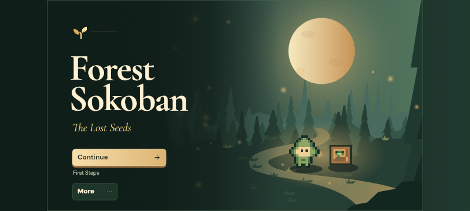

# Figma Home · Continue implementation

Reference: [S21+ · Home · Continue](https://www.figma.com/design/EbPr2cisVRC7wgbkLjKSp9?node-id=7-12421), node `7:12421`.
Implementation date: 16 November 2026. Target demo phone: Samsung Galaxy S21+.

## Design mapping

The 800×360 frame contains centered 640×360 artwork. `FigmaHome` keeps that aspect
ratio and centers it in the safe viewport, with the specified outer gradient.
The crest, title rule, title, subtitle, buttons and helper text retain the Figma
artwork coordinates. Original SVGs for forest/keeper/crate, crest, arrow and dots
are bundled in `app/assets/figma/home/`; their unmodified hashes, original sizes,
nodes and slots are recorded in `provenance.json`. Runtime code loads local
assets exclusively. The Figma screenshot is not an app asset.

Cormorant Garamond Bold/Italic and DM Sans variable fonts are bundled for offline
use, from the Google Fonts repository (`ofl/cormorantgaramond`, `ofl/dmsans`). Their
SIL Open Font License files accompany them in `app/assets/fonts/`.

## Behavior and scope

Continue resumes the saved campaign paused; the level caption derives from that
actual save (First Steps is the reference fixture). Without a save, Continue is
disabled and the caption reads No unfinished campaign. More opens working Campaign
and Guide navigation, progress and existing recovery actions. Busy writes disable
Home actions. The two transparent hit regions are separate from the smaller
visible button surfaces and remain at least 48 dp high at the verified sizes.

This document records the initial Home-only milestone. It has since been superseded
by the [full active UI migration](figma-ui-migration.md). Rules, counters,
persistence and chapter progression are exercised by the regression suite.

## Verification

- Red stage: the new Home/More navigation test failed against the old Home because
  no More control existed. See the implementation session's `figma-red.log`.
- Full host suite: **44 tests passed**, including resume of a non-L01 save and
  navigation from More. [Recorded results](home-test-results.txt).
- Layout/control walkthroughs: 640×360, 800×360, 800×450 and 960×432 at 1.3× text;
  minimum target height and nonoverlapping Continue/More hit regions checked. A separate 640×300 compact-window test also verifies that the targets stay separate and usable.
- Home background covers system-bar insets; a pixel regression first reproduced the old gameplay background leaking through, then passed after correction.
- Flutter analysis: no issues. Formatting check: no changes required.
- All four original SVG files are nonempty; hashes match their provenance record.
- Debug x86_64 APK built successfully and updated the existing emulator installation
  without uninstalling or clearing game data.
- Actual Android emulator screenshot was inspected after waking its sleeping display; Home artwork/fonts rendered and the old inset background was gone. This does not replace physical-device acceptance.
- Font license files were also verified inside the packaged APK.
- Physical Samsung Galaxy S21+ visual/performance/accessibility tests remain pending.

A read-only code review found one compact-window target overlap; the implementation and failing regression were corrected and the follow-up review confirmed the fix. No critical or important findings remained. The Android integration smoke-test navigation was adapted to More, but that entire smoke test has not been executed.

## Reference-size host preview

This host preview uses the bundled SVGs and fonts with a saved-L01 fixture. Rebuild
it from `app` with `flutter test tool/render_home_preview.dart --no-pub`. It is not
a physical-device screenshot or a performance result.
