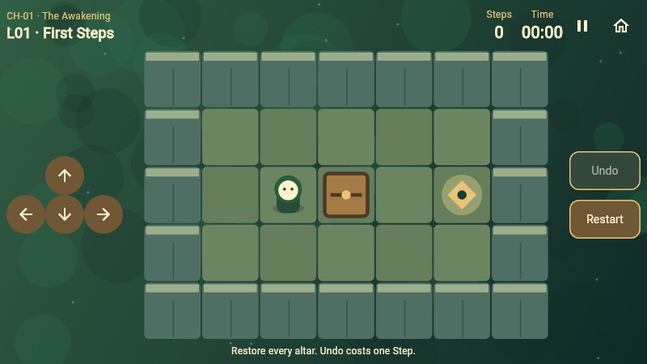

# A02 foundation verification

Executed on 14 November 2026, Asia/Bangkok, in the Linux/WSL workspace.

## Environment

- Flutter 3.50.0 stable, revision `ab2912035e160d9cad6306df307576da6128ebdb`.
- Dart 3.14.0; SDK archive SHA-256 checked against official release metadata.
- Android platform API 36, Build-Tools 36.0.0; minimum app API 29 (Android 10).
- Full Temurin JDK 21.0.13+9 installed after the host Java runtime failed Gradle's
  compiler capability check. Its download checksum was verified using Adoptium
  package metadata.
- Locked application dependencies in `app/pubspec.lock`.

## Executed host checks

| Check | Result | Evidence |
|---|---|---|
| Flutter analysis | PASS: no issues | `flutter analyze --no-pub` |
| Pure Dart domain tests | PASS: 18 | Twelve reference routes, collision, Undo, restore validation, unlocks and score ordering |
| ViewModel tests | PASS: 9 | Commit-before-ACK, write failure, lifecycle/time, restoration, restart, completion, invalid save |
| SQLite tests using native FFI | PASS: 6 | Roundtrip, atomic completion, trigger-injected rollback, whole best pair, duplicate completion and discard isolation |
| Widget tests | PASS: 5 | Initial navigation, two landscape sizes at 1.3x text, Restart dialog and lifecycle |
| Total automated tests | **38 passed** | [Recorded test output](test-results.txt) |
| Baseline content comparison | PASS: all 12 maps/versions/solutions | Compared app JSON to the canonical appendix inside the report ZIP |

Run from `app` with Flutter on PATH:

```sh
flutter pub get --enforce-lockfile
dart format --output=none --set-exit-if-changed lib test integration_test
flutter analyze --no-pub
flutter test --no-pub
```

The widget tests use an in-memory repository. Database tests independently execute
real SQLite via FFI, including injected transaction failure. Neither runs the
Android SQLite platform plugin; the supplied Android integration smoke test must
be executed on a clean test device installation.

## Android artifact

`app/build/app/outputs/flutter-apk/app-debug.apk` was successfully built with
Temurin JDK 21 using:

```sh
flutter build apk --debug --target-platform android-arm64 --no-pub
```

- Package: `edu.hcmut.forest_sokoban`, version `0.1.0+1`.
- Size: 96,484,063 bytes (debug arm64 build, not the final release-size measurement).
- Minimum SDK: 29; target SDK: 36.
- APK Signature Scheme v2 verified with Android Build-Tools `apksigner`.
- The twelve-level JSON and arm64 Flutter engine are present in the packaged APK.
- SHA-256: `02e70844b968e92af58dce45e024451e5e93b6fc5ea21b9a3ab90bc714717918`.

A second build succeeded from `.toolchains/source-check/app`, copied from source
without `build/`, `.dart_tool/`, `.gradle/`, plugin metadata, or `local.properties`.
`flutter pub get --enforce-lockfile` and the APK command both passed using shared
SDK/dependency caches. This is a clean-source rebuild in WSL, not a Windows test
or a remote Git checkout.

This establishes packaging and signature integrity. Device installation and runtime
remain pending. Debug signing is for development; final release signing is a later
deliverable. APKs and SDK/cache directories are intentionally ignored by Git.

## Visual inspection



This is an 800×450 host Flutter render using the bundled Material icon/Roboto
fonts, not an Android emulator screenshot or a physical-device result. The
foundation uses original vector graphics. Final artwork parity, TalkBack, all
screen states and hardware behavior remain review/acceptance tasks.

## Pending acceptance

- Android emulator/physical-device install and runtime; integration smoke test.
- Fresh-checkout build/run on the user's Windows installation and remote CI.
- Physical-device release performance, audio, process-kill and complete NFR suite.
- Legacy V1 database migration (this foundation refuses unknown old schemas).
- Story/ending, Music/SFX/settings and all Should refinements.
- Hosted Supabase/Auth/OTP, score publication/rankings and verified challenges.
- Final release signing, APK-size/performance report and team/manual acceptance.

The manual-case register remains pending in `manual-tests.csv`. This report does
not claim any device, backend, research or final A02 acceptance results.
